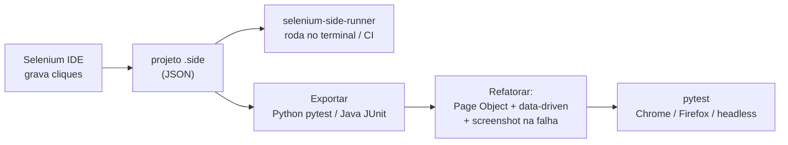

# Tutorial GQS17 — Selenium na prática: do Selenium IDE (gravar e reproduzir) ao WebDriver com Page Object

**Aula 17 — Garantia da Qualidade de Software** | Prof. Giovane Barcelos  
**Duração estimada:** 2h30 (Parte A, Selenium IDE: 1h · Parte B, WebDriver: 1h30)  
**Pré-requisitos:** **Firefox** (ou Edge) para o Selenium IDE, **Google Chrome** ou Firefox para o WebDriver, **Python 3.10+**, Git e, para rodar o IDE pela linha de comando, **Node.js 22+**. A **Etapa 0** mostra como instalar.  
**Arquivos do laboratório:** pasta `class17/lab-selenium/` do repositório <https://github.com/giovanebarcelos/gqs-sandbox> (Etapa 0.4).  
**Aula teórica:** Aula 17 — Selenium: Testes de Interface Web (Slides 6 a 9 tratam do Selenium IDE).

---

## O que você vai construir

A mesma bateria de testes de interface, escrita de dois jeitos, sobre a loja de treino **SauceDemo** (<https://www.saucedemo.com>, site público feito para praticar automação):

| Teste | O que verifica | Parte A — Selenium IDE | Parte B — WebDriver |
|---|---|---|---|
| **Login válido** | `standard_user` entra e vê a página *Products* | gravado e ajustado no IDE | `tests/test_login.py::test_login_valido` |
| **Login bloqueado** | `locked_out_user` é recusado com mensagem de erro | gravado com asserção de texto | 4 cenários *data-driven* em `test_login_invalido` |
| **Adicionar ao carrinho** | o produto escolhido aparece no carrinho | variáveis `store` / `${...}` | fixture `logado` + Page Objects |

E o caminho entre os dois mundos:



**Credenciais do SauceDemo** (públicas, aparecem na própria tela de login — uso didático): usuários `standard_user` e `locked_out_user`, senha `secret_sauce`. Nunca coloque credenciais de um sistema real num teste.

---

## Etapa 0 — Preparação do ambiente

### 0.1 Navegadores

| Navegador | Para quê | Linux (Fedora / Ubuntu) | Windows 11 |
|---|---|---|---|
| **Firefox** | Selenium IDE (extensão) e WebDriver | `sudo dnf install firefox` / `sudo apt install firefox` | <https://www.mozilla.org/firefox/> ou `winget install Mozilla.Firefox` |
| **Google Chrome** | WebDriver (padrão do lab) | <https://www.google.com/chrome/> (pacote `.rpm`/`.deb`) | `winget install Google.Chrome` |
| **Microsoft Edge** | alternativa para o IDE | opcional | já vem instalado |

> **Drivers:** você **não** precisa baixar `chromedriver` nem `geckodriver`. Desde o Selenium 4.6, o **Selenium Manager** (embutido na biblioteca) descobre a versão do navegador e baixa o driver certo na primeira execução. O `webdriver-manager` mostrado no Slide 5 da aula continua funcionando, mas virou opcional.

### 0.2 Python 3.10+

```bash
# Linux
python3 --version            # 3.10 ou mais novo
sudo dnf install python3-pip # Fedora  (Ubuntu: sudo apt install python3-pip python3-venv)
```

```powershell
# Windows 11 (PowerShell)
winget install Python.Python.3.13
py --version
```

### 0.3 Node.js 22+ (só para a Etapa A8 — IDE na linha de comando)

```bash
# Linux
sudo dnf install nodejs       # Fedora   (Ubuntu: use o NodeSource ou o nvm para ter a 22)
node --version                # v22.x ou mais novo
```

```powershell
# Windows 11
winget install OpenJS.NodeJS.LTS
node --version
```

### 0.4 Baixar os arquivos do laboratório

```bash
git clone https://github.com/giovanebarcelos/gqs-sandbox.git
cd gqs-sandbox/class17/lab-selenium
```

Estrutura:

```text
lab-selenium/
├── GQS17-Tutorial-Selenium.md        ← este tutorial
├── ide/
│   ├── GQS17-SauceDemo.side          ← projeto pronto do Selenium IDE (3 testes, 1 suíte)
│   └── exportado/
│       ├── test_regressaoSauceDemo.py    ← o que o IDE gera ao exportar para Python pytest
│       └── RegressaoSauceDemoTest.java   ← o que o IDE gera ao exportar para Java JUnit
└── webdriver/                        ← o mesmo teste, refatorado à mão
    ├── requirements.txt
    ├── pytest.ini
    ├── conftest.py                   ← fixture driver, --browser, --headless, screenshot na falha
    ├── pages/                        ← Page Objects
    │   ├── base_page.py
    │   ├── login_page.py
    │   ├── inventory_page.py
    │   └── cart_page.py
    └── tests/
        ├── test_login.py
        └── test_carrinho.py
```

---

# Parte A — Selenium IDE: gravar, ajustar, reproduzir e exportar

O **Selenium IDE** grava o que você faz no navegador e transforma em uma lista de **comandos** (`open`, `type`, `click`, `assertText`...), cada um com um **alvo** (*target*, o localizador) e um **valor**. É a porta de entrada mais rápida da automação: em minutos você tem um teste de regressão rodando — e, ao exportar, um esqueleto de código WebDriver.

### A1 — Qual Selenium IDE instalar (situação em novembro de 2026)

| Opção | Como obter | Observação |
|---|---|---|
| **Extensão no Firefox** ✅ *recomendada* | <https://addons.mozilla.org/firefox/addon/selenium-ide/> → **Adicionar ao Firefox** | é a versão 3, estável e completa |
| **Extensão no Edge** | <https://microsoftedge.microsoft.com/addons/detail/selenium-ide/ajdpfmkffanmkhejnopjppegokpogffp> | mesma versão 3 |
| **Extensão no Chrome** | ❌ fora da Chrome Web Store | o Chrome não roda mais extensões Manifest V2; a migração para MV3 foi aceita no projeto em 09/11/2026, mas ainda não foi publicada na loja |
| **Selenium IDE 4 (aplicativo desktop)** | <https://github.com/SeleniumHQ/selenium-ide/releases> (Windows, macOS, Linux `.AppImage`) ou `npm install -g selenium-ide` | aplicativo Electron, ainda em **beta** e com binários sem assinatura — o Windows/macOS vão pedir confirmação para abrir |

Neste tutorial usamos a **extensão no Firefox**. Os nomes de botões e comandos são os mesmos no Edge; no aplicativo 4 a organização da tela muda um pouco, mas os comandos, o arquivo `.side` e a exportação são equivalentes.

Depois de instalar, o ícone **Se** aparece na barra do Firefox (se não aparecer, clique no ícone de quebra-cabeça 🧩 e fixe a extensão).

### A2 — Criar o projeto

1. Clique no ícone **Se**. Na tela de boas-vindas, escolha **Record a new test in a new project**.
2. **Project name:** `GQS17 SauceDemo` → **OK**.
3. **Base URL:** `https://www.saucedemo.com` → **Start recording**.

O IDE abre uma **nova janela** do Firefox na URL base, com o aviso *"Selenium IDE is recording..."* no canto. Tudo o que você fizer **nessa janela** vira comando.

### A3 — Gravar o teste "Login válido"

Na janela que está sendo gravada:

1. Clique no campo **Username** e digite `standard_user`.
2. Clique no campo **Password** e digite `secret_sauce`.
3. Clique em **Login**.
4. Já na página de produtos, **adicione a verificação durante a gravação**: clique com o **botão direito** sobre o título **Products** → menu **Selenium IDE** → **Assert** → **Text**.
5. Volte à janela do IDE e clique em **⏹ Stop recording** (canto superior direito). Dê o nome **`Login valido`** ao teste.

O IDE deve mostrar algo assim:

| # | Command | Target | Value |
|---|---|---|---|
| 1 | `open` | `/` | |
| 2 | `setWindowSize` | `1280x800` *(o tamanho da sua janela)* | |
| 3 | `click` | `id=user-name` | |
| 4 | `type` | `id=user-name` | `standard_user` |
| 5 | `click` | `id=password` | |
| 6 | `type` | `id=password` | `secret_sauce` |
| 7 | `click` | `id=login-button` | |
| 8 | `assertText` | `css=.title` *(ou `css=[data-test="title"]`)* | `Products` |

> **Por que a asserção importa:** sem o passo 8, o teste só prova que os cliques aconteceram — passaria até se o login desse erro. Um teste sem **oráculo** (Aula 06) não é teste.

### A4 — Entender e melhorar os localizadores

Clique na linha 6 (`type`). No **editor de comando**, abaixo da tabela:

- **Target** tem uma **seta ▾** que lista os **localizadores alternativos** que o IDE capturou para o mesmo elemento, por exemplo:
  - `id=password`
  - `name=password`
  - `css=#password`
  - `css=[data-test="password"]`
  - `xpath=//input[@id='password']`
  - `xpath=//div[@id='root']/div/div[2]/div/div/div/form/div[2]/input` ← **frágil!**
- O botão **🎯 Select target in page** deixa você clicar no elemento na página para capturar de novo.
- O botão **🔍 Find target in page** pisca o elemento na página — use para conferir se o alvo ainda existe.

**Regra (Slide 12 da aula):** prefira `id` → `data-test`/`data-testid` → `name` → CSS → XPath **relativo**. Nunca deixe um XPath **posicional** (`/div[2]/div/...`): qualquer mudança no layout quebra o teste.

**Faça agora:**

1. Na linha 6, troque o *Target* para `css=[data-test="password"]` (atributo criado justamente para testes).
2. **Apague** as linhas `click` dos passos 3 e 5 (selecione → `Delete`): o `type` já foca o campo, os cliques extras só deixam o teste mais lento.
3. Antes do `assertText`, insira uma **espera**: clique com o botão direito na linha do `assertText` → **Insert new command** e preencha:
   - Command: `waitForElementVisible` · Target: `css=[data-test="title"]` · Value: `10000` *(ms)*
4. Adicione mais uma verificação no fim: Command `assertTitle` · Target `Swag Labs`.
5. No campo **Description** do `assertText`, escreva `oráculo: a página de produtos abriu`. Essa descrição vira comentário no código exportado (Etapa A9).

> **`assert` × `verify`:** `assertText` **para** o teste na primeira falha; `verifyText` registra a falha e **continua**. Use `assert` para pré-condições (sem login, não adianta seguir) e `verify` para várias checagens independentes na mesma tela.

### A5 — Executar e depurar

Na barra de ferramentas do IDE:

| Botão | Função |
|---|---|
| ▶ **Run current test** | executa o teste selecionado |
| ▶▶ **Run all tests** | executa todos os testes da lista |
| ⏱ **Test execution speed** | deixe mais lento para **ver** o que acontece |
| ⏯ **Step over current command** | executa um comando por vez |
| ⏸ **Pause on exceptions** | para no comando que falhou, em vez de abortar |

1. Rode o teste (▶). As linhas ficam **verdes** quando passam. O painel **Log**, embaixo, mostra cada comando e o resultado: `'Login valido' completed successfully`.
2. **Provoque uma falha:** troque o *Value* do `assertText` para `Produtos` e rode de novo. A linha fica **vermelha** e o Log mostra `assertText on css=[data-test="title"] with value Produtos Failed: Actual value 'Products' did not match 'Produtos'`. Volte o valor para `Products`.
3. **Breakpoint:** clique no **número da linha** do `click` em *Login* — aparece um marcador. Rode: o IDE para ali; inspecione a página e continue com ▶ ou ⏯.

### A6 — Teste negativo: "Login bloqueado"

1. Clique em **+** (*Add new test*) ao lado de *Tests* → nome **`Login bloqueado`**.
2. Clique em **⏺ Rec**, digite `locked_out_user` / `secret_sauce`, clique em **Login**.
3. Com o botão direito sobre a **mensagem de erro vermelha** → **Selenium IDE → Assert → Text**. Pare a gravação.
4. Ajuste os comandos para ficar assim:

| Command | Target | Value |
|---|---|---|
| `open` | `/` | |
| `type` | `id=user-name` | `locked_out_user` |
| `type` | `css=[data-test="password"]` | `secret_sauce` |
| `click` | `id=login-button` | |
| `waitForElementVisible` | `css=[data-test="error"]` | `10000` |
| `assertText` | `css=[data-test="error"]` | `Epic sadface: Sorry, this user has been locked out.` |
| `assertElementNotPresent` | `css=[data-test="inventory-list"]` | |

A última linha garante o **resultado** (não entrou na loja), não só a mensagem.

### A7 — Variáveis e reutilização: "Adicionar ao carrinho"

O IDE tem **variáveis**: `store` grava um valor, `storeText` guarda o texto de um elemento, e `${nome}` usa o valor em qualquer *Target* ou *Value*. Crie o teste **`Adicionar ao carrinho`** com os comandos abaixo (pode digitar direto na tabela — clique na linha vazia ao final):

| Command | Target | Value | O que faz |
|---|---|---|---|
| `store` | `standard_user` | `usuario` | variável `usuario` |
| `store` | `secret_sauce` | `senha` | variável `senha` |
| `open` | `/` | | |
| `type` | `id=user-name` | `${usuario}` | usa a variável |
| `type` | `css=[data-test="password"]` | `${senha}` | |
| `click` | `id=login-button` | | |
| `waitForElementVisible` | `css=[data-test="inventory-list"]` | `10000` | |
| `storeText` | `css=[data-test="inventory-item-name"]` | `produto` | guarda o nome do 1º produto |
| `echo` | `Produto escolhido: ${produto}` | | escreve no Log |
| `click` | `css=[data-test^="add-to-cart"]` | | 1º botão *Add to cart* |
| `assertText` | `css=[data-test="shopping-cart-badge"]` | `1` | contador do carrinho |
| `click` | `css=[data-test="shopping-cart-link"]` | | abre o carrinho |
| `waitForElementVisible` | `css=[data-test="cart-list"]` | `10000` | |
| `assertText` | `css=[data-test="inventory-item-name"]` | `${produto}` | o item é o mesmo |

> `[data-test^="add-to-cart"]` é CSS "atributo **começa com**": pega o primeiro botão de adicionar, qualquer que seja o produto.

**Outros comandos que valem conhecer** (aba **Reference**, embaixo, explica cada um enquanto você digita):

| Grupo | Comandos |
|---|---|
| Controle de fluxo | `if` / `else if` / `else` / `end`, `while`, `times` *n*, `do` … `repeat if`, `forEach` |
| Reaproveitar | `run` *nome-do-teste* — chama outro teste (ex.: um teste `Fazer login` reutilizado por todos) |
| Esperas | `waitForElementVisible`, `waitForElementPresent`, `waitForElementEditable`, `waitForText` |
| Verificações | `assertText`, `assertValue`, `assertTitle`, `assertElementPresent`, `assertChecked`, `assertSelectedLabel`, `assertAlert` (e as versões `verify...`) |
| Elementos dinâmicos | `select` (dropdown), `selectFrame` (iFrame), `chooseOkOnNextConfirmation` (confirm) |
| JavaScript | `executeScript` / `runScript` — evite: amarram o teste ao código da página |

**Exercício:** crie um teste `Fazer login` só com os passos de login e, nos outros dois testes, troque esses passos por `run` · `Fazer login`. É a mesma ideia do Page Object, dentro do IDE.

### A8 — Suíte, arquivo `.side` e execução pela linha de comando

1. No menu suspenso **Tests** (canto superior esquerdo) escolha **Test suites** → **+** → nome **`Regressao SauceDemo`**. Nos `⋮` da suíte → **Add tests** → marque os três testes.
2. Nos `⋮` da suíte → **Settings**: *Timeout* `300` s; deixe **Persist session** desmarcado (cada teste com navegador limpo — testes **independentes**, Slide 25).
3. **Salve o projeto:** **Ctrl+S** (ou o ícone 💾). O navegador baixa o arquivo **`GQS17 SauceDemo.side`** — um **JSON** com projeto, testes e suítes, que vai para o Git junto com o código.

> Não quer gravar tudo? Abra o projeto pronto: ícone 📂 **Open project** → `class17/lab-selenium/ide/GQS17-SauceDemo.side`.

Agora rode o mesmo arquivo **sem abrir o IDE**, com o **selenium-side-runner** — é assim que um `.side` entra no CI/CD (Aula 25):

```bash
# instalar (uma vez)
npm install -g selenium-side-runner

cd gqs-sandbox/class17/lab-selenium/ide

# Chrome com janela
selenium-side-runner GQS17-SauceDemo.side

# Firefox
selenium-side-runner -c "browserName=firefox" GQS17-SauceDemo.side

# Chrome sem janela (CI, WSL, servidor) + screenshot das falhas na pasta evidencias/
selenium-side-runner -c "browserName=chrome goog:chromeOptions.args=[--headless=new]" -z evidencias GQS17-SauceDemo.side

# Mesmo teste contra outro ambiente (ex.: homologação)
selenium-side-runner --base-url https://homolog.minhaloja.com.br GQS17-SauceDemo.side
```

No Windows (PowerShell) os comandos são os mesmos. Saída esperada:

```text
  Running project GQS17 SauceDemo
    Running suite Regressao SauceDemo
      ✓ Running test Login valido (1587 ms)
      ✓ Running test Login bloqueado (624 ms)
      ✓ Running test Adicionar ao carrinho (687 ms)

Tests:       3 passed, 3 total
```

O side-runner usa o Selenium Manager: Chrome e Firefox funcionaram sem nenhum driver instalado. Se aparecer `Jest did not exit one second after the test run has completed`, é só um aviso do executor — os resultados acima dele valem.

### A9 — Exportar para código WebDriver

No painel de testes, clique nos `⋮` do teste (ou da suíte) → **Export** → escolha a linguagem:

| Linguagem | Gera |
|---|---|
| **Python pytest** | classe `TestRegressaoSauceDemo` com `setup_method` / `teardown_method` |
| **Java JUnit** | classe `RegressaoSauceDemoTest` com `@Before` / `@After` / `@Test` (**JUnit 4**) |
| JavaScript Mocha, C# NUnit/xUnit, Ruby RSpec | equivalentes |

Opções da tela de exportação: **Include step descriptions as separate comment** (marque — as *Descriptions* da A4 viram comentários) e **Export for use on Selenium Grid** (troca o driver local por `webdriver.Remote`, Slide 23).

O resultado em Python (arquivo [`ide/exportado/test_regressaoSauceDemo.py`](ide/exportado/test_regressaoSauceDemo.py)) — trecho:

```python
# Generated by Selenium IDE
import pytest
import time
import json
from selenium import webdriver
from selenium.webdriver.common.by import By
...
class TestRegressaoSauceDemo():
  def setup_method(self, method):
    self.driver = webdriver.Chrome()
    self.vars = {}

  def teardown_method(self, method):
    self.driver.quit()

  def test_loginvalido(self):
    self.driver.get("https://www.saucedemo.com/")
    self.driver.set_window_size(1280, 800)
    self.driver.find_element(By.ID, "user-name").send_keys("standard_user")
    self.driver.find_element(By.CSS_SELECTOR, "[data-test=\"password\"]").send_keys("secret_sauce")
    self.driver.find_element(By.ID, "login-button").click()
    WebDriverWait(self.driver, 10).until(expected_conditions.visibility_of_element_located((By.CSS_SELECTOR, "[data-test=\"title\"]")))
    # oraculo: a pagina de produtos abriu
    assert self.driver.find_element(By.CSS_SELECTOR, "[data-test=\"title\"]").text == "Products"
    assert self.driver.title == "Swag Labs"
```

Esse arquivo **roda** (`pytest test_regressaoSauceDemo.py`, com o ambiente da Etapa B1) — mas é código **gravado**, não **projetado**. Antes de seguir, liste os problemas que você vê. Compare com a tabela:

| Problema no código exportado | Consequência | Como a Parte B resolve |
|---|---|---|
| Localizadores repetidos em todos os testes | mudou o `id` do campo? conserta em N lugares | **Page Object**: um localizador, um lugar |
| Credenciais e dados escritos no meio do código | cada cenário novo = copiar/colar um teste | **data-driven** com `parametrize` |
| `webdriver.Chrome()` fixo, sempre com janela | não troca de navegador, não roda em CI | fixture com `--browser` e `--headless` |
| Nenhuma evidência quando falha | "falhou no CI" e ninguém sabe o que a tela mostrava | **screenshot automático** na falha |
| Imports sem uso (`time`, `json`, `DesiredCapabilities`, `ActionChains`) | ruído; o `time` convida ao `time.sleep` | só o que é usado |
| Nomes `test_loginvalido` | relatório pouco legível | nomes e `id`s de cenário legíveis |

> **Java:** o exportador gera **JUnit 4** (`org.junit.Test`, `@Before`). Na Aula 13 usamos **JUnit 5** — converta: `org.junit.jupiter.api.Test`, `@BeforeEach`, `@AfterEach` e `Assertions.assertEquals`. Arquivo: [`ide/exportado/RegressaoSauceDemoTest.java`](ide/exportado/RegressaoSauceDemoTest.java).

---

# Parte B — Selenium WebDriver: refatorando com Page Object, data-driven e evidências

### B1 — Ambiente Python

```bash
# Linux
cd gqs-sandbox/class17/lab-selenium/webdriver
python3 -m venv .venv
source .venv/bin/activate
pip install -r requirements.txt     # selenium>=4.25 e pytest>=8
```

```powershell
# Windows 11 (PowerShell)
cd gqs-sandbox\class17\lab-selenium\webdriver
py -m venv .venv
.\.venv\Scripts\Activate.ps1        # se bloquear: Set-ExecutionPolicy -Scope CurrentUser RemoteSigned
pip install -r requirements.txt
```

**Teste de fumaça** — o código exportado pelo IDE roda neste ambiente:

```bash
pytest ../ide/exportado/test_regressaoSauceDemo.py -v
```

Três janelas do Chrome abrem e fecham; `3 passed`. A primeira execução demora um pouco mais: é o Selenium Manager baixando o driver (fica em cache em `~/.cache/selenium`).

### B2 — A base: `pages/base_page.py`

Toda espera explícita fica num lugar só. Nenhum teste chama `find_element` direto, nem `time.sleep`:

```python
from selenium.webdriver.support import expected_conditions as EC
from selenium.webdriver.support.ui import WebDriverWait

URL_BASE = "https://www.saucedemo.com"


class BasePage:
    TIMEOUT = 10

    def __init__(self, driver):
        self.driver = driver
        self.wait = WebDriverWait(driver, self.TIMEOUT)

    def _visivel(self, locator):
        """Espera o elemento ficar visivel e o devolve (nada de time.sleep)."""
        return self.wait.until(EC.visibility_of_element_located(locator))

    def _clicavel(self, locator):
        return self.wait.until(EC.element_to_be_clickable(locator))

    def _digitar(self, locator, texto):
        campo = self._visivel(locator)
        campo.clear()
        campo.send_keys(texto)
```

### B3 — O Page Object de login: `pages/login_page.py`

Os **mesmos localizadores** que você escolheu no IDE (Etapa A4), agora como constantes da página, e métodos com **nome de negócio**:

```python
from selenium.webdriver.common.by import By

from pages.base_page import URL_BASE, BasePage


class LoginPage(BasePage):
    USUARIO = (By.ID, "user-name")
    SENHA = (By.CSS_SELECTOR, "[data-test='password']")
    BOTAO_LOGIN = (By.ID, "login-button")
    ERRO = (By.CSS_SELECTOR, "[data-test='error']")

    def abrir(self):
        self.driver.get(URL_BASE + "/")
        self._visivel(self.USUARIO)
        return self

    def login(self, usuario, senha):
        self._digitar(self.USUARIO, usuario)
        self._digitar(self.SENHA, senha)
        self._clicavel(self.BOTAO_LOGIN).click()

    def mensagem_erro(self):
        return self._visivel(self.ERRO).text
```

`abrir()` devolve `self` para permitir o encadeamento `LoginPage(driver).abrir().login(...)`. Os outros dois Page Objects seguem o mesmo molde — abra-os no editor:

- `pages/inventory_page.py` — `carregada()`, `titulo()`, `nome_do_produto(i)`, `adicionar_ao_carrinho(i)`, `itens_no_carrinho()`, `ir_para_carrinho()`
- `pages/cart_page.py` — `produtos()` devolve a lista de nomes no carrinho

### B4 — A fixture: `conftest.py`

Substitui o `setup_method`/`teardown_method` do código exportado e acrescenta três coisas:

```python
def pytest_addoption(parser):
    parser.addoption("--browser", default="chrome", choices=["chrome", "firefox", "edge"])
    parser.addoption("--headless", action="store_true", help="executa sem abrir janela")


@pytest.fixture
def driver(request):
    drv = _criar_driver(request.config.getoption("--browser"), request.config.getoption("--headless"))
    yield drv                                         # ← o teste roda aqui
    relatorio = getattr(request.node, "rep_call", None)
    if relatorio is not None and relatorio.failed:    # ← falhou? tira a foto antes de fechar
        PASTA_EVIDENCIAS.mkdir(exist_ok=True)
        nome = f"{request.node.name}-{datetime.now():%Y%m%d-%H%M%S}.png"
        ...
        drv.save_screenshot(str(PASTA_EVIDENCIAS / nome))
    drv.quit()


@pytest.hookimpl(hookwrapper=True)
def pytest_runtest_makereport(item, call):
    """Guarda o resultado de cada fase no item, para a fixture saber se falhou."""
    resultado = yield
    relatorio = resultado.get_result()
    setattr(item, f"rep_{relatorio.when}", relatorio)
```

1. **`--browser`** — o mesmo teste em Chrome, Firefox ou Edge (matriz de navegadores, Slide 10).
2. **`--headless`** — sem janela, para CI (Slide 24).
3. **Screenshot na falha** — o *hook* `pytest_runtest_makereport` anota no teste se ele falhou; a fixture lê essa anotação depois do `yield` e salva o PNG em `evidencias/`.

A função `_criar_driver` também desliga o aviso **"Altere sua senha"** do Chrome, que aparece ao logar com `secret_sauce` (senha que consta em vazamentos públicos) e cobre a página.

### B5 — Testes de login *data-driven*: `tests/test_login.py`

O teste "Login bloqueado" do IDE vira **quatro cenários** sem copiar código (Slide 21):

```python
import pytest

from pages.inventory_page import InventoryPage
from pages.login_page import LoginPage


def test_login_valido(driver):
    LoginPage(driver).abrir().login("standard_user", "secret_sauce")

    inventario = InventoryPage(driver).carregada()
    assert inventario.titulo() == "Products"
    assert driver.current_url.endswith("/inventory.html")


CENARIOS_INVALIDOS = [
    pytest.param("locked_out_user", "secret_sauce",
                 "Sorry, this user has been locked out", id="usuario-bloqueado"),
    pytest.param("standard_user", "senha_errada",
                 "Username and password do not match", id="senha-errada"),
    pytest.param("", "secret_sauce", "Username is required", id="usuario-vazio"),
    pytest.param("standard_user", "", "Password is required", id="senha-vazia"),
]


@pytest.mark.parametrize("usuario, senha, mensagem", CENARIOS_INVALIDOS)
def test_login_invalido(driver, usuario, senha, mensagem):
    pagina = LoginPage(driver).abrir()
    pagina.login(usuario, senha)

    assert mensagem in pagina.mensagem_erro()
    assert "inventory" not in driver.current_url
```

Repare que os cenários vêm das técnicas de caixa-preta da **Aula 08**: partição válida, usuário bloqueado, senha errada e os dois **valores-limite** de campo vazio.

### B6 — Carrinho com fixture de pré-condição: `tests/test_carrinho.py`

```python
@pytest.fixture
def logado(driver):
    LoginPage(driver).abrir().login("standard_user", "secret_sauce")
    return InventoryPage(driver).carregada()


def test_adicionar_produto_ao_carrinho(driver, logado):
    produto = logado.nome_do_produto(0)

    logado.adicionar_ao_carrinho(0)
    assert logado.itens_no_carrinho() == 1

    logado.ir_para_carrinho()
    assert CartPage(driver).produtos() == [produto]
```

A fixture `logado` faz o papel do `run · Fazer login` do IDE (Etapa A7): a pré-condição fica fora do teste, e o teste lê como um caso de teste da Aula 06 — *dado* logado, *quando* adiciono, *então* o carrinho tem o produto.

### B7 — Executar

```bash
pytest                                  # Chrome com janela, 6 testes
pytest --headless                       # Chrome sem janela
pytest --browser=firefox --headless     # Firefox
pytest -k invalido                      # só os 4 cenários inválidos
pytest -k "senha-vazia"                 # um cenário específico, pelo id
```

Saída esperada:

```text
tests/test_carrinho.py::test_adicionar_produto_ao_carrinho PASSED        [ 16%]
tests/test_login.py::test_login_valido PASSED                            [ 33%]
tests/test_login.py::test_login_invalido[usuario-bloqueado] PASSED       [ 50%]
tests/test_login.py::test_login_invalido[senha-errada] PASSED            [ 66%]
tests/test_login.py::test_login_invalido[usuario-vazio] PASSED           [ 83%]
tests/test_login.py::test_login_invalido[senha-vazia] PASSED             [100%]

============================== 6 passed in 4.82s ===============================
```

### B8 — Ver a evidência de uma falha

Provoque uma falha de propósito: em `tests/test_login.py`, troque `"Products"` por `"Produtos"` e rode:

```bash
pytest -k login_valido
```

```text
FAILED tests/test_login.py::test_login_valido - AssertionError: assert 'Products' == 'Produtos'
Screenshot da falha: evidencias/test_login_valido-20261111-084209.png
```

Abra o PNG: é a tela no instante da falha — a evidência que vai junto do relatório de defeito (Aula 07 / Aula 24). Desfaça a alteração.

### B9 — Para ir além

| Desafio | Dica | Aula |
|---|---|---|
| Rodar em paralelo | `pip install pytest-xdist` → `pytest -n 4 --headless` | Slide 23 |
| Rodar no Selenium Grid | troque `webdriver.Chrome(...)` por `webdriver.Remote(command_executor="http://localhost:4444", options=opcoes)` | Slide 23 |
| Rodar no GitHub Actions | `pytest --headless` num job `ubuntu-latest` (o Chrome já vem no runner) | Slide 24, Aula 26 |
| Massa de dados em CSV | leia `usuarios.csv` com `csv.DictReader` e passe para `parametrize` | Slide 21 |
| Checkout completo | crie `CheckoutPage` (nome, sobrenome, CEP → *Finish* → `Thank you for your order!`) | Slide 27 |
| Mesma coisa em Java | Maven + `selenium-java` + JUnit 5, partindo do `RegressaoSauceDemoTest.java` exportado | Aula 13 |

---

# Parte C — Selenium IDE × WebDriver: quando usar cada um

| Critério | Selenium IDE | Selenium WebDriver |
|---|---|---|
| Curva de aprendizado | minutos, sem programar | exige programação |
| Criação do primeiro teste | muito rápida (gravação) | mais lenta |
| Manutenção de uma suíte grande | difícil: localizadores repetidos, sem herança | Page Object, reuso, refatoração com IDE de código |
| Dados variados (*data-driven*) | limitado (`forEach`, variáveis) | `parametrize`, CSV, banco, API |
| Lógica complexa | `if`/`while` básicos | toda a linguagem |
| Versionamento / revisão | `.side` é JSON: diff difícil de ler | código revisável em *pull request* |
| CI/CD | `selenium-side-runner` | `pytest` / `mvn test`, Grid, paralelismo |
| Melhor uso | protótipo rápido, reproduzir um bug, smoke test, **descobrir localizadores**, esqueleto de código | suíte de regressão de longo prazo |

**Fluxo recomendado:** *grave no IDE para explorar a página e escolher os localizadores → exporte → refatore para Page Object → mantenha só o código.* O `.side` pode continuar como **smoke test** rápido, rodado pelo side-runner.

---

## Problemas comuns

| Sintoma | Causa provável | Solução |
|---|---|---|
| Não acho o Selenium IDE na Chrome Web Store | a extensão v3 saiu da loja do Chrome (Manifest V2) | use o Firefox ou o Edge (A1), ou o aplicativo Selenium IDE 4 |
| A gravação não captura nada | você interagiu na janela errada | grave na **janela aberta pelo IDE** (aviso *recording* no canto) |
| `Element not found` ao reproduzir, mas na gravação funcionou | a página ainda carregava | `waitForElementVisible` antes; ou diminua a velocidade |
| Teste do IDE quebra depois de mudança de layout | *Target* com XPath posicional | troque por `id` / `data-test` (A4) |
| `selenium-side-runner: command not found` | pacote global fora do `PATH` | `npx selenium-side-runner ...` ou reabra o terminal |
| `Unsupported engine` / erro de sintaxe no side-runner | Node.js antigo | Node.js **22** ou mais novo |
| `SessionNotCreatedException: ... version of ChromeDriver only supports Chrome version ...` | driver antigo no `PATH` tem prioridade sobre o Selenium Manager | apague o `chromedriver` antigo do `PATH`; atualize o Selenium (`pip install -U selenium`) |
| `selenium.common.exceptions.NoSuchDriverException` sem internet | o Selenium Manager não conseguiu baixar o driver | rode uma vez com internet (fica em cache) ou instale o driver manualmente |
| Popup "Altere sua senha" cobrindo a página no Chrome | detecção de senha vazada | o `conftest.py` já desliga; em código próprio use a *pref* `profile.password_manager_leak_detection: False` |
| Chrome trava em container / WSL / CI | sem display e com `/dev/shm` pequeno | `--headless`, `--no-sandbox`, `--disable-dev-shm-usage` (já no `conftest.py`) |
| `ModuleNotFoundError: No module named 'pages'` | pytest rodado fora da pasta `webdriver/` | `cd class17/lab-selenium/webdriver` antes do `pytest` |
| `Activate.ps1 cannot be loaded because running scripts is disabled` | política de execução do PowerShell | `Set-ExecutionPolicy -Scope CurrentUser RemoteSigned` |

---

## Entrega

1. **Parte A:** o seu arquivo `.side` com os 3 testes (+ o teste `Fazer login` reutilizado com `run`, se fez o exercício da A7) e um print da saída do `selenium-side-runner`.
2. **Parte B:** print do `pytest -v` com os 6 testes passando e o PNG gerado na Etapa B8.
3. **Reflexão (5 linhas):** compare o código exportado (A9) com o da Parte B. Qual mudança de UI quebraria **mais** testes em cada versão? Quantos arquivos você teria que alterar em cada uma?

---

## Referências

- Selenium IDE — documentação: <https://www.selenium.dev/selenium-ide/docs/en/introduction/getting-started>
- Selenium IDE — comandos: <https://www.selenium.dev/selenium-ide/docs/en/api/commands>
- Selenium IDE — linha de comando: <https://www.selenium.dev/selenium-ide/docs/en/introduction/command-line-runner>
- Selenium IDE — repositório e versões (v4): <https://github.com/SeleniumHQ/selenium-ide/releases>
- Selenium — downloads e situação do IDE: <https://www.selenium.dev/downloads/>
- Selenium WebDriver — documentação: <https://www.selenium.dev/documentation/webdriver/>
- Selenium Manager: <https://www.selenium.dev/documentation/selenium_manager/>
- Page Object Model: <https://www.selenium.dev/documentation/test_practices/encouraged/page_object_models/>
- SauceDemo (site de treino): <https://www.saucedemo.com>
