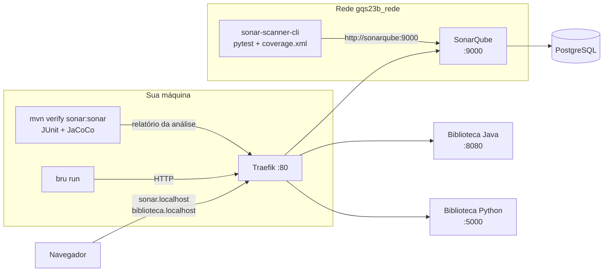

# Tutorial GQS23B — SonarQube na prática: do Quality Gate verde enganoso ao código limpo

**Aula 23B — Garantia da Qualidade de Software** | Prof. Giovane Barcelos
**Duração estimada:** 2h a 2h30 (Parte I, Java) + 40 min (Parte II, Python)
**Pré-requisitos:** Docker + Docker Compose, **JDK 17+ e Maven 3.9+**, Node.js 18+ (para o Bruno CLI), Git, **4 GB de RAM livres** para o SonarQube — e, para a Parte II, Python 3.10+. A **Etapa 0** mostra como instalar tudo.
**Arquivos do laboratório:** pasta `class23B/lab-sonar/` do repositório <https://github.com/giovanebarcelos/gqs-sandbox> (Etapa 0.6).

---

## O que você vai construir

Um SonarQube completo rodando na sua máquina, analisando uma API REST de biblioteca que **vem com defeitos plantados** — acessado por nomes amigáveis no navegador:

| URL | O que é |
|---|---|
| `http://sonar.localhost` | **SonarQube** Community Build — análise estática, cobertura, Quality Profile e Quality Gate |
| `http://biblioteca.localhost` | **Biblioteca API em Java** (Spring Boot) — o código analisado |
| `http://biblioteca-python.localhost` | **Biblioteca API em Python** (Flask) — a mesma API, para a Parte II |
| `http://traefik.localhost` | Painel do **Traefik** — o proxy reverso que distribui as requisições |

A Biblioteca API existe em **duas implementações** — mesmas rotas, mesmas regras e os mesmos defeitos:

| | Parte I — Java (principal) | Parte II — Python |
|---|---|---|
| Aplicação | Spring Boot 3.5 (`java/`) | Flask 3 (`python/`) |
| Teste unitário + cobertura | JUnit 5 + JaCoCo | pytest + pytest-cov |
| Scanner do SonarQube | plugin Maven (`mvn sonar:sonar`) | SonarScanner CLI em container |
| Teste funcional da API | Bruno (ambiente `Traefik`) | Bruno (ambiente `TraefikPython`) |
| Script de análise | `scripts/analisar-java.sh` | `scripts/analisar-python.sh` |

Ao longo do tutorial você vai:

1. rodar os testes e ver que **um teste unitário e três testes de API falham**;
2. analisar o código no SonarQube e descobrir que o **Quality Gate fica verde** mesmo assim;
3. entender **por quê** — e corrigir as duas configurações responsáveis (Quality Profile e Quality Gate);
4. ver o gate **reprovar** e o build Maven **falhar** automaticamente por causa dele;
5. **corrigir** o código e escrever os testes que faltam até o gate ficar verde de verdade;
6. repetir o ciclo com a versão **Python** — e descobrir um defeito que o SonarQube **não** enxerga.



### Estrutura da pasta

```
class23B/lab-sonar/
├── GQS23B-Tutorial-SonarQube-Biblioteca.md   ← este tutorial
├── docker-compose.yml                         ← Traefik + SonarQube + PostgreSQL + as duas APIs
├── .env.example                               ← senha do banco, token do relatório, versões, porta
├── java/                                      ← PARTE I
│   ├── pom.xml                                ← JUnit 5, JaCoCo e sonar-maven-plugin já configurados
│   ├── Dockerfile
│   └── src/main/java/br/edu/gqs/biblioteca/Biblioteca.java   ← regras (defeitos plantados!)
│       src/test/java/br/edu/gqs/biblioteca/BibliotecaTest.java ← suíte incompleta
├── python/                                    ← PARTE II
│   ├── biblioteca/regras.py  ·  biblioteca/app.py
│   ├── tests/test_biblioteca.py
│   ├── sonar-project.properties  ·  .coveragerc
├── bruno/Biblioteca/                          ← testes funcionais — servem às duas APIs
├── solucao/                                   ← gabarito: código corrigido + testes completos
│   ├── java/   (Biblioteca, BibliotecaApplication, BibliotecaTest, BibliotecaControllerTest)
│   └── python/ (regras.py, app.py, test_biblioteca.py, test_app.py)
└── scripts/
    ├── configurar-sonar.sh                    ← perfil + Quality Gate do curso pela Web API
    ├── analisar-java.sh                       ← JUnit + Sonar (esperando o gate) + Bruno
    └── analisar-python.sh                     ← pytest + Sonar (esperando o gate) + Bruno
```

### Números de referência

Medidos numa execução real deste tutorial (SonarQube Community Build **26.10**, PostgreSQL 16, Traefik 3.6, Spring Boot 3.5.6, JaCoCo 0.8.13, pytest 9.2, Bruno CLI 4.3). Os seus devem bater:

| Momento | Projeto | Testes unitários | Bruno | Issues | Cobertura | Duplicação | Confiab. / Seg. / Manut. | Quality Gate |
|---|---|---|---|---|---|---|---|---|
| **A** — padrões do SonarQube (Etapa 4) | Java | 3 de 4 | 5/8 | 6 | 19,7% | 7,4% | E / E / A | **PASSED** 😮 |
| | Python | 3 de 4 | 5/8 | 3 | 24,0% | 0,0% | A / D / A | **PASSED** 😮 |
| **B** — perfil e gate do curso (Etapa 5) | Java | 3 de 4 | 5/8 | 11 | 19,7% | 7,4% | E / E / A | **FAILED** |
| | Python | 3 de 4 | 5/8 | 10 | 24,0% | 0,0% | A / D / A | **FAILED** |
| **C** — código corrigido, build 1.0.1 (Etapas 7 e 10) | Java | 26 de 26 | 8/8 | 0 | 97,3% | 0,0% | A / A / A | **PASSED** |
| | Python | 28 de 28 | 8/8 | 0 (1 aceita) | 99,0% | 0,0% | A / A / A | **PASSED** |

---

# ETAPA 0 — Preparar a máquina (20 a 40 min, só uma vez)

Faça esta etapa **antes da aula**: os downloads (Docker Desktop, JDK, imagem do SonarQube) somam alguns gigabytes.

### 0.1 O que instalar

| Ferramenta | Versão mínima | Para quê | Parte |
|---|---|---|---|
| Git | qualquer recente | baixar o repositório | I e II |
| Docker + Docker Compose v2 | Compose 2.20+ | subir Traefik, SonarQube, PostgreSQL e as APIs | I e II |
| JDK (Java) | 17 (recomendado: 21) | compilar, testar e analisar a API Java | I |
| Maven | 3.9 | `mvn verify sonar:sonar` | I |
| Node.js + npm | 18 (recomendado: LTS) | instalar e rodar o Bruno CLI | I e II |
| Python | 3.10 | pytest e cobertura | II |

> O comando é `docker compose` (com espaço, Compose **v2**). O antigo `docker-compose` (com hífen) não entende `profiles`, usado neste laboratório.

> **Memória:** o SonarQube sozinho usa de 2 a 3 GB. No Docker Desktop (Windows/macOS), confira em *Settings → Resources* que há **pelo menos 4 GB** para o Docker.

### 0.2 Linux

**Docker** — o script oficial funciona em Ubuntu, Debian, Fedora e derivados:

```bash
curl -fsSL https://get.docker.com | sudo sh
sudo systemctl enable --now docker
sudo usermod -aG docker $USER      # permite usar o docker sem sudo
```

**Saia da sessão e entre de novo** (ou reinicie) para o grupo `docker` valer. Teste com `docker run --rm hello-world`.

**Demais ferramentas — Ubuntu / Debian / Mint:**

```bash
sudo apt update
sudo apt install -y git openjdk-21-jdk maven nodejs npm python3 python3-venv python3-pip
```

**Demais ferramentas — Fedora:**

```bash
sudo dnf install -y git java-21-openjdk-devel maven nodejs npm python3 python3-pip
```

> Se o `node -v` do seu sistema for menor que 18, instale a versão LTS pelo [nvm](https://github.com/nvm-sh/nvm): `nvm install --lts`.

> **`vm.max_map_count`:** o SonarQube traz um Elasticsearch embutido que, em servidor, exige `sudo sysctl -w vm.max_map_count=524288`. O `docker-compose.yml` deste laboratório desliga essa verificação (`SONAR_ES_BOOTSTRAP_CHECKS_DISABLE`), então **você não precisa mexer no sysctl**. Em produção, faça o ajuste e remova essa linha.

### 0.3 Windows 10/11

1. **WSL 2** — o Docker Desktop roda sobre ele. No PowerShell **como administrador**:

   ```powershell
   wsl --install
   ```

   Reinicie o computador quando pedir.

2. **Ferramentas** — no PowerShell (normal), com o `winget`:

   ```powershell
   winget install -e --id Git.Git
   winget install -e --id Docker.DockerDesktop
   winget install -e --id EclipseAdoptium.Temurin.21.JDK
   winget install -e --id OpenJS.NodeJS.LTS
   winget install -e --id Python.Python.3.12
   ```

3. **Maven** — baixe o *Binary zip archive* em <https://maven.apache.org/download.cgi>, descompacte em `C:\Tools\` e acrescente `C:\Tools\apache-maven-3.9.x\bin` ao `Path` (*Configurações → Sistema → Sobre → Configurações avançadas do sistema → Variáveis de Ambiente*). Quem usa Chocolatey pode fazer `choco install maven`.

4. **Abra o Docker Desktop** uma vez e espere aparecer *Engine running*. Em *Settings → Resources*, reserve pelo menos 4 GB de memória.

5. **Feche e abra o terminal** para o `Path` novo valer.

> **Terminal recomendado no Windows:** o **Git Bash** (instalado junto com o Git). Os comandos do tutorial — inclusive os scripts `.sh` da pasta `scripts/` — rodam nele sem adaptação. No PowerShell, troque `export VAR=valor` por `$env:VAR="valor"`.

### 0.4 macOS

Com o [Homebrew](https://brew.sh):

```bash
brew install --cask docker          # Docker Desktop — abra-o uma vez pelo Launchpad
brew install git openjdk@21 maven node python@3.12
sudo ln -sfn "$(brew --prefix)/opt/openjdk@21/libexec/openjdk.jdk" /Library/Java/JavaVirtualMachines/openjdk-21.jdk
```

A imagem do SonarQube existe para Apple Silicon (arm64) — roda nativa, sem emulação.

### 0.5 Conferir as versões

Em qualquer sistema, num terminal **novo**:

```bash
git --version
docker --version
docker compose version     # precisa ser v2.x
java -version              # 17 ou mais novo
mvn -v                     # 3.9 ou mais novo — e "Java version" deve ser 17+
node -v                    # v18 ou mais novo
python3 --version          # 3.10+ (só para a Parte II; no Windows: python --version)
```

| Problema | Solução |
|---|---|
| `docker: permission denied ... docker.sock` (Linux) | faltou sair e entrar de novo depois do `usermod -aG docker` |
| `Cannot connect to the Docker daemon` | Docker Desktop fechado (Windows/macOS) ou serviço parado (`sudo systemctl start docker`) |
| `mvn -v` mostra `Java version: 11` | o Maven está usando outro JDK — ajuste `JAVA_HOME` para o JDK 21 |
| `java`/`mvn`/`node` não encontrados no Windows | feche e abra o terminal; confira o `Path` |

### 0.6 Baixar o repositório

```bash
git clone https://github.com/giovanebarcelos/gqs-sandbox.git
cd gqs-sandbox/class23B/lab-sonar
```

Já tem o repositório de outras aulas? Só atualize: `cd gqs-sandbox && git pull`.

**Todos os comandos deste tutorial são executados dentro de `gqs-sandbox/class23B/lab-sonar`**, a menos que digam o contrário.

### 0.7 (Opcional) Adiantar os downloads

```bash
cp .env.example .env
docker compose --profile python pull --ignore-buildable   # Traefik, PostgreSQL e SonarQube
docker compose --profile python build                     # compila as duas APIs
mvn -q -f java/pom.xml dependency:go-offline
docker pull sonarsource/sonar-scanner-cli                 # scanner da Parte II
npm install -g @usebruno/cli
```

> No Linux, se o `npm install -g` reclamar de permissão (`EACCES`), use `sudo npm install -g @usebruno/cli` ou instale o Node pelo `nvm`.

---

# PARTE I — Versão Java

## Etapa 1 — Subir o ambiente (15 min)

### 1.1 Preparar o `.env`

```bash
cd gqs-sandbox/class23B/lab-sonar      # se ainda não estiver nela (Etapa 0.6)
cp .env.example .env                    # Windows (PowerShell): copy .env.example .env
```

Abra o `.env` e **troque a senha do banco** (`POSTGRES_PASSWORD`). Deixe o `TOKEN_ADMIN=relatorio-2026` como está — os testes do Bruno usam esse valor. O `.env` está no `.gitignore`: credencial não vai para o repositório, e você vai ver o SonarQube reclamar exatamente disso no código da Biblioteca.

### 1.2 Verificar a porta 80

O Traefik precisa da porta **80** do seu computador:

```bash
# Linux / macOS
sudo ss -ltnp | grep ':80 '      # ou: sudo lsof -i :80
# Windows (PowerShell)
netstat -ano | findstr ":80 "
```

Se ela estiver ocupada (Apache, IIS, outro Traefik — **inclusive o do laboratório da Aula 24**), pare o outro serviço (`docker compose down` na pasta `class24/lab-kiwi`) ou descomente no `.env`:

```ini
HTTP_PORT=8881
```

e **acrescente a porta em todas as URLs** deste tutorial: `http://sonar.localhost:8881`, `http://biblioteca.localhost:8881`.

### 1.3 Subir os containers

```bash
docker compose up -d --build
docker compose ps
```

A primeira subida demora alguns minutos: o Maven compila a API Java **dentro** de um container (`java/Dockerfile`, build em dois estágios). São quatro containers:

| Container | Imagem | Papel |
|---|---|---|
| `gqs23b_traefik` | `traefik:v3.6` | proxy reverso; lê os *labels* dos outros containers e cria as rotas |
| `gqs23b_sonarqube` | `sonarqube:community` | o servidor de análise (porta interna 9000) |
| `gqs23b_sonar_db` | `postgres:16-alpine` | banco do SonarQube — as análises sobrevivem a um `docker compose down` |
| `gqs23b_biblioteca_java` | construída de `./java` | a Biblioteca API em Java (porta interna 8080) |

A API Python só entra na Parte II (*profile* `python`).

### 1.4 Esperar o SonarQube ficar pronto

```bash
docker inspect -f '{{.State.Health.Status}}' gqs23b_sonarqube
# starting ... starting ... healthy
```

Leva **de 1 a 3 minutos** — o SonarQube sobe um Elasticsearch, um servidor web e o *Compute Engine*. Enquanto não estiver `healthy`, o Traefik não cria a rota e `sonar.localhost` responde `404 page not found`. Acompanhe com `docker compose logs -f sonarqube` até aparecer `SonarQube is operational`.

### 1.5 Acessar

| Teste | Esperado |
|---|---|
| `http://biblioteca.localhost/api/health` | `{"status":"ok","versao":"1.0.0"}` |
| `http://sonar.localhost` | tela de login do SonarQube |
| `http://traefik.localhost` | painel do Traefik, com os routers `sonar`, `biblioteca` e `painel23b` |

> **E se `*.localhost` não resolver?** Chrome, Edge e Firefox resolvem qualquer `*.localhost` para `127.0.0.1`, assim como o Linux com `systemd-resolved`. Se o Maven, o `bru` ou o `curl` não encontrarem o nome (`UnknownHostException`, `ENOTFOUND`), acrescente ao arquivo de hosts (`/etc/hosts`, ou `C:\Windows\System32\drivers\etc\hosts` como administrador):
>
> ```
> 127.0.0.1  sonar.localhost biblioteca.localhost biblioteca-python.localhost traefik.localhost
> ```

---

## Etapa 2 — Primeiro acesso e token de análise (10 min)

### 2.1 Entrar e trocar a senha

Em `http://sonar.localhost`, entre com **`admin` / `admin`**. O SonarQube obriga a trocar a senha no primeiro acesso — escolha uma e **anote**.

### 2.2 Gerar o token de análise

O scanner não usa usuário e senha: usa um **token**. Clique no avatar (canto superior direito) → **My Account** → aba **Security** → *Generate Tokens*:

| Campo | Valor |
|---|---|
| Name | `lab-gqs23b` |
| Type | **Global Analysis Token** |
| Expires in | 30 days |

Clique em *Generate* e **copie o token agora** (começa com `sqa_`) — ele não aparece de novo.

```bash
export SONAR_TOKEN=sqa_xxxxxxxxxxxxxxxxxxxxxxxx      # PowerShell: $env:SONAR_TOKEN="sqa_..."
```

O token vale só para o terminal atual. **Nunca** coloque o token no `pom.xml`, no `sonar-project.properties` ou num script versionado — é o defeito S6437 que você vai ver daqui a pouco.

---

## Etapa 3 — Conhecer a aplicação e rodar os testes (15 min)

### 3.1 A Biblioteca API

As regras ficam em `java/src/main/java/br/edu/gqs/biblioteca/Biblioteca.java` — Java puro, sem Spring, para poder ser testado sem servidor. O `BibliotecaController` só traduz HTTP.

| Método | Rota | Resposta |
|---|---|---|
| GET | `/api/health` | `{"status":"ok","versao":"1.0.0"}` |
| GET | `/api/livros` | `{"disponiveis":[...],"emprestados":[...]}` |
| POST | `/api/emprestimos` `{titulo, matricula}` | `201 {"codigo":"EMP-123456","titulo":...}` ou `404` |
| POST | `/api/devolucoes` `{titulo}` | `200` ou `404` |
| GET | `/api/multa?dias=20&tipo=aluno&raro=true` | `{"multa":90.0}` |
| GET | `/api/relatorio?formato=texto\|csv` | texto puro; exige o cabeçalho `X-Admin-Token` |

Abra o arquivo e leia o comentário do topo: ele lista os defeitos plantados e a regra do SonarQube que cada um dispara.

### 3.2 Experimente

```bash
curl http://biblioteca.localhost/api/livros

curl -X POST http://biblioteca.localhost/api/emprestimos \
     -H "Content-Type: application/json" \
     -d '{"titulo":"Clean Code","matricula":"2026001"}'
# {"erro":"Livro nao encontrado"}      ← mas "Clean Code" está na lista!
```

### 3.3 Testes unitários

```bash
mvn -f java/pom.xml clean verify
```

```
[ERROR] Tests run: 4, Failures: 0, Errors: 1, Skipped: 0
[ERROR]   BibliotecaTest.emprestaLivroDisponivel:38 » LivroNaoEncontrado Livro nao encontrado
```

O defeito está em `emprestar`:

```java
for (String livro : acervo) {
    if (livro == titulo) {        // compara IDENTIDADE (mesmo objeto), não conteúdo
```

Em Java, `==` em objetos compara **referências**. O título que chega pela API (ou que o teste monta com `String.join`) é um objeto `String` **novo**, com o mesmo texto mas em outro lugar da memória — a comparação nunca é verdadeira.

> **Curiosidade:** se o teste usasse o literal `"Clean Code"` direto, ele **passaria** — o compilador reaproveita literais iguais (*string pool*). É por isso que esse tipo de defeito sobrevive a testes mal escritos e explode em produção. O teste da Biblioteca simula o JSON de propósito.

### 3.4 Testes funcionais com Bruno

```bash
npm install -g @usebruno/cli        # uma vez
cd bruno/Biblioteca
bru run --env Traefik
cd ../..
```

```
   ✕ 03 - Emprestar livro disponivel retorna 201 e codigo EMP-xxxxxx
   ✕ 04 - Devolver o livro emprestado retorna 200
   ✕ 06 - Dias nao numerico retorna 400
│ Tests         │          5/8           │
```

O 03 e o 04 falham pelo `==`. O 06 é outro defeito: `GET /api/multa?dias=dez` devolve **200 com multa 0** em vez de recusar — o `catch` vazio de `lerDias` engole o erro.

> Se trocou a porta, edite `bruno/Biblioteca/environments/Traefik.bru` (`baseUrl: http://biblioteca.localhost:8881`).

---

## Etapa 4 — Primeira análise no SonarQube (15 min)

### 4.1 Analisar

```bash
mvn -f java/pom.xml clean verify sonar:sonar \
    -Dmaven.test.failure.ignore=true \
    -Dsonar.token=$SONAR_TOKEN
```

| Parte do comando | O que faz |
|---|---|
| `verify` | compila, roda os testes e gera o `target/site/jacoco/jacoco.xml` (cobertura) |
| `sonar:sonar` | o scanner (plugin Maven) analisa o código e envia o relatório ao servidor |
| `-Dmaven.test.failure.ignore=true` | teste vermelho **não** impede a análise |
| `-Dsonar.token` | o token da Etapa 2 (o Maven também lê a variável `SONAR_TOKEN` sozinho) |

O endereço do servidor (`sonar.host.url`), a chave do projeto e o caminho do `jacoco.xml` estão nas `<properties>` do `java/pom.xml`. Se trocou a porta, acrescente `-Dsonar.host.url=http://sonar.localhost:8881`.

### 4.2 Ler o dashboard

Abra `http://sonar.localhost` → projeto **GQS23B - Biblioteca API (Java)**:

| Indicador | Valor |
|---|---|
| **Quality Gate** | **Passed** ✅ |
| Issues | 6 |
| Confiabilidade | **E** (3 issues: S4973 e 2 × S2095) |
| Segurança | **E** (S6437, S2077, S2245) |
| Manutenibilidade | A |
| Cobertura | 19,7% |
| Duplicação | 7,4% |

Na aba **Issues** estão os 6 problemas. Clique em cada um: o SonarQube mostra a linha, explica **por que é um problema** e **como corrigir**.

| Regra | Onde | O problema |
|---|---|---|
| S4973 | `emprestar` | `livro == titulo` — o mesmo defeito que o JUnit e o Bruno pegaram |
| S2095 (×2) | `contarNoCatalogo` | `Connection` e `Statement` nunca fechados — vazamento de recurso |
| S6437 | `contarNoCatalogo` | senha `biblioteca123` escrita no código: "*Revoke and change this password, as it is compromised*" |
| S2077 | `contarNoCatalogo` | SQL montado concatenando o título — **injeção de SQL** |
| S2245 | `gerarCodigo` | `java.util.Random` é previsível — não serve para gerar códigos |

**Pare e pense:** um teste unitário falhando, três testes de API falhando, nota **E** em confiabilidade e segurança, 19,7% de cobertura... e o Quality Gate está **verde**. Como?

---

## Etapa 5 — Por que o gate passou? Profile e Gate (25 min)

São **duas** configurações diferentes, e as duas estão frouxas na instalação padrão:

| Conceito | Pergunta que responde | Padrão do SonarQube 26.x | Problema |
|---|---|---|---|
| **Quality Profile** | *Quais regras rodam?* | "Sonar way **core**" (274 regras de Java) | não tem as regras clássicas de manutenibilidade: complexidade, variável morta, `catch` vazio... |
| **Quality Gate** | *Quando o projeto passa?* | "Sonar way" | só avalia o **New Code**. Na primeira análise **não existe código novo** — tudo é "código antigo" — e o gate passa sem olhar nada |

O "Sonar way" segue a metodologia **Clean as You Code**: não cobra a dívida antiga, só impede que código novo piore o projeto. Faz sentido para um sistema legado enorme; é uma armadilha para quem acha que "gate verde = código bom".

### 5.1 Trocar o Quality Profile

**Quality Profiles** (menu superior) mostra os perfis de cada linguagem: `Sonar way core`, `Sonar way extended`, `Sonar way comprehensive`... Clique em **Sonar way comprehensive** do Java e compare a quantidade de regras.

Para usá-lo no projeto: abra o projeto → **Project Settings → Quality Profile** → na linha do **Java**, escolha *Sonar way comprehensive*.

### 5.2 Criar o Quality Gate do curso

**Quality Gates** (menu superior) → **Create** → nome `GQS - Codigo Legado`. Na seção de condições sobre o **Overall Code** (código inteiro, não só o novo), adicione:

| Métrica | Operador | Valor | Leitura |
|---|---|---|---|
| Coverage | is less than | 80 | cobertura total abaixo de 80% reprova |
| Duplicated Lines (%) | is greater than | 3 | mais de 3% de linhas duplicadas reprova |
| Reliability Rating | is worse than | A | qualquer bug reprova |
| Security Rating | is worse than | A | qualquer vulnerabilidade reprova |
| Maintainability Rating | is worse than | A | dívida técnica alta reprova |

O SonarQube já cria o gate com as condições de **New Code** do Clean as You Code (por exemplo, *New Issues > 0*) — mantenha-as.

Associe o gate ao projeto: abra o projeto → **Project Settings → Quality Gate** → *Always use a specific Quality Gate* → `GQS - Codigo Legado`.

### 5.3 Alternativa: tudo pela Web API

Tudo o que você fez em 5.1 e 5.2 tem API — é assim que se configura dezenas de projetos de uma vez. O script `scripts/configurar-sonar.sh` troca o perfil dos **dois** projetos (Java e Python), cria o gate e o associa:

```bash
# token de USUÁRIO (squ_...): My Account → Security → Type: User Token
export SONAR_ADMIN_TOKEN=squ_xxxxxxxxxxxxxxxx
./scripts/configurar-sonar.sh                      # ou: ./scripts/configurar-sonar.sh http://sonar.localhost:8881
```

O token de análise (`sqa_`) **não** serve aqui: ele só envia análises; configurar perfil e gate exige permissão de administrador.

### 5.4 Reanalisar

```bash
mvn -f java/pom.xml clean verify sonar:sonar -Dmaven.test.failure.ignore=true -Dsonar.token=$SONAR_TOKEN
```

Agora o dashboard mostra **Quality Gate: Failed** ❌, com 4 condições estouradas: confiabilidade E, segurança E, cobertura 19,7% < 80% e duplicação 7,4% > 3%. As issues subiram de **6 para 11** — as 5 novas vieram do perfil *comprehensive*:

| Regra | Onde | O problema |
|---|---|---|
| S3776 | `calcularMulta` | complexidade cognitiva **35** (limite: 15) — ifs aninhados demais |
| S1854 (×2) | `calcularMulta` | atribuições mortas: valor calculado e jogado fora |
| S1481 | `calcularMulta` | variável `hoje` declarada e nunca usada |
| S108 | `lerDias` | `catch` vazio — o defeito que o teste 06 do Bruno pegou |

Na aba **Measures → Duplications** você vê o bloco duplicado: `relatorioTexto` e `relatorioCsv` são cópia e cola.

**Atenção:** o SonarQube não pegou tudo. O `TOKEN_ADMIN = "relatorio-2026"` também é um segredo fixo no código, e nenhuma regra apontou. Análise estática **complementa** revisão de código e testes — não substitui.

---

## Etapa 6 — A análise como trava automática (10 min)

Um gate só vale se **impedir** algo. Acrescente `-Dsonar.qualitygate.wait=true`: o Maven espera o servidor avaliar o gate e **falha o build** se ele reprovar.

```bash
mvn -f java/pom.xml clean verify sonar:sonar -Dmaven.test.failure.ignore=true \
    -Dsonar.token=$SONAR_TOKEN -Dsonar.qualitygate.wait=true
```

```
[ERROR] QUALITY GATE STATUS: FAILED - View details on http://sonar.localhost/dashboard?id=gqs23b-biblioteca-java
[INFO] BUILD FAILURE
```

O script `scripts/analisar-java.sh` junta tudo — testes, cobertura, análise com espera do gate e Bruno — e devolve código de saída 1 se **qualquer** parte falhar:

```bash
./scripts/analisar-java.sh            # usa SONAR_TOKEN; SONAR_HOST_URL=http://sonar.localhost:8881 se trocou a porta
```

```
junit: FALHOU (1)   quality gate: REPROVOU   bruno: FALHOU
dashboard: http://sonar.localhost/dashboard?id=gqs23b-biblioteca-java
```

> **Integração contínua:** o workflow `class23B/diagrams/GQS23B-github-actions-sonar.yml` faz o mesmo no GitHub Actions, com o token em *secrets* e o passo `sonarqube-quality-gate-action`. Lembre que o runner hospedado do GitHub **não alcança** o `sonar.localhost` da sua máquina — no CI use o SonarQube Cloud, um servidor acessível ou um *self-hosted runner* (Aulas 25 e 26).

---

## Etapa 7 — Corrigir até o gate ficar verde (40 min)

Agora você é o desenvolvedor. Tente corrigir sozinho, issue por issue, guiado pelas explicações do próprio SonarQube; o gabarito está em `solucao/java/`.

### 7.1 As correções

**S4973 — comparar conteúdo, não identidade.** `List.remove(Object)` já usa `equals()`:

```diff
-        for (String livro : acervo) {
-            if (livro == titulo) {
-                acervo.remove(livro);
-                emprestados.add(livro);
-                return gerarCodigo();
-            }
-        }
-        throw new LivroNaoEncontradoException("Livro nao encontrado");
+        if (!acervo.remove(titulo)) {          // remove(Object) usa equals()
+            throw new LivroNaoEncontradoException(NAO_ENCONTRADO);
+        }
+        emprestados.add(titulo);
+        return "EMP-" + (100000 + random.nextInt(900000));
```

**S6437, S2077 e S2095 — `contarNoCatalogo`.** Nenhum endpoint chama esse método: é **código morto**, e a melhor correção é apagá-lo (com `SENHA_CATALOGO`, `URL_CATALOGO` e os imports `java.sql`). Se ele fosse necessário, a versão correta seria:

```java
public int contarNoCatalogo(String titulo) throws SQLException {
    String senha = System.getenv("CATALOGO_SENHA");                    // S6437: senha fora do código
    String sql = "SELECT COUNT(*) FROM exemplares WHERE titulo = ?";   // S2077: parâmetro, não concatenação
    try (Connection conexao = DriverManager.getConnection(URL_CATALOGO, "biblioteca", senha);
         PreparedStatement stmt = conexao.prepareStatement(sql)) {     // S2095: try-with-resources fecha tudo
        stmt.setString(1, titulo);
        try (ResultSet rs = stmt.executeQuery()) {
            return rs.next() ? rs.getInt(1) : 0;
        }
    }
}
```

**S2245 — gerador seguro:**

```diff
-    private final Random random = new Random();
+    private final SecureRandom random = new SecureRandom();
```

**S3776, S1854, S1481 — `calcularMulta`.** Os 8 níveis de `if` viram uma **tabela de fatores** e retornos antecipados; somem a variável `hoje` e a atribuição inútil:

```java
private static final Map<String, double[]> FATORES = Map.of(   // {até o limite, acima, acima e raro}
        ALUNO, new double[] {1, 2, 4},
        "professor", new double[] {0.5, 1.2, 2.4},
        "visitante", new double[] {2, 3, 3});
private static final Map<String, Integer> LIMITE_DIAS = Map.of(ALUNO, 30, "professor", 30, "visitante", 7);

public double calcularMulta(int diasAtraso, String tipoUsuario, boolean livroRaro) {
    if (diasAtraso <= 0) {
        return 0;
    }
    double base = diasAtraso * MULTA_DIARIA;
    double[] fatores = FATORES.get(tipoUsuario);
    if (fatores == null) {
        return Math.min(base, MULTA_MAXIMA);
    }
    double fator;
    if (diasAtraso <= LIMITE_DIAS.get(tipoUsuario)) {
        fator = fatorAteOLimite(tipoUsuario, diasAtraso, livroRaro, fatores);
    } else {
        fator = fatores[livroRaro ? 2 : 1];
    }
    return Math.min(base * fator, MULTA_MAXIMA);
}
```

Refatorar sem testes é apostar. Por isso a solução traz uma **tabela de 13 casos** (`@CsvSource`) cobrindo todos os ramos da multa original — se a refatoração mudasse algum valor, o teste quebraria.

**S108 — não engolir exceção.** Texto inválido vira `IllegalArgumentException`, que o controller já transforma em HTTP 400 (corrige o teste 06 do Bruno):

```diff
         } catch (NumberFormatException e) {
+            throw new IllegalArgumentException("O parametro dias deve ser um numero inteiro", e);
         }
-        return 0;
```

**Duplicação** — os dois relatórios passam a usar um único `montarRelatorio(cabecalho, separadorIndicador, separadorLivro)`.

**Segredo que o Sonar não viu** — `TOKEN_ADMIN` sai do código: o construtor recebe o token, e o `BibliotecaApplication` o lê da propriedade `app.token-admin`, que vem da variável de ambiente `TOKEN_ADMIN` (já definida no `.env` e repassada pelo compose).

**Cobertura** — a suíte original tinha 4 testes. A solução tem 26: `BibliotecaTest` (regras) e `BibliotecaControllerTest`, que usa **MockMvc** para exercitar cada endpoint sem abrir porta de rede.

### 7.2 Aplicar o gabarito

Se você corrigiu sozinho, compare com `solucao/java/`. Para aplicar o gabarito:

```bash
cp solucao/java/Biblioteca.java solucao/java/BibliotecaApplication.java java/src/main/java/br/edu/gqs/biblioteca/
cp solucao/java/BibliotecaTest.java solucao/java/BibliotecaControllerTest.java java/src/test/java/br/edu/gqs/biblioteca/
mvn -f java/pom.xml clean verify
# Tests run: 26, Failures: 0, Errors: 0, Skipped: 0
```

### 7.3 Uma lição que o gabarito aprendeu do jeito difícil

A primeira versão desta correção **reprovou** o gate com *New Issues: 2*. A própria refatoração tinha criado dois problemas novos:

| Regra | O problema | Correção |
|---|---|---|
| S1192 | o literal `"aluno"` aparecia 3 vezes | constante `ALUNO` |
| S9358 | `livroRaro ? fatores[2] : fatores[1]` | `fatores[livroRaro ? 2 : 1]` |

É exatamente para isso que existe a condição sobre **New Code**: corrigir uma dívida não pode criar outra.

### 7.4 Gerar o build 1.0.1 e reanalisar

No `.env`, troque `APP_VERSION=1.0.0` por `APP_VERSION=1.0.1` e reconstrua **só** a API Java:

```bash
docker compose up -d --build biblioteca
curl http://biblioteca.localhost/api/health
# {"status":"ok","versao":"1.0.1"}

./scripts/analisar-java.sh
```

```
[INFO] Tests run: 26, Failures: 0, Errors: 0, Skipped: 0
[INFO] QUALITY GATE STATUS: PASSED
│ Tests         │     8/8      │
junit: OK   quality gate: PASSOU   bruno: OK
```

---

## Etapa 8 — Ler o antes e o depois (10 min)

| Indicador | Antes (Etapa 5) | Depois (Etapa 7) |
|---|---|---|
| Quality Gate | Failed | **Passed** |
| Issues | 11 | **0** |
| Confiabilidade / Segurança / Manutenibilidade | E / E / A | **A / A / A** |
| Cobertura | 19,7% | **97,3%** |
| Duplicação | 7,4% | **0,0%** |
| Testes JUnit | 3 de 4 | **26 de 26** |
| Testes Bruno | 5 de 8 | **8 de 8** |

No projeto, a aba **Activity** mostra a evolução entre as análises. Repare também no bloco **New Code** do dashboard: depois da primeira análise, cada mudança passa a ser comparada com a anterior.

---

# PARTE II — Versão Python

A mesma API, com as mesmas regras e os mesmos defeitos, em Python/Flask. O que muda é **como** o código chega ao SonarQube: em vez do plugin Maven, o **SonarScanner CLI**, rodando num container.

## Etapa 9 — Subir e testar a API Python (15 min)

### 9.1 Subir a API

```bash
docker compose --profile python up -d --build
curl http://biblioteca-python.localhost/api/health
# {"status":"ok","versao":"1.0.0"}
```

As regras ficam em `python/biblioteca/regras.py` (Python puro) e as rotas em `python/biblioteca/app.py`.

### 9.2 Ambiente Python e testes

```bash
python3 -m venv .venv
source .venv/bin/activate              # Windows: .venv\Scripts\activate
pip install -r python/requirements-dev.txt

cd python
pytest -v --cov --cov-report=xml
cd ..
```

```
FAILED tests/test_biblioteca.py::test_empresta_livro_disponivel - biblioteca.regras.LivroNaoEncontrado: ...
1 failed, 3 passed
```

O defeito equivalente ao `==` do Java é o `is`:

```python
for livro in self.acervo:
    if livro is titulo:          # identidade (mesmo objeto), não igualdade
```

O `--cov` gera o `coverage.xml`; o arquivo `python/.coveragerc` define **o que** medir (`source = biblioteca`) e grava caminhos relativos (`relative_files = True`), que o scanner consegue casar com os fontes.

### 9.3 Bruno contra a API Python

A coleção é **a mesma** — só muda o ambiente:

```bash
cd bruno/Biblioteca && bru run --env TraefikPython && cd ../..
# 5/8 — falham 03, 04 e 06, como no Java
```

---

## Etapa 10 — Analisar, revisar e corrigir o Python (25 min)

### 10.1 Analisar com o SonarScanner em container

```bash
cd python
docker run --rm --network gqs23b_rede \
    -e SONAR_TOKEN=$SONAR_TOKEN \
    -v "$PWD:/usr/src" \
    sonarsource/sonar-scanner-cli -Dsonar.qualitygate.wait=true
cd ..
```

| Parte do comando | O que faz |
|---|---|
| `--network gqs23b_rede` | coloca o scanner na **mesma rede** do SonarQube: ele acessa `http://sonarqube:9000` pelo nome do serviço — igual em Linux, Windows e macOS |
| `-v "$PWD:/usr/src"` | monta a pasta `python/` onde o scanner procura o `sonar-project.properties` |
| `-Dsonar.qualitygate.wait=true` | espera o gate; o container sai com erro se reprovar |

> No Git Bash do Windows, prefixe com `MSYS_NO_PATHCONV=1` (senão `/usr/src` vira `C:/Program Files/Git/usr/src`). O script `scripts/analisar-python.sh` já faz isso.

A configuração está em `python/sonar-project.properties`: chave do projeto, pastas de fontes e testes, versão do Python e o caminho do `coverage.xml`. Compare com as `<properties>` do `pom.xml`: mesmas informações, outro formato.

### 10.2 Comparar Java × Python

Se você rodou o `configurar-sonar.sh` (ou trocou o perfil do **Python** para *Sonar way comprehensive* e associou o gate ao projeto Python), o resultado é **Failed**, com 10 issues:

| Regra | Onde | O problema | No Java? |
|---|---|---|---|
| S2068 | `CATALOGO_PASSWORD` | senha fixa no código | S6437 |
| S2245 | `_gerar_codigo` | `random` previsível | S2245 |
| S3776 | `calcular_multa` | complexidade cognitiva 35 | S3776 |
| S1481 | `calcular_multa` | variável `hoje` não usada | S1481 |
| S9409 (×2) | relatórios | vários `append()` seguidos — use `extend()` | — |
| S4502 | `app.py` | proteção contra **CSRF** desligada | — |
| S1192 | `app.py` | literal `"text/plain"` repetido 3 vezes | — |
| S5778 (×2) | `test_biblioteca.py` | `pytest.raises` envolvendo mais de uma chamada | — |

E o mais importante — o que o SonarQube **não** apontou em Python:

| Defeito | Java | Python |
|---|---|---|
| comparação por identidade (`==` / `is`) | S4973 ✅ | **nada** ❌ — só o pytest e o Bruno pegaram |
| SQL concatenado | S2077 ✅ | nada ❌ |
| conexão não fechada | S2095 ✅ | nada ❌ |
| `catch`/`except` vazio | S108 ✅ | nada ❌ — só o Bruno (teste 06) pegou |
| bloco duplicado | 7,4% ✅ | 0,0% ❌ |

Cada analisador tem regras diferentes para cada linguagem. **Testes e análise estática se complementam** — nenhum dos dois sozinho pega tudo.

### 10.3 Revisar o S4502 — nem toda issue é para corrigir

O S4502 diz: *"Make sure disabling CSRF protection is safe here."* CSRF é um ataque em que um site malicioso usa o **cookie de sessão** do navegador da vítima para fazer requisições em nome dela. A Biblioteca API recebe JSON e não usa cookie nem sessão — não há o que explorar.

A resposta certa não é mudar o código, é **revisar e justificar**: abra a issue no SonarQube → mude o status para **Accept** → escreva no comentário:

> API JSON sem cookie de sessão nem formulário HTML: não há o que um ataque CSRF explorar.

Issues aceitas saem da conta das notas, mas ficam registradas (métrica *Accepted Issues*) com a justificativa — quem auditar o projeto sabe quem decidiu e por quê.

### 10.4 Corrigir

As correções seguem as mesmas ideias do Java (`solucao/python/` tem o gabarito):

| Defeito | Correção |
|---|---|
| `livro is titulo` | `titulo not in self.acervo` / `self.acervo.remove(titulo)` (usam `==`) |
| `contar_no_catalogo` | removido (código morto) |
| `random.randint` | `secrets.randbelow` |
| `calcular_multa` | tabela `FATORES` + retornos antecipados |
| `except ValueError: pass` | `raise ValueError(...) from erro` → HTTP 400 |
| relatórios duplicados / `append()` seguidos | `_montar_relatorio` com `linhas.extend(...)` |
| `"text/plain"` repetido | constante `TEXTO` |
| `TOKEN_ADMIN` fixo | lido de `os.environ["TOKEN_ADMIN"]` |
| testes | `test_biblioteca.py` completo + `test_app.py` com o cliente de teste do Flask |

```bash
cp solucao/python/regras.py solucao/python/app.py python/biblioteca/
cp solucao/python/test_biblioteca.py solucao/python/test_app.py python/tests/
(cd python && pytest -q)                                 # 28 passed

# no .env: APP_VERSION_PYTHON=1.0.1
docker compose --profile python up -d --build biblioteca-python
./scripts/analisar-python.sh
```

```
TOTAL                      103      1    99%
28 passed
QUALITY GATE STATUS: PASSED
│ Tests         │     8/8      │
pytest: OK   quality gate: PASSOU   bruno: OK
```

> Se o gate continuar reprovado só por **Security Rating**, falta a revisão do S4502 (Etapa 10.3).

---

## Etapa 11 — Encerrar o ambiente

```bash
docker compose --profile python down        # para, mantendo as análises
docker compose --profile python down -v     # para e APAGA o banco do SonarQube (recomeça do zero)
```

Para refazer o laboratório com os defeitos, desfaça as correções e volte as versões do `.env` para `1.0.0`:

```bash
git checkout java/src python/biblioteca python/tests
rm -f java/src/test/java/br/edu/gqs/biblioteca/BibliotecaControllerTest.java python/tests/test_app.py
```

---

## Armadilhas conhecidas

| Sintoma | Causa | Solução |
|---|---|---|
| `Bind for 0.0.0.0:80 failed: port is already allocated` | outro serviço (ou o lab da Aula 24) usa a 80 | pare o outro ou use `HTTP_PORT` no `.env` (Etapa 1.2) |
| `sonar.localhost` → `404 page not found` | SonarQube ainda iniciando | espere o `healthy` (Etapa 1.4) |
| container do SonarQube reinicia em loop, log com `exit code 137` | memória insuficiente | reserve 4 GB ao Docker (Etapa 0.1) |
| `HTTP 401 Unauthorized. Please check the property sonar.token or the environment variable SONAR_TOKEN` | token ausente, errado ou expirado | gere outro (Etapa 2.2) e exporte `SONAR_TOKEN` |
| Quality Gate verde com o código cheio de problemas | gate "Sonar way" só olha New Code; perfil "core" | Etapa 5 |
| `configurar-sonar.sh` responde `Insufficient privileges` | usou o token de análise (`sqa_`) | use um **User Token** (`squ_`) do admin |
| Cobertura **0%** no projeto Java | rodou `sonar:sonar` sem o `verify` antes (sem `jacoco.xml`) | `mvn clean verify sonar:sonar` |
| Cobertura **0%** no Python com `Cannot resolve the file path` | `coverage.xml` com caminhos que o scanner não casa | use o `.coveragerc` do laboratório e rode `pytest --cov` dentro de `python/` |
| O build Maven para no teste e não analisa | falta `-Dmaven.test.failure.ignore=true` | Etapa 4.1 |
| `UnknownHostException: sonar.localhost` | o sistema não resolve `*.localhost` | linha no arquivo de hosts (Etapa 1.5) |
| Scanner Python: `network gqs23b_rede not found` | o ambiente não está no ar | `docker compose up -d` |
| Bruno 03 passa mas 04 falha (ou vice-versa) | rodou uma requisição isolada e o acervo ficou "sujo" | rode a coleção inteira, ou reinicie a API (`docker compose restart biblioteca`) |
| Teste passa no código mas a API continua errada | corrigiu e não reconstruiu a imagem | `docker compose up -d --build biblioteca` (ou `biblioteca-python`) |

---

## Perguntas para o relatório

1. (Etapa 3) Por que `livro == titulo` funcionaria num teste com o literal `"Clean Code"` e falha com o título vindo da API?
2. (Etapa 4) Com nota E em confiabilidade e segurança, o gate "Sonar way" passou. Explique com suas palavras o que é **New Code** e por que isso aconteceu.
3. (Etapa 5) Qual a diferença entre **Quality Profile** e **Quality Gate**? Dê um exemplo de mudança em cada um.
4. (Etapa 5) O `TOKEN_ADMIN` fixo não foi apontado por nenhuma regra. Que outra prática de qualidade pegaria esse problema?
5. (Etapa 6) Por que `-Dsonar.qualitygate.wait=true` é o que transforma o SonarQube de "relatório" em "trava"?
6. (Etapa 7) A refatoração da multa criou 2 issues novas. Que condição do gate pegou isso, e por que ela é importante?
7. (Etapa 7) Por que escrever a tabela de testes da multa **antes** de refatorar?
8. (Etapa 10) Liste os defeitos que o SonarQube encontrou em Java mas não em Python. O que isso ensina sobre depender de uma única ferramenta?
9. (Etapa 10) Quando é aceitável marcar uma issue como **Accept** em vez de corrigir? Que cuidado é obrigatório nesse caso?

## O que entregar

1. Print do dashboard Java na Etapa 4 (gate **Passed** com nota E).
2. Print do dashboard Java na Etapa 5 (gate **Failed**, com as condições estouradas).
3. Print da saída do `analisar-java.sh` com `BUILD FAILURE` (Etapa 6).
4. Print do dashboard Java na Etapa 7.4 (gate **Passed**, 0 issues, 97% de cobertura) e da aba **Activity**.
5. O `diff` da sua correção Java (`git diff java/`).
6. (Parte II) Print da issue S4502 aceita, com a justificativa, e do dashboard Python aprovado.
7. As respostas às perguntas acima.
