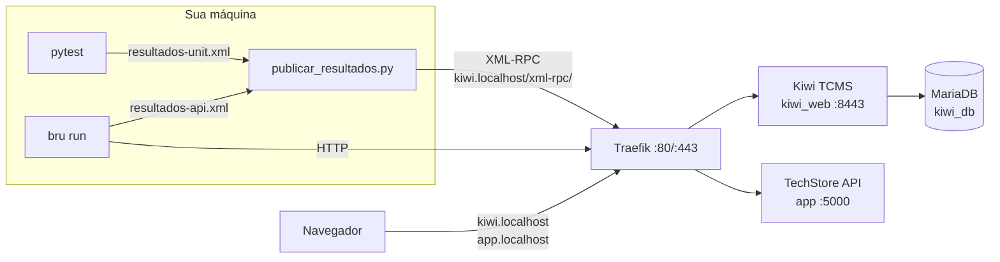
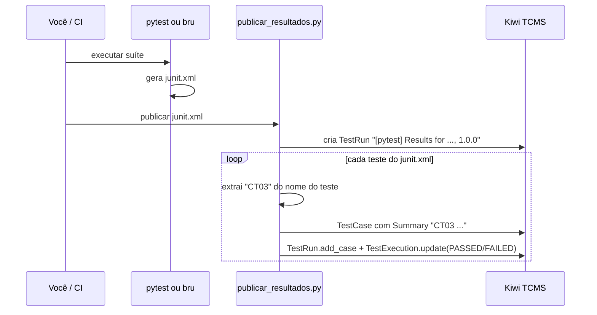

# Tutorial GQS24 — Kiwi TCMS na prática: do caso de teste manual à execução automatizada

**Aula 24 — Garantia da Qualidade de Software** | Prof. Giovane Barcelos
**Duração estimada:** 2h a 2h30 | **Pré-requisitos:** Docker + Docker Compose, Python 3.10+, Node.js 18+ (para o Bruno CLI), Git

---

## O que você vai construir

Um ambiente completo de gestão de testes rodando na sua máquina, acessado por nomes amigáveis no navegador:

| URL | O que é |
|---|---|
| `https://kiwi.localhost` | **Kiwi TCMS** — planos, casos de teste, rodadas de execução e bug tracker |
| `http://app.localhost` | **TechStore API** — a aplicação sob teste (carrinho de compras) |
| `http://traefik.localhost` | Painel do **Traefik** — o proxy reverso que distribui as requisições |

A TechStore API **vem com dois defeitos plantados**. Ao longo do tutorial você vai:

1. escrever um caso de teste no Kiwi, executá-lo **à mão** e ver que ele falha;
2. registrar o defeito no bug tracker do próprio Kiwi, ligado à execução que o encontrou;
3. rodar **testes unitários (pytest)** e **testes de API (Bruno)** e publicar os resultados no Kiwi **automaticamente** — cada teste automatizado atualiza o caso de teste correspondente;
4. descobrir o segundo defeito pela automação;
5. **corrigir** o código, gerar um novo build e provar, no Kiwi, que tudo passou.



### Estrutura da pasta

```
class24/lab-kiwi/
├── GQS24-Tutorial-KiwiTCMS-TechStore.md   ← este tutorial
├── docker-compose.yml                      ← Traefik + Kiwi TCMS + MariaDB + TechStore API
├── .env.example                            ← senhas e portas (copie para .env)
├── app/                                    ← aplicação sob teste (Python/Flask)
│   ├── Dockerfile
│   ├── techstore/carrinho.py               ← regras de negócio (com 2 defeitos!)
│   ├── techstore/app.py                    ← endpoints REST
│   └── tests/test_carrinho.py              ← testes unitários (pytest)
├── bruno/TechStore-Carrinho/               ← coleção Bruno (testes de API)
├── kiwi/
│   ├── preparar_kiwi.py                    ← cria produto, plano e casos via API
│   ├── publicar_resultados.py              ← junit.xml → execuções no Kiwi
│   ├── kiwi_conexao.py                     ← conexão/credenciais compartilhadas
│   └── tcms.conf.example
└── scripts/executar-testes.sh              ← roda pytest + Bruno e publica tudo
```

### Números de referência

Medidos numa execução real deste tutorial (Kiwi TCMS **16.6**, Traefik 3.6, MariaDB 11, `tcms-api` 15.0, pytest 9.2, Bruno CLI 4.3). Os seus devem bater:

| Rodada | Build | Casos | PASSED | FAILED |
|---|---|---|---|---|
| Rodada manual | 1.0.0 | 1 (CT14) | 0 | 1 |
| `[pytest]` automatizada | 1.0.0 | 8 | 6 | 2 (CT03, CT05) |
| `[bruno]` automatizada | 1.0.0 | 7 | 5 | 2 (CT14, CT15) |
| `[pytest]` após correção | 1.0.1 | 8 | 8 | 0 |
| `[bruno]` após correção | 1.0.1 | 7 | 7 | 0 |

---

## Etapa 1 — Subir o ambiente (15 min)

### 1.1 Preparar o `.env`

```bash
cd repository/class24/lab-kiwi
cp .env.example .env
```

Abra o `.env` e **troque as duas senhas** do banco. O `.env` fica só na sua máquina: ele está no `.gitignore`, porque senha não vai para o repositório (a mesma regra que o SonarQube cobra na Aula 23B).

### 1.2 Verificar as portas 80 e 443

O Traefik precisa das portas **80** (HTTP) e **443** (HTTPS) do seu computador. Confira se estão livres:

```bash
# Linux / macOS
sudo ss -ltnp | grep -E ':(80|443) '      # ou: sudo lsof -i :80 -i :443
# Windows (PowerShell)
netstat -ano | findstr ":80 :443"
```

Se aparecer alguma coisa (Apache, Nginx, IIS, Skype, outro Traefik...), **não edite o compose** — descomente no `.env`:

```ini
HTTP_PORT=8880
HTTPS_PORT=8443
```

A partir daí, **acrescente a porta em todas as URLs** deste tutorial: `http://app.localhost:8880`, `https://kiwi.localhost:8443`, `http://traefik.localhost:8880`.

### 1.3 Subir os containers

```bash
docker compose up -d --build
docker compose ps
```

São quatro containers:

| Container | Imagem | Papel |
|---|---|---|
| `gqs24_traefik` | `traefik:v3.6` | proxy reverso; lê os *labels* dos outros containers e cria as rotas |
| `gqs24_techstore_api` | construída de `./app` | a aplicação sob teste |
| `gqs24_kiwi_db` | `mariadb:11` | banco do Kiwi |
| `gqs24_kiwi_web` | `kiwitcms/kiwi:latest` | o Kiwi TCMS (Django) |

> **Como o Traefik sabe para onde mandar cada nome?** Abra o `docker-compose.yml` e procure os `labels`. Por exemplo, no serviço `app`:
> `traefik.http.routers.app.rule=Host(\`app.localhost\`)` + `loadbalancer.server.port=5000`.
> Nenhuma porta da aplicação ou do Kiwi é publicada no host — **só o Traefik** recebe conexões de fora.

### 1.4 Esperar o Kiwi ficar pronto

```bash
docker inspect -f '{{.State.Health.Status}}' gqs24_kiwi_web
# starting ... starting ... healthy
```

Leva de 30 a 60 segundos. **Enquanto estiver `starting`, o Traefik não cria a rota** e `kiwi.localhost` responde `404 page not found` — é normal, espere o `healthy`.

### 1.5 Setup inicial do Kiwi (só na primeira vez)

```bash
docker exec -it gqs24_kiwi_web /Kiwi/manage.py initial_setup
```

O comando é **interativo** (repare no `-it`) e pergunta:

1. `Username:` → `admin`
2. `Email address:` → `admin@techstore.local`
3. `Password:` / `Password (again):` → escolha uma senha e **anote**
4. `Enter Kiwi TCMS domain:` → `kiwi.localhost` (ou `kiwi.localhost:8443` se trocou a porta)

Sem `-it` o superusuário **não** é criado (*"Superuser creation skipped due to not running in a TTY"*).

### 1.6 Acessar

| Teste | Esperado |
|---|---|
| `http://app.localhost/api/health` | `{"status":"ok","versao":"1.0.0"}` |
| `http://traefik.localhost` | painel do Traefik, com os routers `app`, `kiwi`, `kiwi-http` e `painel` em verde |
| `http://kiwi.localhost` | redireciona para `https://kiwi.localhost` |
| `https://kiwi.localhost` | tela de login do Kiwi |

O certificado HTTPS é **autoassinado** (gerado pelo próprio Traefik), então o navegador vai avisar — clique em *Avançado → Continuar*. Entre com o usuário criado no passo 1.5. A versão do Kiwi aparece no menu de ajuda (`?`, canto superior direito).

> **E se `*.localhost` não resolver?** Chrome, Edge e Firefox resolvem qualquer `*.localhost` para `127.0.0.1` sozinhos, assim como o Linux com `systemd-resolved`. Se o `bru`, o `python` ou o `curl` não encontrarem o nome (`ENOTFOUND`, `Name or service not known`), acrescente ao arquivo de hosts (`/etc/hosts` no Linux/macOS, `C:\Windows\System32\drivers\etc\hosts` no Windows, editando como administrador):
>
> ```
> 127.0.0.1  app.localhost kiwi.localhost traefik.localhost
> ```

---

## Etapa 2 — Conhecer a aplicação sob teste (10 min)

A **TechStore API** calcula o valor de um carrinho de compras. O código das regras está em `app/techstore/carrinho.py`, separado do Flask (`app/techstore/app.py`) justamente para poder ser testado por **teste unitário**, sem subir servidor.

### 2.1 Regras de negócio (o "requisito")

| Regra | Descrição |
|---|---|
| **RN01** | subtotal = soma de (preço × quantidade) de cada item |
| **RN02** | o cupom `GQS10` dá 10% de desconto sobre o subtotal; qualquer outro cupom é recusado |
| **RN03** | frete fixo de R$ 15,00; **grátis quando o valor com desconto for maior ou igual a R$ 200,00** |
| **RN04** | a quantidade de cada item deve estar **entre 1 e 10** (inclusive) |
| **RN05** | produto inexistente é recusado |

Catálogo: `1` Mouse Gamer R$ 120,00 · `2` Teclado Mecânico R$ 250,00 · `3` Headset R$ 80,00 · `4` Cabo HDMI R$ 25,00.

### 2.2 Endpoints

| Método | Rota | Resposta |
|---|---|---|
| GET | `/api/health` | `200 {"status":"ok","versao":"1.0.0"}` |
| GET | `/api/produtos` | `200` lista dos 4 produtos |
| GET | `/api/produtos/{id}` | `200` produto, ou `404` |
| POST | `/api/carrinho/calcular` | `200 {"subtotal","desconto","frete","total"}`, `400` entrada inválida, `404` produto inexistente |

### 2.3 Experimente

```bash
curl http://app.localhost/api/produtos

curl -X POST http://app.localhost/api/carrinho/calcular \
     -H "Content-Type: application/json" \
     -d '{"itens":[{"produto_id":2,"quantidade":1}],"cupom":"GQS10"}'
# {"subtotal":250.0,"desconto":25.0,"frete":0.0,"total":225.0}
```

**Pergunta para o relatório:** olhando só as regras RN03 e RN04, quais valores você testaria usando **análise de valor limite** (Aula 08)? Guarde a resposta — é exatamente onde estão os defeitos.

---

## Etapa 3 — Modelar o produto no Kiwi (10 min)

Tudo no Kiwi fica abaixo de um **Product**, que precisa de uma **Classification**. Uma instalação nova **não tem nenhuma classificação**.

Vá em `ADMIN > Everything else` (o admin do Django) e crie, nesta ordem:

| Passo | Onde (admin) | O que criar |
|---|---|---|
| 3.1 | `Management > Classifications` | `Aplicacoes Web` |
| 3.2 | `Management > Products` | `TechStore Carrinho`, classificação `Aplicacoes Web` |
| 3.3 | `Management > Versions` | `1.0` para o produto `TechStore Carrinho` |
| 3.4 | `Management > Builds` | `1.0.0` para a versão `1.0` |
| 3.5 | `Testcases > Categories` | `API REST` e `Regras de Negocio`, produto `TechStore Carrinho` |

Ao salvar o produto, o Kiwi cria sozinho a versão `unspecified` e a categoria `--default--`.

| Conceito no Kiwi | Neste laboratório | Significado |
|---|---|---|
| Product | TechStore Carrinho | o sistema sob teste |
| Version | 1.0 | a versão "comercial" do produto |
| Build | 1.0.0 → 1.0.1 | cada pacote gerado daquela versão; a correção gera um build novo |
| Category | API REST / Regras de Negocio | agrupamento funcional dos casos |

---

## Etapa 4 — Plano de teste e caso de teste manual (15 min)

### 4.1 Criar o plano

`TESTING > New Test Plan`:

| Campo | Valor |
|---|---|
| Name | `TechStore Carrinho v1.0 - Regressao` |
| Product / Version | `TechStore Carrinho` / `1.0` |
| Type | `Regression` |
| Text | `Regressão da API de carrinho: regras RN01 a RN05 (testes unitários com pytest e testes de API com Bruno).` |

Salve e **anote o número do plano** que aparece no título (`TP-1: ...`). Ele será o `TCMS_PLAN_ID` da Etapa 7.

### 4.2 Convenção de identificadores — leia antes de criar o caso

O Kiwi numera os casos sozinho: `TC-1`, `TC-2`... Esse número depende da ordem de criação e **muda de uma instalação para outra**. Por isso, neste laboratório, **o Summary de cada caso começa com um identificador nosso, fixo: `CT01`, `CT02`... `CT16`** (CT = Caso de Teste).

É esse identificador que liga o Kiwi ao código: o teste `test_CT03_...` do pytest e o `test("CT14 - ...")` do Bruno atualizam, respectivamente, os casos `CT03 - ...` e `CT14 - ...` do Kiwi (Etapa 7). Não confunda: **`TC-13` é o id do Kiwi; `CT14` é o nosso**.

### 4.3 Escrever o caso CT14

Dentro do plano, use `TESTING > New Test Case` (ou o botão de novo caso no próprio plano):

| Campo | Valor |
|---|---|
| Summary | `CT14 - API: frete gratis no limite de R$ 200,00` |
| Product | `TechStore Carrinho` |
| Category | `API REST` |
| Priority | `P1` |
| Status | `CONFIRMED` |
| Automated | desmarcado (por enquanto ele é manual) |
| Text | o roteiro abaixo |

```markdown
**Requisito:** RN03 — frete grátis a partir de R$ 200,00 (inclusive)
**Técnica:** análise de valor limite (exatamente no limite)

**Pré-condição:** API no ar em http://app.localhost

**Passos**
1. Enviar POST /api/carrinho/calcular com o corpo:
   {"itens":[{"produto_id":1,"quantidade":1},{"produto_id":3,"quantidade":1}]}
   (Mouse Gamer R$ 120,00 + Headset R$ 80,00 = R$ 200,00)

**Resultado esperado**
- status 200
- subtotal 200.0, frete 0.0, total 200.0
```

Se o caso não estiver no plano, adicione-o na lista `Test cases` do plano.

> **Status importa:** só casos `CONFIRMED` podem entrar numa rodada de execução. `PROPOSED`, `DISABLED` e `NEED_UPDATE` ficam de fora.

---

## Etapa 5 — Execução manual e registro do defeito (20 min)

### 5.1 Criar a rodada

`TESTING > New Test Run`, escolhendo o plano `TechStore Carrinho v1.0 - Regressao`:

| Campo | Valor |
|---|---|
| Summary | `Rodada manual - build 1.0.0` |
| Build | `1.0.0` |
| Manager / Default tester | você |
| Casos | `CT14` |

O Kiwi cria uma **TestExecution** (`TE-n`) para o caso, em `IDLE`.

### 5.2 Executar o roteiro

Faça exatamente o que o caso manda — pelo `curl` ou pelo Bruno em modo gráfico (abra a coleção `bruno/TechStore-Carrinho`, escolha o ambiente **Traefik** e envie a requisição *CT14*):

```bash
curl -X POST http://app.localhost/api/carrinho/calcular \
     -H "Content-Type: application/json" \
     -d '{"itens":[{"produto_id":1,"quantidade":1},{"produto_id":3,"quantidade":1}]}'
```

Resultado obtido:

```json
{"subtotal":200.0,"desconto":0.0,"frete":15.0,"total":215.0}
```

O esperado era `frete 0.0` e `total 200.0`. **Falhou.**

### 5.3 Registrar o resultado

Na rodada, clique no status da execução e marque **`FAILED`**. Em *Add comment* registre a evidência:

> Carrinho de exatamente R$ 200,00 cobrou frete de R$ 15,00 (total 215,00). RN03 diz que a partir de 200,00, inclusive, o frete é grátis.

Os 8 status possíveis: `IDLE`, `RUNNING`, `PAUSED`, `PASSED`, `FAILED`, `BLOCKED`, `ERROR`, `WAIVED`.

### 5.4 Preparar o bug tracker interno

O Kiwi tem **bug tracker próprio** — não precisa de Jira nem Mantis. Duas configurações, uma única vez:

**a) Severidades** — o Kiwi sobe sem nenhuma. Em `ADMIN > Everything else > Bugs > Severities` crie:

| Name | Weight | Icon | Color |
|---|---|---|---|
| Baixa | 1 | `fa fa-info-circle` | `#0088ce` |
| Media | 2 | `fa fa-exclamation-triangle` | `#f0ab00` |
| Alta | 3 | `fa fa-exclamation-circle` | `#ec7a08` |
| Critica | 4 | `fa fa-fire` | `#cc0000` |

(O `preparar_kiwi.py` da Etapa 6 também cria essas quatro, se você preferir.)

**b) Bug tracker "Kiwi TCMS"** — habilita o botão de *1 clique* nas execuções. Em `ADMIN > Everything else > Testcases > Bug trackers > Add`:

| Campo | Valor |
|---|---|
| Name | `Kiwi TCMS interno` |
| Type | `tcms.issuetracker.types.KiwiTCMS` (último item da lista) |
| Base URL | `https://kiwi.localhost` (com a porta, se você a trocou) |

Os demais campos ficam vazios. **Sem o Base URL o Kiwi recusa** com *"Enable reporting to this Issue Tracker by configuring its base_url!"*.

### 5.5 Abrir o defeito a partir da execução

Volte à rodada manual. No menu da execução `FAILED` do CT14 escolha **Report bug** e selecione `Kiwi TCMS interno`. O Kiwi cria o `BUG-1` com:

- Summary `Failed test: CT14 - API: frete gratis no limite de R$ 200,00` — **renomeie** para algo que descreva o defeito: `Frete cobrado em carrinho de exatamente R$ 200,00`;
- Product, Version e Build preenchidos a partir da execução (`1.0.0`);
- **vínculo automático com a execução** `TE-n` — é isso que dá rastreabilidade.

Abra o bug (`SEARCH > Search Bugs`), clique em *Edit* e complete:

| Campo | Valor |
|---|---|
| Severity | `Alta` |
| Assignee | você (o "desenvolvedor") |

E escreva no comentário os **três itens que todo relatório de defeito precisa ter**:

```markdown
**Passos para reproduzir:** POST /api/carrinho/calcular com 1 Mouse Gamer (120) + 1 Headset (80)
**Resultado esperado:** frete 0.00, total 200.00 (RN03: grátis a partir de 200,00 inclusive)
**Resultado obtido:** frete 15.00, total 215.00
**Encontrado por:** CT14, rodada manual, build 1.0.0
```

> **Alternativa sem o bug tracker configurado:** `TESTING > New Bug` (Summary, Severity, Product, Version, Build, Assignee e texto) e, na execução `FAILED`, *Add hyperlink* com a URL `https://kiwi.localhost/bugs/1/` e a caixa **Is a defect** marcada.

**Pergunta para o relatório:** a severidade é Alta. E a prioridade? Quem decide, e por que pode ser diferente da severidade?

---

## Etapa 6 — Completar o catálogo de casos pela API (10 min)

Escrever 15 casos à mão é o tipo de trabalho que se automatiza. O script `kiwi/preparar_kiwi.py` cria (ou **reaproveita**) produto, versão, build, categorias, plano, severidades e os casos `CT01` a `CT16`.

### 6.1 Ambiente Python

```bash
cd repository/class24/lab-kiwi
python3 -m venv .venv
source .venv/bin/activate              # Windows: .venv\Scripts\activate
pip install -r app/requirements-dev.txt -r kiwi/requirements.txt
```

### 6.2 Credenciais — fora do código

Crie `~/.tcms.conf` a partir de `kiwi/tcms.conf.example`:

```ini
[tcms]
url = https://kiwi.localhost/xml-rpc/
username = admin
password = sua-senha
```

```bash
chmod 600 ~/.tcms.conf
```

Ou exporte as variáveis (valem só para o terminal atual):

```bash
export KIWI_URL=https://kiwi.localhost/xml-rpc/
export KIWI_USERNAME=admin
export KIWI_PASSWORD=sua-senha
```

Se você trocou a porta HTTPS, a URL fica `https://kiwi.localhost:8443/xml-rpc/`.

### 6.3 Rodar

```bash
python3 kiwi/preparar_kiwi.py
```

Saída esperada (os ids podem variar):

```
Product    1  TechStore Carrinho
Version    2  1.0
Build      3  1.0.0
TestPlan   1  TechStore Carrinho v1.0 - Regressao   <-- use este id em TCMS_PLAN_ID
  added: TC-2   CT01 - Calcular subtotal de multiplos itens
  ...
  reuse: TC-1   CT14 - API: frete gratis no limite de R$ 200,00
  ...
Severidades: Baixa, Media, Alta, Critica
```

Repare no **`reuse`** do CT14: o script procura os casos pelo **prefixo** `CT14 ` e aproveita o que você escreveu à mão. Rode de novo — nada é duplicado (estratégia *get or create*).

Abra o plano no Kiwi. Agora ele tem 15 casos, todos com **Automated = True**. Abra um deles e clique em *Edit*: o campo **Script** diz qual código executa o caso (ex.: `app/tests/test_carrinho.py::test_CT03_frete_gratis_no_limite_exato_de_200`). É assim que o Kiwi documenta a automação de um caso que nasceu manual.

| Casos | Categoria | Executados por |
|---|---|---|
| CT01 a CT08 | Regras de Negocio | pytest — `app/tests/test_carrinho.py` |
| CT10 a CT16 | API REST | Bruno — `bruno/TechStore-Carrinho/CT1x-*.bru` |

---

## Etapa 7 — Executar os casos automaticamente (25 min)

Aqui está o coração do tutorial: **o caso escrito no Kiwi passa a ser executado por código, e o resultado volta sozinho para o Kiwi.**



### 7.1 Testes unitários com pytest

```bash
cd app
pytest -v
```

```
tests/test_carrinho.py::test_CT01_subtotal_de_multiplos_itens PASSED
tests/test_carrinho.py::test_CT02_cupom_GQS10_aplica_10_por_cento PASSED
tests/test_carrinho.py::test_CT03_frete_gratis_no_limite_exato_de_200 FAILED
tests/test_carrinho.py::test_CT04_frete_cobrado_abaixo_de_200 PASSED
tests/test_carrinho.py::test_CT05_rejeita_quantidade_menor_que_1[0] FAILED
tests/test_carrinho.py::test_CT05_rejeita_quantidade_menor_que_1[-1] PASSED
...
========================= 2 failed, 10 passed =========================
```

Dois testes falham: o **CT03** (o mesmo defeito do BUG-1, agora pego pelo teste unitário) e o **CT05** — um **defeito novo**, que ninguém tinha visto ainda: a quantidade `0` é aceita.

Gere o relatório no formato JUnit, que é o "idioma comum" entre ferramentas de teste:

```bash
pytest -v --junitxml=../resultados-unit.xml
cd ..
```

### 7.2 Testes de API com Bruno

Instale o Bruno CLI (uma vez):

```bash
npm install -g @usebruno/cli
```

Rode a coleção contra a API publicada pelo Traefik:

```bash
cd bruno/TechStore-Carrinho
bru run --env Traefik --reporter-junit ../../resultados-api.xml
cd ../..
```

```
CT14-frete-gratis-limite (200 OK)
   ✕ CT14 - Carrinho de exatamente 200,00 tem frete gratis
      frete: expected 15 to equal +0
CT15-quantidade-zero (200 OK)
   ✕ CT15 - Quantidade zero retorna 400
      expected 200 to equal 400
...
│ Tests         │          5/7           │
```

> Se trocou a porta HTTP, edite `bruno/TechStore-Carrinho/environments/Traefik.bru` e use `baseUrl: http://app.localhost:8880`. Para rodar a API **fora** do Docker (`cd app && python -m techstore.app`), use o ambiente `Local` (`http://localhost:5000`).

Abra um `.bru` e veja como o teste é escrito — o nome começa com o identificador do caso:

```javascript
tests {
  test("CT14 - Carrinho de exatamente 200,00 tem frete gratis", function () {
    expect(res.getStatus()).to.equal(200);
    const r = res.getBody();
    expect(r.subtotal).to.equal(200);
    expect(r.frete, "frete").to.equal(0);
    expect(r.total, "total").to.equal(200);
  });
}
```

### 7.3 Publicar os resultados no Kiwi

```bash
export TCMS_PLAN_ID=1          # o número do plano (Etapa 4.1 / saída do preparar_kiwi.py)
export TCMS_BUILD=1.0.0        # o build que foi testado

TCMS_PREFIX="[pytest]" python3 kiwi/publicar_resultados.py resultados-unit.xml
TCMS_PREFIX="[bruno]"  python3 kiwi/publicar_resultados.py resultados-api.xml
```

```
TestRun TR-2 (plano TP-1)
  PASSED  TC-2   CT01 - Calcular subtotal de multiplos itens
  PASSED  TC-3   CT02 - Aplicar cupom GQS10 com 10% de desconto
  FAILED  TC-4   CT03 - Frete gratis no limite exato de R$ 200,00
  PASSED  TC-5   CT04 - Cobrar frete abaixo de R$ 200,00
  FAILED  TC-6   CT05 - Rejeitar quantidade menor que 1
  PASSED  TC-7   CT06 - Validar limite maximo de 10 unidades
  PASSED  TC-8   CT07 - Rejeitar cupom invalido
  PASSED  TC-9   CT08 - Rejeitar produto inexistente
Rodada TR-2 concluida -> FAILED: 2, PASSED: 6
TestRun TR-3 (plano TP-1)
  ...
  FAILED  TC-1   CT14 - API: frete gratis no limite de R$ 200,00
  FAILED  TC-14  CT15 - API: quantidade zero retorna 400
  ...
Rodada TR-3 concluida -> FAILED: 2, PASSED: 5
```

Abra o plano no Kiwi: há duas rodadas novas, `[pytest] Results for TechStore Carrinho, 1.0, 1.0.0` e `[bruno] Results for ...`. Clique numa execução `FAILED` e leia o comentário: ele traz o nome do teste e a **mensagem de falha** do junit.xml — a evidência, sem ninguém digitar nada.

**Como o script decide qual caso atualizar** (leia `kiwi/publicar_resultados.py`):

| No junit.xml | Identificador extraído | Caso no Kiwi |
|---|---|---|
| `test_CT03_frete_gratis_no_limite_exato_de_200` | `CT03` | `CT03 - Frete gratis no limite exato de R$ 200,00` |
| `test_CT05_rejeita_quantidade_menor_que_1[0]` e `[-1]` | `CT05` (2 testes) | **uma** execução; fica `FAILED` se qualquer um falhar |
| `CT14 - Carrinho de exatamente 200,00 tem frete gratis` | `CT14` | `CT14 - API: frete gratis no limite de R$ 200,00` |
| um teste sem `CTxx` no nome | — | cria um caso novo com o nome do teste |

O trabalho pesado (criar Version, Build e TestRun, mudar status) é feito pela classe `Backend` da biblioteca `tcms-api` — a mesma do plugin oficial `kiwitcms-junit.xml-plugin`. O nosso script só acrescenta a regra "achar o caso pelo prefixo `CTxx`", que o plugin oficial não tem (ele procura pelo Summary **exato** e, por isso, criaria casos paralelos `test_CT03_...` em vez de usar o caso que você escreveu).

### 7.4 Tudo de uma vez: `scripts/executar-testes.sh`

O script roda as duas suítes e publica as duas rodadas. É o que um pipeline de CI chamaria:

```bash
TCMS_PLAN_ID=1 TCMS_BUILD=1.0.0 ./scripts/executar-testes.sh
echo $?        # 1 = alguma suíte falhou (o pipeline fica vermelho)
```

Use `PUBLICAR=0` para só rodar os testes, sem enviar ao Kiwi. No Windows, rode os comandos das Etapas 7.1 a 7.3 um a um (ou use o Git Bash/WSL).

> **Integração contínua:** num GitHub Actions o mesmo script roda depois do `docker compose up`, com as credenciais em *secrets*:
>
> ```yaml
> - run: ./scripts/executar-testes.sh
>   env:
>     KIWI_URL: ${{ secrets.KIWI_URL }}
>     KIWI_USERNAME: ${{ secrets.KIWI_USERNAME }}
>     KIWI_PASSWORD: ${{ secrets.KIWI_PASSWORD }}
>     TCMS_PLAN_ID: 1
>     TCMS_BUILD: ${{ github.sha }}
> ```
>
> Cada commit vira um Build no Kiwi, e o histórico de cada caso mostra em qual commit ele começou a falhar (Aulas 25 e 26).

### 7.5 Registrar o defeito que a automação achou

O CT05 (pytest) e o CT15 (Bruno) revelaram um defeito que a rodada manual não cobria. Na rodada `[bruno] Results ... 1.0.0`, execução `FAILED` do **CT15** → **Report bug** → `Kiwi TCMS interno`. Renomeie para `API aceita item com quantidade zero`, severidade `Media`, e preencha passos/esperado/obtido. Esse é o **BUG-2**.

Ligue também o BUG-1 às execuções automatizadas do CT03 e do CT14: na execução, *Add hyperlink* → URL `https://kiwi.localhost/bugs/1/` → marque **Is a defect**.

---

## Etapa 8 — Analisar no Kiwi (10 min)

| O que ver | Onde | O que você deve encontrar |
|---|---|---|
| Visão do plano | `TP-1` | 15 casos e 3 rodadas (manual, `[pytest]`, `[bruno]`) |
| Progresso de uma rodada | página da rodada | barra com PASSED/FAILED e o percentual |
| Histórico de um caso | página do `CT14` → *Executions* | uma execução manual e uma automatizada, ambas `FAILED` no build 1.0.0 |
| Defeitos e suas execuções | `SEARCH > Search Bugs` → `BUG-1` | lista de execuções ligadas ao defeito |
| Manual × automatizado | `TELEMETRY > Testing > Breakdown` | proporção de casos automatizados |
| Casos que mais falham | `TELEMETRY > Testing > TestCase health` | CT03, CT05, CT14, CT15 |

**Métricas para o relatório** (build 1.0.0, rodadas automatizadas):

- taxa de aprovação = PASSED / executados = 11 / 15 = **73%**
- defeitos encontrados: **2** (BUG-1 por teste manual e automatizado; BUG-2 só pela automação)

---

## Etapa 9 — Corrigir os defeitos e retestar (20 min)

Agora você é o desenvolvedor. Os dois defeitos estão em `app/techstore/carrinho.py`, marcados com o comentário `DEFEITO PLANTADO`.

### 9.1 A correção

**BUG-1 — frete (RN03):** a regra diz "maior **ou igual**".

```diff
 def calcular_frete(valor_com_desconto):
     """RN03 - frete gratis a partir de R$ 200,00 (inclusive)."""
-    # DEFEITO PLANTADO #1 (BUG-1): a regra diz "maior OU IGUAL".
-    # Com ">", um carrinho de exatamente R$ 200,00 paga frete.
-    if valor_com_desconto > LIMITE_FRETE_GRATIS:
+    if valor_com_desconto >= LIMITE_FRETE_GRATIS:
         return Decimal("0.00")
     return VALOR_FRETE
```

**BUG-2 — quantidade (RN04):** o limite inferior é 1, não 0.

```diff
-    # DEFEITO PLANTADO #2 (BUG-2): o limite inferior deveria ser
-    # QUANTIDADE_MINIMA (1). Com "< 0", a quantidade 0 passa na validacao.
-    if quantidade < 0 or quantidade > QUANTIDADE_MAXIMA:
+    if quantidade < QUANTIDADE_MINIMA or quantidade > QUANTIDADE_MAXIMA:
         raise CarrinhoInvalido(
```

Os dois são **erros de valor limite** — por isso só um teste que escolhe *exatamente* o limite (200,00 e 0) os encontra. Um teste com R$ 300,00 ou quantidade 5 passaria sempre.

### 9.2 Confirmar localmente (teste unitário)

```bash
cd app && pytest -q && cd ..
# 12 passed
```

### 9.3 Gerar o build 1.0.1 da aplicação

No `.env`, troque `APP_VERSION=1.0.0` por `APP_VERSION=1.0.1` e reconstrua **só** a API:

```bash
docker compose up -d --build app
curl http://app.localhost/api/health
# {"status":"ok","versao":"1.0.1"}
```

### 9.4 Retestar e publicar no build novo

```bash
TCMS_PLAN_ID=1 TCMS_BUILD=1.0.1 ./scripts/executar-testes.sh
```

```
Rodada TR-4 concluida -> PASSED: 8
Rodada TR-5 concluida -> PASSED: 7
pytest: OK   bruno: OK
```

O Build `1.0.1` **não precisou ser criado à mão**: o `Backend` do `tcms-api` cria o build se ele não existir.

Feche também o ciclo da rodada manual: crie a rodada `Rodada manual - build 1.0.1` com o CT14, repita o `curl` da Etapa 5.2 (agora `frete 0.0`, `total 200.0`) e marque `PASSED`.

### 9.5 Fechar os defeitos

Abra o `BUG-1` e o `BUG-2`, escreva no comentário a evidência da correção e clique em **Close**:

> Corrigido no build 1.0.1 (`>=` em `calcular_frete`). Reteste: CT03 PASSED (TR-4), CT14 PASSED (TR-5 e rodada manual 1.0.1).

Agora a página do **CT14** conta a história completa: `FAILED` no 1.0.0 (manual e Bruno) → `BUG-1` → `PASSED` no 1.0.1. É essa rastreabilidade **requisito → caso → execução → defeito → correção → reteste** que uma planilha não oferece.

---

## Etapa 10 — Encerrar o ambiente

```bash
docker compose down        # para, mantendo os dados do Kiwi
docker compose down -v     # para e APAGA o banco do Kiwi (recomeça do zero)
```

Para refazer o laboratório com os defeitos, desfaça a correção: `git checkout app/techstore/carrinho.py` e volte o `APP_VERSION` para `1.0.0`.

---

## Armadilhas conhecidas

| Sintoma | Causa | Solução |
|---|---|---|
| `Bind for 0.0.0.0:80 failed: port is already allocated` | outro serviço usa a 80/443 | `HTTP_PORT`/`HTTPS_PORT` no `.env` (Etapa 1.2) |
| `kiwi.localhost` → `404 page not found` | Kiwi ainda `starting`; o Traefik ignora containers não saudáveis | espere o `healthy` (Etapa 1.4) |
| Traefik não cria rota nenhuma e o log reclama da versão da API do Docker (`client version ... is too old`) | Traefik < 3.6 com Docker Engine 29+ | use `traefik:v3.6` ou mais novo (já está no compose) |
| `ENOTFOUND app.localhost` no `bru` / `Name or service not known` no Python | o sistema não resolve `*.localhost` | linha no arquivo de hosts (Etapa 1.6) |
| Não consegue logar depois do setup | `initial_setup` rodou sem `-it` | rode de novo com `docker exec -it` |
| Lista de classificações vazia | instalação nova não tem nenhuma | crie a classificação antes do produto (Etapa 3.1) |
| Caso não aparece para adicionar à rodada | status `PROPOSED` | mude para `CONFIRMED` |
| `Enable reporting to this Issue Tracker by configuring its base_url!` | bug tracker sem Base URL | Etapa 5.4 b |
| `RuntimeError: Config file ... not found` | sem `~/.tcms.conf` e sem `KIWI_*` | Etapa 6.2 |
| `SSLCertVerificationError` | certificado autoassinado | os scripts já tratam (comentário "APENAS EM LABORATÓRIO" em `kiwi_conexao.py`) |
| Rodada automatizada cria casos `test_CT...` duplicados | usou o plugin oficial em vez do `publicar_resultados.py` | use o script do laboratório (Etapa 7.3) |
| Teste passou mas a API do container continua errada | corrigiu o código e não reconstruiu a imagem | `docker compose up -d --build app` |

---

## Perguntas para o relatório

1. (Etapa 2) Quais valores limite de RN03 e RN04 você escolheria? Eles pegariam os dois defeitos?
2. (Etapa 3) Qual a diferença entre **Version** e **Build**? Por que a correção gerou um build novo e não uma versão nova?
3. (Etapa 4) Por que usar um identificador próprio (`CT14`) no Summary em vez do id do Kiwi (`TC-13`)?
4. (Etapa 5) Severidade × prioridade do BUG-1: quem define cada uma?
5. (Etapa 7) O BUG-2 só foi encontrado pela automação. O que isso diz sobre a cobertura da rodada manual?
6. (Etapa 7) O CT05 tem dois testes no pytest (`[0]` e `[-1]`) e só um passou. Por que a execução no Kiwi deve ficar `FAILED` e não "meio aprovada"?
7. (Etapa 9) Por que o reteste precisa ser registrado no build **1.0.1**, e não sobrescrever o resultado do 1.0.0?

## O que entregar

1. Print do plano `TP-1` com os 15 casos (coluna *Automated*).
2. Print da rodada manual com o CT14 `FAILED` e do `BUG-1` mostrando a execução vinculada.
3. Print das rodadas `[pytest]` e `[bruno]` do build 1.0.0 (com as falhas) e do build 1.0.1 (tudo `PASSED`).
4. Print da página do CT14 mostrando o histórico de execuções.
5. O `diff` da correção (`git diff app/techstore/carrinho.py`).
6. As respostas às perguntas acima.
