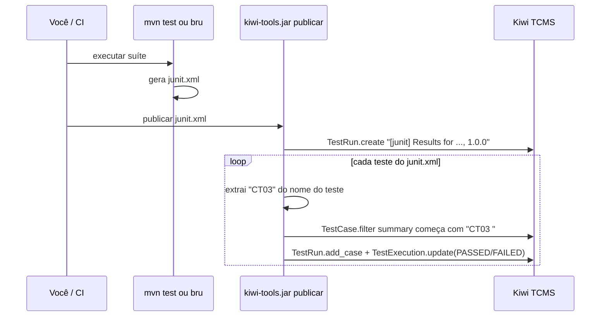

# Tutorial GQS24 — Kiwi TCMS na prática: do caso de teste manual à execução automatizada  

**Aula 24 — Garantia da Qualidade de Software** | Prof. Giovane Barcelos  
**Duração estimada:** 2h a 2h30 (Parte I, Java) + 30 min (Parte II, Python)  
**Pré-requisitos:** Docker + Docker Compose, **JDK 17+ e Maven 3.9+**, Node.js 18+ (para o Bruno CLI), Git — e, para a Parte II, Python 3.10+. A **Etapa 0** mostra como instalar tudo.  
**Arquivos do laboratório:** pasta `class24/lab-kiwi/` do repositório <https://github.com/giovanebarcelos/gqs-sandbox> (Etapa 0.6).  

---  

## O que você vai construir  

Um ambiente completo de gestão de testes rodando na sua máquina, acessado por nomes amigáveis no navegador:  

| URL | O que é |  
|---|---|  
| `https://kiwi.localhost` | **Kiwi TCMS** — planos, casos de teste, rodadas de execução e bug tracker |  
| `http://app.localhost` | **TechStore API em Java** (Spring Boot) — a aplicação sob teste |  
| `http://app-python.localhost` | **TechStore API em Python** (Flask) — a mesma API, para a Parte II |  
| `http://traefik.localhost` | Painel do **Traefik** — o proxy reverso que distribui as requisições |  

A TechStore API existe em **duas implementações idênticas** — mesmas rotas, mesmas regras e **os mesmos dois defeitos plantados**:  

| | Parte I — Java (principal) | Parte II — Python |  
|---|---|---|  
| Aplicação | Spring Boot 3.5 (`java/app`) | Flask 3 (`python/app`) |  
| Teste unitário | JUnit 5 + Maven Surefire | pytest |  
| Teste de API | Bruno (ambiente `Traefik`) | Bruno (ambiente `TraefikPython`) |  
| Integração com o Kiwi | `java/kiwi` — cliente JSON-RPC em Java (`kiwi-tools.jar`) | `python/kiwi` — biblioteca oficial `tcms-api` |  
| Script de execução | `scripts/executar-testes.sh` | `scripts/executar-testes-python.sh` |  

Ao longo do tutorial você vai:  

1. escrever um caso de teste no Kiwi, executá-lo **à mão** e ver que ele falha;  
2. registrar o defeito no bug tracker do próprio Kiwi, ligado à execução que o encontrou;  
3. rodar **testes unitários (JUnit)** e **testes de API (Bruno)** e publicar os resultados no Kiwi **automaticamente** — cada teste automatizado atualiza o caso de teste correspondente;  
4. descobrir o segundo defeito pela automação;  
5. **corrigir** o código Java, gerar um novo build e provar, no Kiwi, que tudo passou;  
6. repetir o ciclo automatizado com a versão **Python**.  

```mermaid  
flowchart LR  
    nav[Navegador] -->|kiwi.localhost<br/>app.localhost<br/>app-python.localhost| T[Traefik :80/:443]  
    T --> K[Kiwi TCMS<br/>kiwi_web :8443]  
    T --> AJ[TechStore Java<br/>app :8080]  
    T --> AP[TechStore Python<br/>app-python :5000]  
    K --> DB[(MariaDB<br/>kiwi_db)]  
    subgraph host[Sua máquina]  
      J[mvn test / pytest] -->|junit.xml| PUB[kiwi-tools.jar publicar<br/>ou publicar_resultados.py]  
      B[bru run] -->|resultados-api.xml| PUB  
    end  
    B -->|HTTP| T  
    PUB -->|JSON-RPC / XML-RPC<br/>kiwi.localhost| T  
```  

### Estrutura da pasta  

```  
class24/lab-kiwi/  
├── GQS24-Tutorial-KiwiTCMS-TechStore.md    ← este tutorial  
├── docker-compose.yml                       ← Traefik + Kiwi TCMS + MariaDB + as duas APIs  
├── .env.example                             ← senhas, versões e portas (copie para .env)  
├── tcms.conf.example                        ← modelo do ~/.tcms.conf (Java e Python)  
├── java/                                    ← PARTE I  
│   ├── app/                                 ← API Spring Boot + testes JUnit 5  
│   │   ├── pom.xml  ·  Dockerfile  
│   │   ├── src/main/java/br/edu/gqs/techstore/CalculadoraCarrinho.java  ← regras (2 defeitos!)  
│   │   ├── src/main/java/br/edu/gqs/techstore/CarrinhoController.java   ← endpoints REST  
│   │   └── src/test/java/br/edu/gqs/techstore/CalculadoraCarrinhoTest.java  
│   └── kiwi/                                ← kiwi-tools.jar: "preparar" e "publicar"  
│       └── src/main/java/br/edu/gqs/kiwi/   (KiwiClient, PrepararKiwi, PublicarResultados)  
├── python/                                  ← PARTE II  
│   ├── app/                                 ← API Flask + testes pytest  
│   └── kiwi/                                ← preparar_kiwi.py e publicar_resultados.py (tcms-api)  
├── bruno/TechStore-Carrinho/                ← coleção Bruno — serve às duas APIs  
└── scripts/  
    ├── executar-testes.sh                   ← JUnit + Bruno + publicação (Java)  
    └── executar-testes-python.sh            ← pytest + Bruno + publicação (Python)  
```  

### Números de referência  

Medidos numa execução real deste tutorial (Kiwi TCMS **16.6**, Traefik 3.6, MariaDB 11, Spring Boot 3.5.6, JUnit 5 / Surefire 3.5, pytest 9.2, Bruno CLI 4.3). Os seus devem bater:  

| Rodada | Build | Casos | PASSED | FAILED |  
|---|---|---|---|---|  
| Rodada manual | 1.0.0 | 1 (CT14) | 0 | 1 |  
| `[junit]` automatizada (Java) | 1.0.0 | 8 | 6 | 2 (CT03, CT05) |  
| `[bruno]` automatizada (API Java) | 1.0.0 | 7 | 5 | 2 (CT14, CT15) |  
| `[junit]` após correção | 1.0.1 | 8 | 8 | 0 |  
| `[bruno]` após correção | 1.0.1 | 7 | 7 | 0 |  
| `[pytest]` / `[bruno]` (Parte II) | 1.0.0 → 1.0.1 | 8 / 7 | 6 / 5 → 8 / 7 | 2 / 2 → 0 / 0 |  

---  

# ETAPA 0 — Preparar a máquina (20 a 40 min, só uma vez)  

Faça esta etapa **antes da aula**: os downloads (Docker Desktop, JDK, imagens do Kiwi) somam alguns gigabytes.  

### 0.1 O que instalar  

| Ferramenta | Versão mínima | Para quê | Parte |  
|---|---|---|---|  
| Git | qualquer recente | baixar o repositório | I e II |  
| Docker + Docker Compose v2 | Compose 2.20+ | subir Traefik, Kiwi, MariaDB e as APIs | I e II |  
| JDK (Java) | 17 (recomendado: 21) | compilar e testar a API e o `kiwi-tools.jar` | I |  
| Maven | 3.9 | `mvn test` e `mvn package` | I |  
| Node.js + npm | 18 (recomendado: LTS) | instalar e rodar o Bruno CLI | I e II |  
| Python | 3.10 | pytest e `tcms-api` | II |  

> O comando é `docker compose` (com espaço, Compose **v2**). O antigo `docker-compose` (com hífen, v1) foi descontinuado e não entende alguns recursos do arquivo, como `profiles`.  

### 0.2 Linux  

**Docker** — o script oficial funciona em Ubuntu, Debian, Fedora e derivados:  

```bash  
curl -fsSL https://get.docker.com | sudo sh  
sudo systemctl enable --now docker  
sudo usermod -aG docker $USER      # permite usar o docker sem sudo  
```  

**Saia da sessão e entre de novo** (ou reinicie) para o grupo `docker` valer. Teste com `docker run --rm hello-world`.  

**Demais ferramentas — Ubuntu / Debian / Mint:**  

```bash  
sudo apt update  
sudo apt install -y git openjdk-21-jdk maven nodejs npm python3 python3-venv python3-pip  
```  

**Demais ferramentas — Fedora:**  

```bash  
sudo dnf install -y git java-21-openjdk-devel maven nodejs npm python3 python3-pip  
```  

> Se o `node -v` do seu sistema for menor que 18 (comum em distribuições antigas), instale a versão LTS pelo [nvm](https://github.com/nvm-sh/nvm): `nvm install --lts`.  

### 0.3 Windows 10/11  

1. **WSL 2** — o Docker Desktop roda sobre ele. No PowerShell **como administrador**:  

   ```powershell  
   wsl --install  
   ```  

   Reinicie o computador quando pedir.  

2. **Ferramentas** — no PowerShell (normal), com o `winget`:  

   ```powershell  
   winget install -e --id Git.Git  
   winget install -e --id Docker.DockerDesktop  
   winget install -e --id EclipseAdoptium.Temurin.21.JDK  
   winget install -e --id OpenJS.NodeJS.LTS  
   winget install -e --id Python.Python.3.12  
   ```  

3. **Maven** — baixe o *Binary zip archive* em <https://maven.apache.org/download.cgi>, descompacte em `C:\Tools\` e acrescente `C:\Tools\apache-maven-3.9.x\bin` ao `Path` (*Configurações → Sistema → Sobre → Configurações avançadas do sistema → Variáveis de Ambiente*). Quem usa Chocolatey pode fazer `choco install maven`.  

4. **Abra o Docker Desktop** uma vez e espere aparecer *Engine running*. Ele precisa estar aberto sempre que você usar o laboratório.  

5. **Feche e abra o terminal** para o `Path` novo valer.  

> **Terminal recomendado no Windows:** o **Git Bash** (instalado junto com o Git). Os comandos do tutorial — inclusive os scripts `.sh` da pasta `scripts/` — rodam nele sem adaptação. No PowerShell, troque `export VAR=valor` por `$env:VAR="valor"` e rode os passos das Etapas 7.1 a 7.3 um a um.  

### 0.4 macOS  

Com o [Homebrew](https://brew.sh):  

```bash  
brew install --cask docker          # Docker Desktop — abra-o uma vez pelo Launchpad  
brew install git openjdk@21 maven node python@3.12  
sudo ln -sfn "$(brew --prefix)/opt/openjdk@21/libexec/openjdk.jdk" /Library/Java/JavaVirtualMachines/openjdk-21.jdk  
```  

> **Mac com Apple Silicon (M1/M2/M3/M4):** a imagem do Kiwi TCMS só existe para `x86_64`. O Docker Desktop a executa por emulação (Rosetta) — funciona, mas a primeira subida e o `initial_setup` ficam mais lentos. Se o Docker reclamar de `no matching manifest for linux/arm64`, acrescente `platform: linux/amd64` ao serviço `kiwi_web` do `docker-compose.yml`.  

### 0.5 Conferir as versões  

Em qualquer sistema, num terminal **novo**:  

```bash  
git --version  
docker --version  
docker compose version     # precisa ser v2.x  
java -version              # 17 ou mais novo  
mvn -v                     # 3.9 ou mais novo — e "Java version" deve ser 17+  
node -v                    # v18 ou mais novo  
npm -v  
python3 --version          # 3.10+ (só para a Parte II; no Windows: python --version)  
```  

| Problema | Solução |  
|---|---|  
| `docker: permission denied ... docker.sock` (Linux) | faltou sair e entrar de novo depois do `usermod -aG docker` |  
| `Cannot connect to the Docker daemon` | Docker Desktop fechado (Windows/macOS) ou serviço parado (`sudo systemctl start docker`) |  
| `mvn -v` mostra `Java version: 11` | o Maven está usando outro JDK — ajuste `JAVA_HOME` para o JDK 21 |  
| `docker-compose: command not found` | use `docker compose` (com espaço) |  
| `java`/`mvn`/`node` não encontrados no Windows | feche e abra o terminal; confira o `Path` |  

### 0.6 Baixar o repositório  

```bash  
git clone https://github.com/giovanebarcelos/gqs-sandbox.git  
cd gqs-sandbox/class24/lab-kiwi  
ls  
# docker-compose.yml  GQS24-Tutorial-KiwiTCMS-TechStore.md  java  python  bruno  scripts ...  
```  

Já tem o repositório de outras aulas? Só atualize: `cd gqs-sandbox && git pull`.  

**Todos os comandos deste tutorial são executados dentro de `gqs-sandbox/class24/lab-kiwi`**, a menos que digam o contrário.  

### 0.7 (Opcional) Adiantar os downloads  

Ainda com boa internet, baixe as imagens e as dependências do Maven antes da aula:  

```bash  
docker compose --profile python pull --ignore-buildable   # Traefik, MariaDB e Kiwi  
docker compose --profile python build                     # compila as duas APIs  
mvn -q -f java/app/pom.xml dependency:go-offline  
mvn -q -f java/kiwi/pom.xml package  
npm install -g @usebruno/cli  
```  

> No Linux, se o `npm install -g` reclamar de permissão (`EACCES`), use `sudo npm install -g @usebruno/cli` ou instale o Node pelo `nvm`.  

---  

# PARTE I — Versão Java  

## Etapa 1 — Subir o ambiente (15 min)  

### 1.1 Preparar o `.env`  

```bash  
cd gqs-sandbox/class24/lab-kiwi      # se ainda não estiver nela (Etapa 0.6)  
cp .env.example .env                # Windows (PowerShell): copy .env.example .env  
```  

Abra o `.env` e **troque as duas senhas** do banco. O `.env` fica só na sua máquina: ele está no `.gitignore`, porque senha não vai para o repositório (a mesma regra que o SonarQube cobra na Aula 23B).  

### 1.2 Verificar as portas 80 e 443  

O Traefik precisa das portas **80** (HTTP) e **443** (HTTPS) do seu computador. Confira se estão livres:  

```bash  
# Linux / macOS  
sudo ss -ltnp | grep -E ':(80|443) '      # ou: sudo lsof -i :80 -i :443  
# Windows (PowerShell)  
netstat -ano | findstr ":80 :443"  
```  

Se aparecer alguma coisa (Apache, Nginx, IIS, outro Traefik...), **não edite o compose** — descomente no `.env`:  

```ini  
HTTP_PORT=8880  
HTTPS_PORT=8443  
```  

A partir daí, **acrescente a porta em todas as URLs** deste tutorial: `http://app.localhost:8880`, `https://kiwi.localhost:8443`, `http://traefik.localhost:8880`.  

### 1.3 Subir os containers  

```bash  
docker compose up -d --build  
docker compose ps  
```  

A primeira subida demora alguns minutos: o Maven compila a API Java **dentro** de um container (`java/app/Dockerfile`, build em dois estágios), então você não precisa de JDK só para subir o ambiente. São quatro containers:  

| Container | Imagem | Papel |  
|---|---|---|  
| `gqs24_traefik` | `traefik:v3.6` | proxy reverso; lê os *labels* dos outros containers e cria as rotas |  
| `gqs24_techstore_java` | construída de `./java/app` | a aplicação sob teste (Spring Boot, porta interna 8080) |  
| `gqs24_kiwi_db` | `mariadb:11` | banco do Kiwi |  
| `gqs24_kiwi_web` | `kiwitcms/kiwi:latest` | o Kiwi TCMS (Django) |  

A API Python (`gqs24_techstore_python`) **não** sobe agora: ela pertence ao *profile* `python` e só entra na Parte II.  

> **Como o Traefik sabe para onde mandar cada nome?** Abra o `docker-compose.yml` e procure os `labels`. No serviço `app`:  
> `traefik.http.routers.app.rule=Host(\`app.localhost\`)` + `loadbalancer.server.port=8080`.  
> Nenhuma porta da aplicação ou do Kiwi é publicada no host — **só o Traefik** recebe conexões de fora.  

### 1.4 Esperar o Kiwi ficar pronto  

```bash  
docker inspect -f '{{.State.Health.Status}}' gqs24_kiwi_web  
# starting ... starting ... healthy  
```  

Leva de 30 a 60 segundos. **Enquanto estiver `starting`, o Traefik não cria a rota** e `kiwi.localhost` responde `404 page not found` — é normal, espere o `healthy`.  

### 1.5 Setup inicial do Kiwi (só na primeira vez)  

```bash  
docker exec -it gqs24_kiwi_web /Kiwi/manage.py initial_setup  
```  

O comando é **interativo** (repare no `-it`) e pergunta:  

1. `Username:` → `admin`  
2. `Email address:` → `admin@techstore.local`  
3. `Password:` / `Password (again):` → escolha uma senha e **anote**  
4. `Enter Kiwi TCMS domain:` → `kiwi.localhost` (ou `kiwi.localhost:8443` se trocou a porta)  

Sem `-it` o superusuário **não** é criado (*"Superuser creation skipped due to not running in a TTY"*).  

### 1.6 Acessar  

| Teste | Esperado |  
|---|---|  
| `http://app.localhost/api/health` | `{"status":"ok","versao":"1.0.0"}` |  
| `http://traefik.localhost` | painel do Traefik, com os routers `app`, `kiwi`, `kiwi-http` e `painel` |  
| `http://kiwi.localhost` | redireciona para `https://kiwi.localhost` |  
| `https://kiwi.localhost` | tela de login do Kiwi |  

O certificado HTTPS é **autoassinado** (gerado pelo próprio Traefik), então o navegador vai avisar — clique em *Avançado → Continuar*. Entre com o usuário criado no passo 1.5. A versão do Kiwi aparece no menu de ajuda (`?`, canto superior direito).  

> **E se `*.localhost` não resolver?** Chrome, Edge e Firefox resolvem qualquer `*.localhost` para `127.0.0.1` sozinhos, assim como o Linux com `systemd-resolved`. Se o `bru`, o Java, o Python ou o `curl` não encontrarem o nome (`ENOTFOUND`, `UnknownHostException`, `Name or service not known`), acrescente ao arquivo de hosts (`/etc/hosts` no Linux/macOS, `C:\Windows\System32\drivers\etc\hosts` no Windows, editando como administrador):  
>  
> ```  
> 127.0.0.1  app.localhost app-python.localhost kiwi.localhost traefik.localhost  
> ```  

---  

## Etapa 2 — Conhecer a aplicação sob teste (10 min)  

A **TechStore API** calcula o valor de um carrinho de compras. As regras estão em `java/app/src/main/java/br/edu/gqs/techstore/CalculadoraCarrinho.java` — uma classe **Java pura, sem nenhuma anotação do Spring**, para poder ser testada por **teste unitário** sem subir servidor. O `CarrinhoController` só traduz HTTP para chamadas dessa classe.  

### 2.1 Regras de negócio (o "requisito")  

| Regra | Descrição |  
|---|---|  
| **RN01** | subtotal = soma de (preço × quantidade) de cada item |  
| **RN02** | o cupom `GQS10` dá 10% de desconto sobre o subtotal; qualquer outro cupom é recusado |  
| **RN03** | frete fixo de R$ 15,00; **grátis quando o valor com desconto for maior ou igual a R$ 200,00** |  
| **RN04** | a quantidade de cada item deve estar **entre 1 e 10** (inclusive) |  
| **RN05** | produto inexistente é recusado |  

Catálogo: `1` Mouse Gamer R$ 120,00 · `2` Teclado Mecânico R$ 250,00 · `3` Headset R$ 80,00 · `4` Cabo HDMI R$ 25,00.  

### 2.2 Endpoints  

| Método | Rota | Resposta |  
|---|---|---|  
| GET | `/api/health` | `200 {"status":"ok","versao":"1.0.0"}` |  
| GET | `/api/produtos` | `200` lista dos 4 produtos |  
| GET | `/api/produtos/{id}` | `200` produto, ou `404` |  
| POST | `/api/carrinho/calcular` | `200 {"subtotal","desconto","frete","total"}`, `400` entrada inválida, `404` produto inexistente |  

### 2.3 Experimente  

```bash  
curl http://app.localhost/api/produtos  

curl -X POST http://app.localhost/api/carrinho/calcular \
     -H "Content-Type: application/json" \
     -d '{"itens":[{"produto_id":2,"quantidade":1}],"cupom":"GQS10"}'  
# {"subtotal":250.00,"desconto":25.00,"frete":0.00,"total":225.00}  
```  

Os valores monetários são `BigDecimal` no Java — nunca `double` para dinheiro.  

**Pergunta para o relatório:** olhando só as regras RN03 e RN04, quais valores você testaria usando **análise de valor limite** (Aula 08)? Guarde a resposta — é exatamente onde estão os defeitos.  

---  

## Etapa 3 — Modelar o produto no Kiwi (10 min)  

Tudo no Kiwi fica abaixo de um **Product**, que precisa de uma **Classification**. Uma instalação nova **não tem nenhuma classificação**.  

Vá em `ADMIN > Everything else` (o admin do Django) e crie, nesta ordem:  

| Passo | Onde (admin) | O que criar |  
|---|---|---|  
| 3.1 | `Management > Classifications` | `Aplicacoes Web` |  
| 3.2 | `Management > Products` | `TechStore Carrinho`, classificação `Aplicacoes Web` |  
| 3.3 | `Management > Versions` | `1.0` para o produto `TechStore Carrinho` |  
| 3.4 | `Management > Builds` | `1.0.0` para a versão `1.0` |  
| 3.5 | `Testcases > Categories` | `API REST` e `Regras de Negocio`, produto `TechStore Carrinho` |  

Ao salvar o produto, o Kiwi cria sozinho a versão `unspecified` e a categoria `--default--`.  

| Conceito no Kiwi | Neste laboratório | Significado |  
|---|---|---|  
| Product | TechStore Carrinho | o sistema sob teste |  
| Version | 1.0 | a versão "comercial" do produto |  
| Build | 1.0.0 → 1.0.1 | cada pacote gerado daquela versão; a correção gera um build novo |  
| Category | API REST / Regras de Negocio | agrupamento funcional dos casos |  

---  

## Etapa 4 — Plano de teste e caso de teste manual (15 min)  

### 4.1 Criar o plano  

`TESTING > New Test Plan`:  

| Campo | Valor |  
|---|---|  
| Name | `TechStore Carrinho v1.0 - Regressao` |  
| Product / Version | `TechStore Carrinho` / `1.0` |  
| Type | `Regression` |  
| Text | `Regressão da API de carrinho: regras RN01 a RN05 (testes unitários e testes de API com Bruno).` |  

Salve e **anote o número do plano** que aparece no título (`TP-1: ...`). Ele será o `TCMS_PLAN_ID` da Etapa 7.  

### 4.2 Convenção de identificadores — leia antes de criar o caso  

O Kiwi numera os casos sozinho: `TC-1`, `TC-2`... Esse número depende da ordem de criação e **muda de uma instalação para outra**. Por isso, neste laboratório, **o Summary de cada caso começa com um identificador nosso, fixo: `CT01`, `CT02`... `CT16`** (CT = Caso de Teste).  

É esse identificador que liga o Kiwi ao código: o método `ct03_freteGratisNoLimiteExatoDe200()` do JUnit e o `test("CT14 - ...")` do Bruno atualizam, respectivamente, os casos `CT03 - ...` e `CT14 - ...` do Kiwi (Etapa 7). Não confunda: **`TC-13` é o id do Kiwi; `CT14` é o nosso**.  

### 4.3 Escrever o caso CT14  

Use `TESTING > New Test Case`:  

| Campo | Valor |  
|---|---|  
| Summary | `CT14 - API: frete gratis no limite de R$ 200,00` |  
| Product | `TechStore Carrinho` |  
| Category | `API REST` |  
| Priority | `P1` |  
| Status | `CONFIRMED` |  
| Automated | desmarcado (por enquanto ele é manual) |  
| Text | o roteiro abaixo |  

```markdown  
**Requisito:** RN03 — frete grátis a partir de R$ 200,00 (inclusive)  
**Técnica:** análise de valor limite (exatamente no limite)  

**Pré-condição:** API no ar em http://app.localhost  

**Passos**  
1. Enviar POST /api/carrinho/calcular com o corpo:  
   {"itens":[{"produto_id":1,"quantidade":1},{"produto_id":3,"quantidade":1}]}  
   (Mouse Gamer R$ 120,00 + Headset R$ 80,00 = R$ 200,00)  

**Resultado esperado**  
- status 200  
- subtotal 200.00, frete 0.00, total 200.00  
```  

Depois, na página do plano, adicione o caso à lista `Test cases`.  

> **Status importa:** só casos `CONFIRMED` podem entrar numa rodada de execução. `PROPOSED`, `DISABLED` e `NEED_UPDATE` ficam de fora.  

---  

## Etapa 5 — Execução manual e registro do defeito (20 min)  

### 5.1 Criar a rodada  

`TESTING > New Test Run`, escolhendo o plano `TechStore Carrinho v1.0 - Regressao`:  

| Campo | Valor |  
|---|---|  
| Summary | `Rodada manual - build 1.0.0` |  
| Build | `1.0.0` |  
| Manager / Default tester | você |  
| Casos | `CT14` |  

O Kiwi cria uma **TestExecution** (`TE-n`) para o caso, em `IDLE`.  

### 5.2 Executar o roteiro  

Faça exatamente o que o caso manda — pelo `curl` ou pelo Bruno em modo gráfico (abra a coleção `bruno/TechStore-Carrinho`, escolha o ambiente **Traefik** e envie a requisição *CT14*):  

```bash  
curl -X POST http://app.localhost/api/carrinho/calcular \
     -H "Content-Type: application/json" \
     -d '{"itens":[{"produto_id":1,"quantidade":1},{"produto_id":3,"quantidade":1}]}'  
```  

Resultado obtido:  

```json  
{"subtotal":200.00,"desconto":0.00,"frete":15.00,"total":215.00}  
```  

O esperado era `frete 0.00` e `total 200.00`. **Falhou.**  

### 5.3 Registrar o resultado  

Na rodada, clique no status da execução e marque **`FAILED`**. Em *Add comment* registre a evidência:  

> Carrinho de exatamente R$ 200,00 cobrou frete de R$ 15,00 (total 215,00). RN03 diz que a partir de 200,00, inclusive, o frete é grátis.  

Os 8 status possíveis: `IDLE`, `RUNNING`, `PAUSED`, `PASSED`, `FAILED`, `BLOCKED`, `ERROR`, `WAIVED`.  

### 5.4 Preparar o bug tracker interno  

O Kiwi tem **bug tracker próprio** — não precisa de Jira nem Mantis. Duas configurações, uma única vez:  

**a) Severidades** — o Kiwi sobe sem nenhuma. Em `ADMIN > Everything else > Bugs > Severities` crie:  

| Name | Weight | Icon | Color |  
|---|---|---|---|  
| Baixa | 1 | `fa fa-info-circle` | `#0088ce` |  
| Media | 2 | `fa fa-exclamation-triangle` | `#f0ab00` |  
| Alta | 3 | `fa fa-exclamation-circle` | `#ec7a08` |  
| Critica | 4 | `fa fa-fire` | `#cc0000` |  

(O `preparar` da Etapa 6 também cria essas quatro, se você preferir.)  

**b) Bug tracker "Kiwi TCMS"** — habilita o botão de *1 clique* nas execuções. Em `ADMIN > Everything else > Testcases > Bug trackers > Add`:  

| Campo | Valor |  
|---|---|  
| Name | `Kiwi TCMS interno` |  
| Type | `tcms.issuetracker.types.KiwiTCMS` (último item da lista) |  
| Base URL | `https://kiwi.localhost` (com a porta, se você a trocou) |  

Os demais campos ficam vazios. **Sem o Base URL o Kiwi recusa** com *"Enable reporting to this Issue Tracker by configuring its base_url!"*.  

### 5.5 Abrir o defeito a partir da execução  

Volte à rodada manual. No menu da execução `FAILED` do CT14 escolha **Report bug** e selecione `Kiwi TCMS interno`. O Kiwi cria o `BUG-1` com:  

- Summary `Failed test: CT14 - API: frete gratis no limite de R$ 200,00` — **renomeie** para algo que descreva o defeito: `Frete cobrado em carrinho de exatamente R$ 200,00`;  
- Product, Version e Build preenchidos a partir da execução (`1.0.0`);  
- **vínculo automático com a execução** `TE-n` — é isso que dá rastreabilidade.  

Abra o bug (`SEARCH > Search Bugs`), clique em *Edit* e complete:  

| Campo | Valor |  
|---|---|  
| Severity | `Alta` |  
| Assignee | você (o "desenvolvedor") |  

E escreva no comentário os **três itens que todo relatório de defeito precisa ter**:  

```markdown  
**Passos para reproduzir:** POST /api/carrinho/calcular com 1 Mouse Gamer (120) + 1 Headset (80)  
**Resultado esperado:** frete 0.00, total 200.00 (RN03: grátis a partir de 200,00 inclusive)  
**Resultado obtido:** frete 15.00, total 215.00  
**Encontrado por:** CT14, rodada manual, build 1.0.0  
```  

> **Alternativa sem o bug tracker configurado:** `TESTING > New Bug` (Summary, Severity, Product, Version, Build, Assignee e texto) e, na execução `FAILED`, *Add hyperlink* com a URL `https://kiwi.localhost/bugs/1/` e a caixa **Is a defect** marcada.  

**Pergunta para o relatório:** a severidade é Alta. E a prioridade? Quem decide, e por que pode ser diferente da severidade?  

---  

## Etapa 6 — Completar o catálogo de casos pela API, em Java (10 min)  

Escrever 15 casos à mão é o tipo de trabalho que se automatiza. O comando `preparar` do `kiwi-tools.jar` cria (ou **reaproveita**) produto, versão, build, categorias, plano, severidades e os casos `CT01` a `CT16`.  

### 6.1 Compilar o `kiwi-tools.jar`  

```bash  
mvn -q -f java/kiwi/pom.xml package  
ls java/kiwi/target/kiwi-tools.jar  
```  

O projeto `java/kiwi` tem **uma única dependência** (Jackson, para JSON). HTTP e XML vêm do próprio JDK (`java.net.http.HttpClient` e `javax.xml`). Abra `KiwiClient.java` e veja como é simples conversar com o Kiwi: toda chamada é um `POST` em `/json-rpc/` com  

```json  
{"jsonrpc": "2.0", "method": "TestCase.filter", "params": [{"summary__startswith": "CT14 "}], "id": 1}  
```  

e o login (`Auth.login`) devolve um cookie de sessão que o `CookieManager` reaproveita nas chamadas seguintes.  

### 6.2 Credenciais — fora do código  

Crie `~/.tcms.conf` a partir de `tcms.conf.example` (o mesmo arquivo serve para as ferramentas Java e Python):  

```ini  
[tcms]  
url = https://kiwi.localhost/xml-rpc/  
username = admin  
password = sua-senha  
```  

```bash  
chmod 600 ~/.tcms.conf  
```  

Ou exporte as variáveis (valem só para o terminal atual):  

```bash  
export KIWI_URL=https://kiwi.localhost/xml-rpc/  
export KIWI_USERNAME=admin  
export KIWI_PASSWORD=sua-senha  
```  

No Windows (PowerShell): `$env:KIWI_URL="https://kiwi.localhost/xml-rpc/"` e assim por diante. Se você trocou a porta HTTPS, a URL fica `https://kiwi.localhost:8443/xml-rpc/`. O cliente Java troca `xml-rpc` por `json-rpc` sozinho.  

### 6.3 Rodar  

```bash  
java -jar java/kiwi/target/kiwi-tools.jar preparar  
```  

Saída esperada (os ids podem variar):  

```  
Product    1  TechStore Carrinho  
Version    2  1.0  
Build      3  1.0.0  
TestPlan   1  TechStore Carrinho v1.0 - Regressao   <-- use este id em TCMS_PLAN_ID  
  added: TC-2   CT01 - Calcular subtotal de multiplos itens  
  ...  
  reuse: TC-1   CT14 - API: frete gratis no limite de R$ 200,00  
  ...  
Severidades: Baixa, Media, Alta, Critica  
```  

Repare no **`reuse`** do CT14: o programa procura os casos pelo **prefixo** `CT14 ` e aproveita o que você escreveu à mão. Rode de novo — nada é duplicado (estratégia *get or create*).  

Abra o plano no Kiwi. Agora ele tem 15 casos, todos com **Automated = True**. Abra um deles e clique em *Edit*: o campo **Script** diz qual código executa o caso (ex.: `java/app/src/test/java/br/edu/gqs/techstore/CalculadoraCarrinhoTest.java#ct03_freteGratisNoLimiteExatoDe200`). É assim que o Kiwi documenta a automação de um caso que nasceu manual.  

| Casos | Categoria | Executados por |  
|---|---|---|  
| CT01 a CT08 | Regras de Negocio | JUnit 5 — `CalculadoraCarrinhoTest.java` |  
| CT10 a CT16 | API REST | Bruno — `bruno/TechStore-Carrinho/CT1x-*.bru` |  

---  

## Etapa 7 — Executar os casos automaticamente (25 min)  

Aqui está o coração do tutorial: **o caso escrito no Kiwi passa a ser executado por código, e o resultado volta sozinho para o Kiwi.**  



### 7.1 Testes unitários com JUnit 5  

```bash  
mvn -f java/app/pom.xml test  
```  

```  
[ERROR] Tests run: 12, Failures: 2, Errors: 0, Skipped: 0  
[ERROR]   CalculadoraCarrinhoTest.ct03_freteGratisNoLimiteExatoDe200:54 expected: <0.00> but was: <15.00>  
[ERROR]   CalculadoraCarrinhoTest.ct05_rejeitaQuantidadeMenorQue1:67 Expected br.edu.gqs.techstore.CarrinhoInvalidoException to be thrown, but nothing was thrown.  
```  

Dois testes falham: o **CT03** (o mesmo defeito do BUG-1, agora pego pelo teste unitário) e o **CT05** — um **defeito novo**, que ninguém tinha visto ainda: a quantidade `0` é aceita.  

Abra `CalculadoraCarrinhoTest.java` e veja a convenção: o nome do método começa com o id do caso, e o `@DisplayName` repete o id para quem lê o relatório na IDE:  

```java  
@Test  
@DisplayName("CT03 - RN03: valor limite - exatamente R$ 200,00 ja tem frete gratis")  
void ct03_freteGratisNoLimiteExatoDe200() {  
    assertEquals(new BigDecimal("0.00"), calculadora.calcularFrete(new BigDecimal("200.00")));  
}  

@ParameterizedTest(name = "quantidade {0}")  
@ValueSource(ints = {0, -1})  
@DisplayName("CT05 - RN04: limite inferior - 0 e -1 devem ser recusados")  
void ct05_rejeitaQuantidadeMenorQue1(int quantidade) {  
    assertThrows(CarrinhoInvalidoException.class, () -> calculadora.validarQuantidade(quantidade));  
}  
```  

O **relatório JUnit XML** — o "idioma comum" entre ferramentas de teste — não precisa ser pedido: o **Maven Surefire** já grava um arquivo por classe em `java/app/target/surefire-reports/TEST-*.xml`, mesmo quando há falhas.  

### 7.2 Testes de API com Bruno  

Instale o Bruno CLI (uma vez):  

```bash  
npm install -g @usebruno/cli  
```  

Rode a coleção contra a API Java publicada pelo Traefik:  

```bash  
cd bruno/TechStore-Carrinho  
bru run --env Traefik --reporter-junit ../../resultados-api.xml  
cd ../..  
```  

```  
CT14-frete-gratis-limite (200 OK)  
   ✕ CT14 - Carrinho de exatamente 200,00 tem frete gratis  
      frete: expected 15 to equal +0  
CT15-quantidade-zero (200 OK)  
   ✕ CT15 - Quantidade zero retorna 400  
      expected 200 to equal 400  
...  
│ Tests         │          5/7           │  
```  

> Se trocou a porta HTTP, edite `bruno/TechStore-Carrinho/environments/Traefik.bru` e use `baseUrl: http://app.localhost:8880`. Para rodar a API **fora** do Docker (`mvn -f java/app/pom.xml spring-boot:run`), use o ambiente `Local` (`http://localhost:8080`).  

Abra um `.bru` e veja como o teste é escrito — o nome começa com o identificador do caso:  

```javascript  
tests {  
  test("CT14 - Carrinho de exatamente 200,00 tem frete gratis", function () {  
    expect(res.getStatus()).to.equal(200);  
    const r = res.getBody();  
    expect(r.subtotal).to.equal(200);  
    expect(r.frete, "frete").to.equal(0);  
    expect(r.total, "total").to.equal(200);  
  });  
}  
```  

### 7.3 Publicar os resultados no Kiwi  

```bash  
export TCMS_PLAN_ID=1          # o número do plano (Etapa 4.1 / saída do "preparar")  
export TCMS_BUILD=1.0.0        # o build que foi testado  

TCMS_PREFIX="[junit]" java -jar java/kiwi/target/kiwi-tools.jar publicar java/app/target/surefire-reports  
TCMS_PREFIX="[bruno]" java -jar java/kiwi/target/kiwi-tools.jar publicar resultados-api.xml  
```  

```  
TestRun TR-2 (plano TP-1)  
  PASSED  TC-2   CT01 - Calcular subtotal de multiplos itens  
  PASSED  TC-3   CT02 - Aplicar cupom GQS10 com 10% de desconto  
  FAILED  TC-4   CT03 - Frete gratis no limite exato de R$ 200,00  
  PASSED  TC-5   CT04 - Cobrar frete abaixo de R$ 200,00  
  FAILED  TC-6   CT05 - Rejeitar quantidade menor que 1  
  PASSED  TC-7   CT06 - Validar limite maximo de 10 unidades  
  PASSED  TC-8   CT07 - Rejeitar cupom invalido  
  PASSED  TC-9   CT08 - Rejeitar produto inexistente  
Rodada TR-2 concluida -> {FAILED=2, PASSED=6}  
TestRun TR-3 (plano TP-1)  
  ...  
  FAILED  TC-1   CT14 - API: frete gratis no limite de R$ 200,00  
  FAILED  TC-14  CT15 - API: quantidade zero retorna 400  
  ...  
Rodada TR-3 concluida -> {FAILED=2, PASSED=5}  
```  

O `publicar` aceita uma **pasta** (lê todos os `TEST-*.xml` do Surefire) ou arquivos `.xml` avulsos (como o do Bruno).  

Abra o plano no Kiwi: há duas rodadas novas, `[junit] Results for TechStore Carrinho, 1.0, 1.0.0` e `[bruno] Results for ...`. Clique numa execução `FAILED` e leia o comentário: ele traz o nome do teste e a **mensagem de falha** do junit.xml — a evidência, sem ninguém digitar nada.  

**Como o `PublicarResultados.java` decide qual caso atualizar:**  

| No junit.xml | Identificador extraído | Caso no Kiwi |  
|---|---|---|  
| `ct03_freteGratisNoLimiteExatoDe200` | `CT03` | `CT03 - Frete gratis no limite exato de R$ 200,00` |  
| `ct05_rejeitaQuantidadeMenorQue1(int)[1]` e `[2]` | `CT05` (2 testes) | **uma** execução; fica `FAILED` se qualquer um falhar |  
| `CT14 - Carrinho de exatamente 200,00 tem frete gratis` | `CT14` | `CT14 - API: frete gratis no limite de R$ 200,00` |  
| um teste sem `CTxx` no nome | — | cria um caso novo com o nome do teste |  

As variáveis `TCMS_PLAN_ID`, `TCMS_BUILD`, `TCMS_PRODUCT_VERSION`, `TCMS_PREFIX` e `TCMS_RUN_ID` têm os mesmos nomes usados pelos plugins oficiais do Kiwi — quem conhecer um, entende o outro. A diferença está na regra "achar o caso pelo prefixo `CTxx`": os plugins oficiais procuram o Summary **exato** e, por isso, criariam casos paralelos (`ct03_freteGratis...`) em vez de usar o caso que você escreveu.  

### 7.4 Tudo de uma vez: `scripts/executar-testes.sh`  

O script roda as duas suítes e publica as duas rodadas (compilando o `kiwi-tools.jar` se ele ainda não existir). É o que um pipeline de CI chamaria:  

```bash  
TCMS_PLAN_ID=1 TCMS_BUILD=1.0.0 ./scripts/executar-testes.sh  
echo $?        # 1 = alguma suíte falhou (o pipeline fica vermelho)  
```  

Use `PUBLICAR=0` para só rodar os testes, sem enviar ao Kiwi. No Windows, rode os comandos das Etapas 7.1 a 7.3 um a um (ou use o Git Bash/WSL).  

> **Integração contínua:** num GitHub Actions o mesmo script roda depois do `docker compose up`, com as credenciais em *secrets*:  
>  
> ```yaml  
> - uses: actions/setup-java@v4  
>   with: { distribution: temurin, java-version: '17' }  
> - run: ./scripts/executar-testes.sh  
>   env:  
>     KIWI_URL: ${{ secrets.KIWI_URL }}  
>     KIWI_USERNAME: ${{ secrets.KIWI_USERNAME }}  
>     KIWI_PASSWORD: ${{ secrets.KIWI_PASSWORD }}  
>     TCMS_PLAN_ID: 1  
>     TCMS_BUILD: ${{ github.sha }}  
> ```  
>  
> Cada commit vira um Build no Kiwi, e o histórico de cada caso mostra em qual commit ele começou a falhar (Aulas 25 e 26).  

### 7.5 Registrar o defeito que a automação achou  

O CT05 (JUnit) e o CT15 (Bruno) revelaram um defeito que a rodada manual não cobria. Na rodada `[bruno] Results ... 1.0.0`, execução `FAILED` do **CT15** → **Report bug** → `Kiwi TCMS interno`. Renomeie para `API aceita item com quantidade zero`, severidade `Media`, e preencha passos/esperado/obtido. Esse é o **BUG-2**.  

Ligue também o BUG-1 às execuções automatizadas do CT03 e do CT14: na execução, *Add hyperlink* → URL `https://kiwi.localhost/bugs/1/` → marque **Is a defect**.  

---  

## Etapa 8 — Analisar no Kiwi (10 min)  

| O que ver | Onde | O que você deve encontrar |  
|---|---|---|  
| Visão do plano | `TP-1` | 15 casos e 3 rodadas (manual, `[junit]`, `[bruno]`) |  
| Progresso de uma rodada | página da rodada | barra com PASSED/FAILED e o percentual |  
| Histórico de um caso | página do `CT14` → *Executions* | uma execução manual e uma automatizada, ambas `FAILED` no build 1.0.0 |  
| Defeitos e suas execuções | `SEARCH > Search Bugs` → `BUG-1` | lista de execuções ligadas ao defeito |  
| Manual × automatizado | `TELEMETRY > Testing > Breakdown` | proporção de casos automatizados |  
| Casos que mais falham | `TELEMETRY > Testing > TestCase health` | CT03, CT05, CT14, CT15 |  

**Métricas para o relatório** (build 1.0.0, rodadas automatizadas):  

- taxa de aprovação = PASSED / executados = 11 / 15 = **73%**  
- defeitos encontrados: **2** (BUG-1 por teste manual e automatizado; BUG-2 só pela automação)  

---  

## Etapa 9 — Corrigir os defeitos e retestar (20 min)  

Agora você é o desenvolvedor. Os dois defeitos estão em `CalculadoraCarrinho.java`, marcados com o comentário `DEFEITO PLANTADO`.  

### 9.1 A correção  

**BUG-1 — frete (RN03):** a regra diz "maior **ou igual**". Com `BigDecimal`, isso é `compareTo(...) >= 0`.  

```diff  
     public BigDecimal calcularFrete(BigDecimal valorComDesconto) {  
-        // DEFEITO PLANTADO #1 (BUG-1): a regra diz "maior OU IGUAL".  
-        // Com "> 0", um carrinho de exatamente R$ 200,00 paga frete.  
-        if (valorComDesconto.compareTo(LIMITE_FRETE_GRATIS) > 0) {  
+        if (valorComDesconto.compareTo(LIMITE_FRETE_GRATIS) >= 0) {  
             return centavos(BigDecimal.ZERO);  
         }  
         return VALOR_FRETE;  
     }  
```  

**BUG-2 — quantidade (RN04):** o limite inferior é 1, não 0.  

```diff  
-        // DEFEITO PLANTADO #2 (BUG-2): o limite inferior deveria ser  
-        // QUANTIDADE_MINIMA (1). Com "< 0", a quantidade 0 passa na validacao.  
-        if (quantidade < 0 || quantidade > QUANTIDADE_MAXIMA) {  
+        if (quantidade < QUANTIDADE_MINIMA || quantidade > QUANTIDADE_MAXIMA) {  
             throw new CarrinhoInvalidoException(  
```  

Os dois são **erros de valor limite** — por isso só um teste que escolhe *exatamente* o limite (200,00 e 0) os encontra. Um teste com R$ 300,00 ou quantidade 5 passaria sempre.  

### 9.2 Confirmar localmente (teste unitário)  

```bash  
mvn -f java/app/pom.xml test  
# Tests run: 12, Failures: 0, Errors: 0, Skipped: 0  
# BUILD SUCCESS  
```  

### 9.3 Gerar o build 1.0.1 da aplicação  

No `.env`, troque `APP_VERSION=1.0.0` por `APP_VERSION=1.0.1` e reconstrua **só** a API Java:  

```bash  
docker compose up -d --build app  
curl http://app.localhost/api/health  
# {"status":"ok","versao":"1.0.1"}  
```  

### 9.4 Retestar e publicar no build novo  

```bash  
TCMS_PLAN_ID=1 TCMS_BUILD=1.0.1 ./scripts/executar-testes.sh  
```  

```  
Rodada TR-4 concluida -> {PASSED=8}  
Rodada TR-5 concluida -> {PASSED=7}  
junit: OK   bruno: OK  
```  

O Build `1.0.1` **não precisou ser criado à mão**: o `publicar` cria o build se ele não existir.  

Feche também o ciclo da rodada manual: crie a rodada `Rodada manual - build 1.0.1` com o CT14, repita o `curl` da Etapa 5.2 (agora `frete 0.00`, `total 200.00`) e marque `PASSED`.  

### 9.5 Fechar os defeitos  

Abra o `BUG-1` e o `BUG-2`, escreva no comentário a evidência da correção e clique em **Close**:  

> Corrigido no build 1.0.1 (`>= 0` em `calcularFrete`). Reteste: CT03 PASSED (TR-4), CT14 PASSED (TR-5 e rodada manual 1.0.1).  

Agora a página do **CT14** conta a história completa: `FAILED` no 1.0.0 (manual e Bruno) → `BUG-1` → `PASSED` no 1.0.1. É essa rastreabilidade **requisito → caso → execução → defeito → correção → reteste** que uma planilha não oferece.  

---  

# PARTE II — Versão Python  

A mesma API, com as mesmas regras e **os mesmos dois defeitos**, implementada em Python/Flask. Os casos de teste do Kiwi são **os mesmos** (`CT01` a `CT16`): o que muda é o código que os executa. Por isso as Etapas 3, 4, 5 e 8 não se repetem — você só refaz o ciclo automatizado.  

> Fez a Parte I até o fim? Então no Kiwi o build `1.0.1` já está verde para o Java. As rodadas Python ficam no mesmo plano, com o prefixo `[pytest]` — compare as duas linguagens lado a lado.  

## Etapa 10 — Ciclo completo com Python (30 min)  

### 10.1 Subir a API Python  

Ela está no *profile* `python` do compose:  

```bash  
docker compose --profile python up -d --build  
curl http://app-python.localhost/api/health  
# {"status":"ok","versao":"1.0.0"}  
```  

As regras ficam em `python/app/techstore/carrinho.py` (Python puro, sem Flask) e as rotas em `python/app/techstore/app.py` — a mesma separação da `CalculadoraCarrinho` × `CarrinhoController` do Java.  

### 10.2 Ambiente Python  

```bash  
python3 -m venv .venv  
source .venv/bin/activate              # Windows: .venv\Scripts\activate  
pip install -r python/app/requirements-dev.txt -r python/kiwi/requirements.txt  
```  

As credenciais são as mesmas da Etapa 6.2 (`~/.tcms.conf` ou `KIWI_*`). As ferramentas Python usam a biblioteca **oficial** do Kiwi, `tcms-api`, que fala XML-RPC.  

### 10.3 Preparar o Kiwi (opcional)  

Se você **não** fez a Parte I, crie o catálogo com a versão Python do `preparar`:  

```bash  
python3 python/kiwi/preparar_kiwi.py  
```  

Ele faz o mesmo que o `kiwi-tools.jar preparar` — inclusive reaproveitar casos pelo prefixo `CTxx` — e aponta o campo **Script** dos casos CT01–CT08 para `python/app/tests/test_carrinho.py::test_CT0x_...`. Se você já fez a Parte I, pode pular: os casos já existem.  

### 10.4 Testes unitários com pytest  

```bash  
cd python/app  
pytest -v --junitxml=../../resultados-unit.xml  
cd ../..  
```  

```  
tests/test_carrinho.py::test_CT03_frete_gratis_no_limite_exato_de_200 FAILED  
tests/test_carrinho.py::test_CT05_rejeita_quantidade_menor_que_1[0] FAILED  
...  
========================= 2 failed, 10 passed =========================  
```  

Mesma convenção do JUnit: o nome da função começa com o id do caso.  

```python  
def test_CT03_frete_gratis_no_limite_exato_de_200():  
    """RN03 - valor limite: exatamente R$ 200,00 ja tem frete gratis."""  
    assert calcular_frete(Decimal("200.00")) == Decimal("0.00")  
```  

### 10.5 Testes de API com Bruno contra a API Python  

A coleção é **a mesma** — só muda o ambiente:  

```bash  
cd bruno/TechStore-Carrinho  
bru run --env TraefikPython --reporter-junit ../../resultados-api.xml  
cd ../..  
```  

Resultado idêntico ao da Parte I: CT14 e CT15 falham. É a prova de que o teste de API testa o **comportamento** e não a implementação — ele não sabe (nem precisa saber) em que linguagem a API foi escrita.  

### 10.6 Publicar no Kiwi  

```bash  
TCMS_PREFIX="[pytest]" python3 python/kiwi/publicar_resultados.py resultados-unit.xml  
TCMS_PREFIX="[bruno]"  python3 python/kiwi/publicar_resultados.py resultados-api.xml  
```  

Ou tudo de uma vez:  

```bash  
TCMS_PLAN_ID=1 TCMS_BUILD=1.0.0 ./scripts/executar-testes-python.sh  
```  

```  
Rodada TR-6 concluida -> FAILED: 2, PASSED: 6  
Rodada TR-7 concluida -> FAILED: 2, PASSED: 5  
pytest: FALHOU   bruno: FALHOU  
```  

O `publicar_resultados.py` usa a classe `Backend` do `tcms-api` — a mesma do plugin oficial `kiwitcms-junit.xml-plugin` — e acrescenta a regra do prefixo `CTxx`. Compare com o `PublicarResultados.java`: é o mesmo algoritmo, em outra linguagem.  

### 10.7 Corrigir, reconstruir e retestar  

Os defeitos estão em `python/app/techstore/carrinho.py`:  

```diff  
 def validar_quantidade(quantidade):  
-    if quantidade < 0 or quantidade > QUANTIDADE_MAXIMA:  
+    if quantidade < QUANTIDADE_MINIMA or quantidade > QUANTIDADE_MAXIMA:  

 def calcular_frete(valor_com_desconto):  
-    if valor_com_desconto > LIMITE_FRETE_GRATIS:  
+    if valor_com_desconto >= LIMITE_FRETE_GRATIS:  
```  

```bash  
(cd python/app && pytest -q)                     # 12 passed  
# no .env: APP_VERSION_PYTHON=1.0.1  
docker compose --profile python up -d --build app-python  
TCMS_PLAN_ID=1 TCMS_BUILD=1.0.1 ./scripts/executar-testes-python.sh  
```  

```  
Rodada TR-10 concluida -> PASSED: 8  
Rodada TR-11 concluida -> PASSED: 7  
pytest: OK   bruno: OK  
```  

---  

## Etapa 11 — Encerrar o ambiente  

```bash  
docker compose --profile python down        # para, mantendo os dados do Kiwi  
docker compose --profile python down -v     # para e APAGA o banco do Kiwi (recomeça do zero)  
```  

Para refazer o laboratório com os defeitos, desfaça as correções e volte as versões do `.env` para `1.0.0`:  

```bash  
git checkout java/app/src/main/java/br/edu/gqs/techstore/CalculadoraCarrinho.java python/app/techstore/carrinho.py  
```  

---  

## Armadilhas conhecidas  

| Sintoma | Causa | Solução |  
|---|---|---|  
| `Bind for 0.0.0.0:80 failed: port is already allocated` | outro serviço usa a 80/443 | `HTTP_PORT`/`HTTPS_PORT` no `.env` (Etapa 1.2) |  
| `kiwi.localhost` → `404 page not found` | Kiwi ainda `starting`; o Traefik ignora containers não saudáveis | espere o `healthy` (Etapa 1.4) |  
| Traefik não cria rota nenhuma e o log reclama da versão da API do Docker (`client version ... is too old`) | Traefik < 3.6 com Docker Engine 29+ | use `traefik:v3.6` ou mais novo (já está no compose) |  
| `app-python.localhost` → `404 page not found` | a API Python é do *profile* `python` | `docker compose --profile python up -d` |  
| `ENOTFOUND app.localhost` no `bru` / `UnknownHostException` no Java | o sistema não resolve `*.localhost` | linha no arquivo de hosts (Etapa 1.6) |  
| Não consegue logar depois do setup | `initial_setup` rodou sem `-it` | rode de novo com `docker exec -it` |  
| Lista de classificações vazia | instalação nova não tem nenhuma | crie a classificação antes do produto (Etapa 3.1) |  
| Caso não aparece para adicionar à rodada | status `PROPOSED` | mude para `CONFIRMED` |  
| `Enable reporting to this Issue Tracker by configuring its base_url!` | bug tracker sem Base URL | Etapa 5.4 b |  
| `Configure ~/.tcms.conf ou exporte KIWI_URL...` | sem credenciais | Etapa 6.2 |  
| `invalid target release: 17` no Maven | JDK antigo | instale o JDK 17 ou mais novo (`java -version`) |  
| `Unable to access jarfile java/kiwi/target/kiwi-tools.jar` | jar não compilado | `mvn -q -f java/kiwi/pom.xml package` |  
| `SSLCertVerificationError` (Python) / `PKIX path building failed` (Java) | certificado autoassinado | as ferramentas do laboratório já tratam (comentários "APENAS EM LABORATÓRIO" em `KiwiClient.java` e `kiwi_conexao.py`) |  
| Rodada automatizada cria casos `ct03_...` / `test_CT03_...` duplicados | usou um plugin oficial em vez das ferramentas do laboratório | use `kiwi-tools.jar publicar` ou `publicar_resultados.py` |  
| Teste unitário passa mas a API do container continua errada | corrigiu o código e não reconstruiu a imagem | `docker compose up -d --build app` (ou `app-python`) |  

---  

## Perguntas para o relatório  

1. (Etapa 2) Quais valores limite de RN03 e RN04 você escolheria? Eles pegariam os dois defeitos?  
2. (Etapa 3) Qual a diferença entre **Version** e **Build**? Por que a correção gerou um build novo e não uma versão nova?  
3. (Etapa 4) Por que usar um identificador próprio (`CT14`) no Summary em vez do id do Kiwi (`TC-13`)?  
4. (Etapa 5) Severidade × prioridade do BUG-1: quem define cada uma?  
5. (Etapa 7) O BUG-2 só foi encontrado pela automação. O que isso diz sobre a cobertura da rodada manual?  
6. (Etapa 7) O CT05 tem dois testes no JUnit (`[1]` e `[2]`) e só um passou. Por que a execução no Kiwi deve ficar `FAILED` e não "meio aprovada"?  
7. (Etapa 9) Por que o reteste precisa ser registrado no build **1.0.1**, e não sobrescrever o resultado do 1.0.0?  
8. (Etapa 10) A coleção Bruno rodou sem nenhuma alteração contra as APIs Java e Python. Que vantagem isso traz? E o teste unitário — dá para reaproveitar entre as linguagens? Por quê?  

## O que entregar  

1. Print do plano `TP-1` com os 15 casos (coluna *Automated*).  
2. Print da rodada manual com o CT14 `FAILED` e do `BUG-1` mostrando a execução vinculada.  
3. Print das rodadas `[junit]` e `[bruno]` do build 1.0.0 (com as falhas) e do build 1.0.1 (tudo `PASSED`).  
4. Print da página do CT14 mostrando o histórico de execuções.  
5. O `diff` da correção Java (`git diff java/app`).  
6. (Parte II) Print das rodadas `[pytest]` dos builds 1.0.0 e 1.0.1 e o `diff` da correção Python.  
7. As respostas às perguntas acima.  
