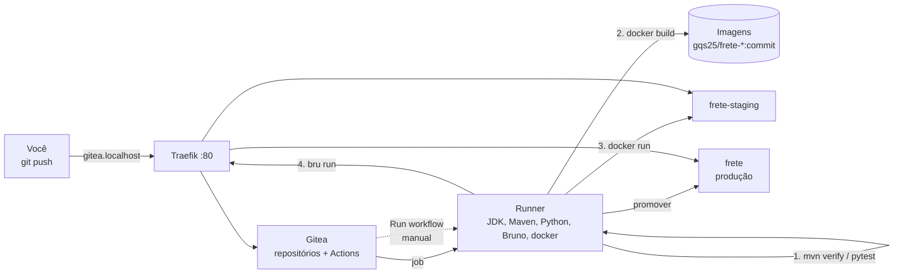

# Tutorial GQS25 — CI/CD na prática com Gitea Actions: do `git push` à produção

**Aula 25 — Garantia da Qualidade de Software** | Prof. Giovane Barcelos
**Duração estimada:** 2h (Parte I, Java) + 30 min (Parte II, Python)
**Pré-requisitos:** Docker + Docker Compose e Git. JDK 17, Maven, Python e Node são **opcionais** — o pipeline roda tudo dentro do runner; eles só servem para rodar os testes na sua máquina antes do push. A **Etapa 0** mostra como instalar.
**Arquivos do laboratório:** pasta `class25/lab-gitea/` do repositório <https://github.com/giovanebarcelos/gqs-sandbox> (Etapa 0.4).

---

## O que você vai construir

Uma esteira de CI/CD completa rodando na sua máquina — servidor Git, executor de pipelines, ambientes de staging e produção — acessada por nomes amigáveis no navegador:

| URL | O que é | Quem cria |
|---|---|---|
| `http://gitea.localhost` | **Gitea** — servidor Git com **Gitea Actions** (pipelines em YAML, sintaxe do GitHub Actions) | `docker compose` |
| `http://frete-staging.localhost` | API de frete **Java** em **staging** (homologação) | o pipeline, a cada push |
| `http://frete.localhost` | API de frete **Java** em **produção** | a promoção manual |
| `http://frete-python-staging.localhost` | API de frete **Python** em staging | o pipeline |
| `http://frete-python.localhost` | API de frete **Python** em produção | a promoção manual |
| `http://traefik.localhost` | Painel do **Traefik**, o proxy reverso | `docker compose` |

Repare na terceira coluna: **as aplicações não estão no `docker-compose.yml`**. O compose sobe só a infraestrutura de CI/CD. Quem publica a API — e decide se ela pode ser publicada — é o pipeline. É exatamente o cenário "depois do CI/CD" do Slide 6 da aula.

A aplicação é a **API de frete da LojaOnline** (a equipe fictícia dos Slides 6 e 17), em duas implementações idênticas — mesmas rotas, mesmas regras e **os mesmos dois defeitos plantados**:

| | Parte I — Java (principal) | Parte II — Python |
|---|---|---|
| Aplicação | Spring Boot 3.5 (`frete-java/`) | Flask 3 (`frete-python/`) |
| Teste unitário + gate de cobertura | JUnit 5 + JaCoCo (`check` ≥ 80%) | pytest + pytest-cov (`--cov-fail-under=80`) |
| Teste de API em staging | Bruno (`bruno/Frete-API`) | Bruno (mesma coleção) |
| Pipeline | `.gitea/workflows/pipeline.yml` | `.gitea/workflows/pipeline.yml` |
| Promoção para produção | `.gitea/workflows/promover-producao.yml` | idem |

Ao longo do tutorial você vai:

1. subir um Gitea com runner próprio e enviar o projeto com `git push`;
2. ver o pipeline **parar no teste unitário** (defeito 1) — nada é publicado;
3. corrigir e ver a versão chegar em **staging**, onde os **testes de API** pegam o defeito 2 — e a promoção para produção é **recusada**;
4. corrigir de novo, ver tudo verde e **promover para produção** com um clique (CD *Delivery*);
5. sabotar o pipeline com `continue-on-error` e ver por que é o anti-padrão mais perigoso do tema;
6. fazer **rollback** para a versão anterior, também com um clique;
7. abrir um **pull request** e ver o pipeline validar sem publicar nada;
8. repetir o ciclo com a versão **Python**.



### Estrutura da pasta

```
class25/lab-gitea/
├── GQS25-Tutorial-CICD-Gitea.md       ← este tutorial
├── docker-compose.yml                 ← Traefik + Gitea + runner (a infraestrutura)
├── .env.example                       ← token do runner e porta (copie para .env)
├── runner/                            ← imagem do runner: act_runner + JDK 17, Maven,
│   ├── Dockerfile                        Python, Node, Bruno CLI e cliente Docker
│   └── entrypoint.sh
├── scripts/limpar-ambientes.sh        ← remove staging/produção e as imagens geradas
├── frete-java/                        ← PARTE I — vira o repositório aluno/frete-java
│   ├── .gitea/workflows/
│   │   ├── pipeline.yml               ← testes → imagem → staging → testes de API
│   │   └── promover-producao.yml      ← produção, disparado à mão
│   ├── pom.xml  ·  Dockerfile
│   ├── src/main/java/br/edu/gqs/frete/
│   │   ├── CalculadoraFrete.java      ← regras de negócio (defeito 1!)
│   │   ├── FreteInvalidoException.java← (defeito 2!)
│   │   └── FreteController.java  ·  Regiao.java  ·  ...
│   ├── src/test/java/...              ← JUnit 5: 10 testes de regra + 5 de HTTP
│   ├── bruno/Frete-API/               ← 7 testes de API (rodam contra staging)
│   └── scripts/deploy.sh              ← publica uma versão num ambiente
└── frete-python/                      ← PARTE II — vira o repositório aluno/frete-python
    ├── .gitea/workflows/  ·  frete/  ·  tests/  ·  bruno/  ·  scripts/deploy.sh
    └── requirements.txt  ·  requirements-dev.txt  ·  Dockerfile
```

### Números de referência

Medidos ao executar este tutorial do início ao fim (Gitea 28.2, act_runner 0.6.1, Traefik 3.6, Bruno CLI 4.3):

| Momento | Java | Python |
|---|---|---|
| 1º push (defeito 1) | job 1 falha: **15 testes, 1 falha** (`pedidoDeExatamente200TemFreteGratis`); jobs 2–4 **pulados** | **16 testes, 1 falha**; jobs 2–4 pulados |
| 2º push (defeito 1 corrigido) | jobs 1–3 verdes, staging no ar; job 4 falha: **Bruno 5 de 7** (API05 e API06 → HTTP 500) | idem |
| 3º push (defeito 2 corrigido) | **4 jobs verdes**; imagem marcada como `homologada` | idem |
| Cobertura de linhas | **98,1%** (51 de 52) — gate em 80% | **96,3%** — gate em 80% |
| Duração de um pipeline | ~40 s no 1º (baixa as dependências do Maven), ~20 s nos seguintes | ~20 s |
| Promoção para produção | ~3 s | ~3 s |

> A primeira execução do job "2. Imagem Docker" demora mais (1 a 2 min): o Docker baixa as imagens `maven` e `eclipse-temurin`. Nas seguintes, o cache resolve.

---

# ETAPA 0 — Preparar a máquina (15 a 30 min, só uma vez)

### 0.1 O que instalar

| Ferramenta | Versão mínima | Para quê | Obrigatório? |
|---|---|---|---|
| Git | qualquer recente | clonar o repositório e fazer `push` para o Gitea | **sim** |
| Docker + Docker Compose v2 | Compose 2.20+ | subir Traefik, Gitea e o runner; o runner usa o Docker para publicar a API | **sim** |
| JDK 17+ e Maven 3.9+ | — | rodar `mvn verify` **antes** do push (Parte I) | opcional |
| Python 3.10+ | — | rodar o `pytest` antes do push (Parte II) | opcional |
| Node.js 18+ e Bruno CLI | — | rodar os testes de API na sua máquina | opcional |

O pipeline **não usa** nada disso da sua máquina: o runner tem a própria cópia de JDK, Maven, Python e Bruno (veja `runner/Dockerfile`). É a primeira lição de CI: **o build não depende da máquina de ninguém**.

**Linux (Ubuntu/Debian/Fedora):**

```bash
curl -fsSL https://get.docker.com | sudo sh
sudo systemctl enable --now docker
sudo usermod -aG docker $USER        # saia e entre de novo na sessão depois disto
sudo apt install -y git              # Fedora: sudo dnf install -y git
# opcionais: sudo apt install -y openjdk-21-jdk maven python3 python3-venv nodejs npm
```

**Windows 10/11** (PowerShell; o Docker Desktop precisa do WSL 2 — `wsl --install` como administrador, depois reinicie):

```powershell
winget install -e --id Git.Git
winget install -e --id Docker.DockerDesktop
# opcionais: EclipseAdoptium.Temurin.21.JDK, Python.Python.3.12, OpenJS.NodeJS.LTS
```

Abra o Docker Desktop e espere *Engine running*. Use o **Git Bash** como terminal: todos os comandos do tutorial rodam nele sem adaptação.

**macOS** (com [Homebrew](https://brew.sh)):

```bash
brew install --cask docker           # abra o Docker Desktop uma vez
brew install git                     # opcionais: openjdk@21 maven python@3.12 node
```

### 0.2 Conferir

```bash
git --version
docker --version
docker compose version               # precisa ser v2.x
docker run --rm hello-world
```

### 0.3 Identidade do Git

O Gitea mostra o autor de cada commit; configure uma vez:

```bash
git config --global user.name  "Seu Nome"
git config --global user.email "seu.email@exemplo.com"
```

### 0.4 Baixar o repositório

```bash
git clone https://github.com/giovanebarcelos/gqs-sandbox.git
cd gqs-sandbox/class25/lab-gitea
```

Já tem o repositório? `cd gqs-sandbox && git pull`.

**As Etapas 1 e 2 são executadas dentro de `gqs-sandbox/class25/lab-gitea`.** A partir da Etapa 3 você trabalha numa **cópia** do projeto, fora do `gqs-sandbox` (a Etapa 3.1 explica por quê).

---

# PARTE I — Versão Java

## Etapa 1 — Subir a infraestrutura de CI/CD (15 min)

### 1.1 Preparar o `.env`

```bash
cp .env.example .env
openssl rand -hex 20                 # gera 40 caracteres hexadecimais
```

Abra o `.env` e cole o valor gerado em `RUNNER_TOKEN`. É o segredo que o **runner** usa para se registrar no Gitea: o Gitea lê o mesmo valor ao subir, e o runner se apresenta com ele.

> Sem `openssl` (Windows fora do Git Bash)? Qualquer sequência de 40 caracteres `0-9a-f` serve. **O `.env` não vai para o Git** — já está no `.gitignore`. Token em arquivo versionado é o anti-padrão do Slide 11.

### 1.2 Verificar a porta 80

O Traefik usa a porta 80 da sua máquina. Se ela estiver ocupada (outro servidor web, o lab da Aula 23B ou 24 ainda rodando), descomente `HTTP_PORT=8882` no `.env` e **acrescente `:8882` em todas as URLs** deste tutorial (`http://gitea.localhost:8882`, ...).

```bash
# Linux/macOS: algo já escuta na 80?
sudo lsof -i :80 || echo "porta 80 livre"
```

### 1.3 Subir

```bash
docker compose up -d --build
```

A primeira vez demora alguns minutos: o Docker monta a imagem do runner (`runner/Dockerfile`), que instala JDK 17, Maven, Python, Node, o Bruno CLI e o cliente Docker sobre o `act_runner` oficial.

```bash
docker compose ps
# gqs25_gitea     ... Up (healthy)
# gqs25_runner    ... Up
# gqs25_traefik   ... Up

docker logs gqs25_runner | tail -3
# level=info msg="Runner registered successfully."
# ... runner: gqs25-runner, with version: v0.6.1, with labels: [gqs-runner], declare successfully
```

### 1.4 Criar o seu usuário

A tela de instalação do Gitea foi pulada (`INSTALL_LOCK`) e o cadastro público está desligado. Crie o administrador pela linha de comando — **troque a senha**:

```bash
docker exec -u git gqs25_gitea gitea admin user create --admin \
  --username aluno --email aluno@gqs.local \
  --password 'Troque-esta-senha!' --must-change-password=false
# New user 'aluno' has been successfully created!
```

> Pode usar outro nome de usuário: troque `aluno` também nas URLs dos `git remote` das próximas etapas.

### 1.5 Conferir no navegador

1. Abra `http://gitea.localhost` e entre com `aluno` e a senha.
2. Avatar (canto superior direito) → **Site Administration** → **Actions** → **Runners**: o `gqs25-runner` aparece com o rótulo `gqs-runner` e o estado **Idle** (ocioso, esperando trabalho).
3. Abra `http://traefik.localhost`: em *HTTP Routers*, aparecem as rotas do Gitea e do painel. As das APIs ainda não existem — o pipeline ainda não publicou nada.

| Problema | Solução |
|---|---|
| `gitea.localhost` não abre | use Chrome, Edge ou Firefox (resolvem `*.localhost` sozinhos); em outros, acrescente `127.0.0.1 gitea.localhost frete.localhost frete-staging.localhost` ao arquivo `hosts` |
| Runner não aparece / `Waiting to retry` no log | `RUNNER_TOKEN` vazio ou diferente; corrija o `.env` e rode `docker compose up -d --force-recreate` |
| Página do Traefik com *404* | a porta não é a 80: use a `HTTP_PORT` do `.env` na URL |

---

## Etapa 2 — Conhecer a aplicação e o pipeline (15 min)

### 2.1 Regras de negócio (o "requisito")

`POST /api/frete` recebe `{"regiao": "SUL", "pesoKg": 2.0, "valorPedido": 100.00}` e devolve o frete e o prazo:

| Regra | Descrição |
|---|---|
| **R1** | frete = base da região + **R$ 2,50 por kg (ou fração) acima de 1 kg** |
| **R2** | pedidos **a partir de R$ 200,00** têm frete grátis |
| **R3** | peso aceito: maior que 0 e **no máximo 30 kg**; fora disso, **HTTP 400** com a mensagem do erro |
| **R4** | região desconhecida: **HTTP 400** |

| Região | Base | Prazo |
|---|---|---|
| SUL | R$ 15,00 | 3 dias |
| SUDESTE | R$ 18,00 | 2 dias |
| CENTRO_OESTE | R$ 25,00 | 5 dias |
| NORDESTE | R$ 30,00 | 7 dias |
| NORTE | R$ 35,00 | 9 dias |

Endpoints: `GET /api/health` (com a **versão publicada**), `GET /api/regioes` e `POST /api/frete`.

### 2.2 O pipeline, job por job

Abra `frete-java/.gitea/workflows/pipeline.yml`. Ele implementa as etapas do Slide 7 da aula:

| Job | Etapa do Slide 7 | O que faz | Se falhar... |
|---|---|---|---|
| **1. Build, testes unitários e cobertura** | 1–3 e 6 | `mvn -B verify`: compila, roda JUnit e o `jacoco:check` reprova abaixo de 80% de linhas | nada é empacotado |
| **2. Imagem Docker** | 7 | `docker build -t gqs25/frete-java:<commit>` | nada é publicado |
| **3. Deploy em staging** | 8 | `scripts/deploy.sh staging <commit>` → `http://frete-staging.localhost` | staging continua com a versão anterior |
| **4. Testes de API em staging** | 9 | `bru run --env Staging`; se passar, marca a imagem como `<commit>-homologada` | a versão **não pode ir para produção** |

Três detalhes do YAML que valem ouro:

- **`needs:`** encadeia os jobs. Sem ele, os quatro rodariam em paralelo — e o deploy aconteceria mesmo com teste vermelho (Slide 21).
- **`if: github.event_name == 'push'`** no job 2: num *pull request* o pipeline só **valida**; publicar é coisa do `main` (Etapa 8).
- **`runs-on: gqs-runner`** escolhe o runner pelo rótulo. O `docker-compose.yml` registra o runner com `gqs-runner:host`: o job roda **dentro do container do runner**, que já tem as ferramentas. No GitHub, o equivalente seria `runs-on: ubuntu-latest` + `actions/setup-java` (Aula 26).

E o segundo workflow, `promover-producao.yml`, tem gatilho **`workflow_dispatch`**: só roda quando alguém clica em **Run workflow** e informa a versão. É o **CD *Delivery*** do Slide 5 — o artefato está pronto, mas a decisão de publicar é humana. Antes de publicar, ele confere se existe a imagem `<versao>-homologada`: **só vai para produção o que passou em staging**.

> **Gitea Actions × GitHub Actions:** a sintaxe é a mesma e as actions vêm do próprio GitHub (`actions/checkout@v7`). Mas a compatibilidade não é total — o `upload-artifact` precisa ficar na **v3**, porque a v4 em diante usa uma API de artefatos que só existe no GitHub.com (erro `GHESNotSupportedError`). A Aula 26 usa a versão atual.

### 2.3 (Opcional) Rodar os testes na sua máquina

Boa prática do Slide 9 — *nunca commitar código com testes quebrados*:

```bash
mvn -f frete-java/pom.xml -q verify
# [ERROR] Tests run: 15, Failures: 1 ...  CalculadoraFreteTest.pedidoDeExatamente200TemFreteGratis
```

Falhou? Ótimo: é o defeito 1. Faça o push assim mesmo — a Etapa 3 mostra o pipeline fazendo o papel de quem esqueceu de rodar os testes.

---

## Etapa 3 — Primeiro push: o pipeline barra o defeito 1 (15 min)

### 3.1 Criar o seu repositório

O projeto `frete-java` vira um repositório **próprio**, separado do `gqs-sandbox`. Copie a pasta para fora do clone — um repositório Git dentro de outro confunde os dois:

```bash
cp -r frete-java ~/frete-java
cd ~/frete-java
git init -b main
git add .
git commit -m "API de frete: versao inicial"
git remote add origin http://gitea.localhost/aluno/frete-java.git
git push -u origin main
```

O Git pede usuário e senha: `aluno` e a senha da Etapa 1.4. O repositório **não precisava existir**: o Gitea está configurado para criá-lo no primeiro push (`ENABLE_PUSH_CREATE_USER`).

> **De agora em diante, os comandos rodam em `~/frete-java`**, a menos que digam o contrário.

### 3.2 Acompanhar a execução

No Gitea, abra o repositório `aluno/frete-java` → aba **Actions**. A execução "API de frete: versao inicial" aparece com o ícone amarelo (em andamento) e, em menos de um minuto, fica **vermelha**:

| Job | Resultado |
|---|---|
| 1. Build, testes unitários e cobertura | ❌ **failure** |
| 2. Imagem Docker | ⊘ skipped |
| 3. Deploy em staging | ⊘ skipped |
| 4. Testes de API em staging | ⊘ skipped |

Clique no job 1 e abra o passo **mvn verify**:

```text
[ERROR] Tests run: 10, Failures: 1, Errors: 0, Skipped: 0 <<< FAILURE! -- in br.edu.gqs.frete.CalculadoraFreteTest
[ERROR] br.edu.gqs.frete.CalculadoraFreteTest.pedidoDeExatamente200TemFreteGratis <<< FAILURE!
org.opentest4j.AssertionFailedError: R2: a partir de R$ 200,00 o frete e' gratis ==> expected: <true> but was: <false>
```

Na página da execução, em **Artifacts**, baixe `relatorios-java`: tem os relatórios do Surefire e o HTML do JaCoCo. O passo de upload tem `if: always()` — os relatórios são guardados **justamente** quando o build falha, que é quando mais se precisa deles.

### 3.3 O que **não** aconteceu

```bash
curl -s http://frete-staging.localhost/api/health
# 404 page not found        <- nenhum ambiente foi criado
docker images gqs25/frete-java
# (vazio)                   <- nenhuma imagem foi gerada
```

Isso é o **fail fast** do Slide 15: o defeito foi detectado em segundos, isolado ao commit que o causou, **antes** de existir qualquer artefato. Compare com o "antes do CI/CD" do Slide 6, onde quem descobre o bug é o cliente.

---

## Etapa 4 — Corrigir o defeito 1; staging pega o defeito 2 (20 min)

### 4.1 A correção

`src/main/java/br/edu/gqs/frete/CalculadoraFrete.java`, regra R2 — "a partir de" inclui o próprio valor:

```diff
-        boolean gratis = valorPedido.compareTo(LIMITE_FRETE_GRATIS) > 0;
+        boolean gratis = valorPedido.compareTo(LIMITE_FRETE_GRATIS) >= 0;
```

```bash
mvn -q verify                        # opcional: agora passa (15 testes, 0 falhas)
git commit -am "Corrige frete gratis: a partir de R\$ 200,00 (>=)"
git push
```

### 4.2 O pipeline avança — e para mais adiante

| Job | Resultado |
|---|---|
| 1. Build, testes unitários e cobertura | ✅ |
| 2. Imagem Docker | ✅ `gqs25/frete-java:<commit>` |
| 3. Deploy em staging | ✅ `http://frete-staging.localhost` |
| 4. Testes de API em staging | ❌ **failure** |

No log do job 4, passo **Bruno contra staging**:

```text
   ✓ API01 - Health responde 200 com status ok e a versao publicada
   ✓ API02 - Lista as 5 regioes atendidas
   ✓ API03 - Sul, 2 kg, R$ 100: frete R$ 17,50 em 3 dias
   ✓ API04 - Pedido de exatamente R$ 200,00 tem frete gratis
   ✕ API05 - Peso acima de 30 kg responde 400 com a mensagem do erro
   ✕ API06 - Peso zero responde 400
   ✓ API07 - Regiao desconhecida responde 400
│ Requests      │ 7 (5 Passed, 2 Failed) │
```

Confira você mesmo — staging está no ar, com a versão do seu commit:

```bash
git rev-parse --short=7 HEAD                         # a versão = 7 primeiros caracteres do commit
curl -s http://frete-staging.localhost/api/health
# {"status":"ok","versao":"1862d8a"}
curl -s -X POST http://frete-staging.localhost/api/frete \
     -H "Content-Type: application/json" \
     -d '{"regiao":"SUL","pesoKg":31,"valorPedido":100}'
# {"timestamp":"...","status":500,"error":"Internal Server Error","path":"/api/frete"}
```

### 4.3 Por que os testes unitários não pegaram?

O teste unitário `pesoAcimaDe30KgERejeitado` **passa**: a regra lança `FreteInvalidoException`, como deveria. O defeito está **entre** a regra e o HTTP — o controller só traduz `IllegalArgumentException` em 400, e a exceção nova herda de `RuntimeException`:

```java
public class FreteInvalidoException extends RuntimeException {       // <- não é IllegalArgumentException
```

```java
@ExceptionHandler(IllegalArgumentException.class)                    // <- não alcança a exceção acima
public ResponseEntity<Map<String, String>> entradaInvalida(...)
```

Cada camada de teste do Slide 15 enxerga uma coisa: o teste unitário prova a **regra**; o teste de API em staging prova o **sistema montado**, com HTTP, serialização e tratamento de erro de verdade.

### 4.4 Tentar promover assim mesmo

Staging está no ar. Dá para mandar essa versão para produção? Tente:

1. Aba **Actions** → na lista da esquerda, **Promover para producao**.
2. Aparece *"This workflow has a workflow_dispatch event trigger."* → **Run Workflow**.
3. Em *Versao homologada*, digite a versão do `curl` acima (ex.: `1862d8a`) → **Run Workflow**.

```text
A versao 1862d8a NAO foi homologada em staging - promocao recusada.
❌ Failure - Main Conferir se a versao passou em staging
```

E `http://frete.localhost` continua sem responder: **produção nunca recebeu uma versão reprovada**. A trava não depende de alguém lembrar de olhar o pipeline — ela está no próprio workflow.

> **Teste de segurança:** rode a promoção digitando `abc; rm -rf /` como versão. O workflow recusa com *"Versao invalida"*. O valor do formulário entra por **variável de ambiente** e é validado com uma expressão regular, nunca colado direto no script com `${{ }}` — essa é a defesa contra injeção de comandos em workflows.

---

## Etapa 5 — Corrigir o defeito 2 e promover para produção (15 min)

### 5.1 A correção

`src/main/java/br/edu/gqs/frete/FreteInvalidoException.java` — peso inválido **é** um argumento inválido:

```diff
-public class FreteInvalidoException extends RuntimeException {
+public class FreteInvalidoException extends IllegalArgumentException {
```

```bash
git commit -am "Corrige erro 500 com peso invalido: FreteInvalidoException vira 400"
git push
```

### 5.2 Pipeline verde

Os quatro jobs ficam verdes. No fim do job 4:

```text
Versao 6bac153 homologada. Para publicar em producao, rode o
workflow 'Promover para producao' informando: 6bac153
```

```bash
docker images gqs25/frete-java --format '{{.Tag}}'
# 6bac153-homologada        <- a "etiqueta" que libera a promoção
# 6bac153
# 1862d8a                   <- a versão reprovada continua aqui, mas sem etiqueta
```

### 5.3 Promover

**Actions** → **Promover para producao** → **Run Workflow** → versão `6bac153` (a sua será outra) → **Run Workflow**. Em ~3 segundos:

```bash
curl -s http://frete.localhost/api/health
# {"status":"ok","versao":"6bac153"}
curl -s -X POST http://frete.localhost/api/frete \
     -H "Content-Type: application/json" \
     -d '{"regiao":"SUL","pesoKg":31,"valorPedido":100}'
# {"erro":"Peso deve ser maior que 0 e no maximo 30 kg"}
```

Abra `http://traefik.localhost`: agora há rotas para `frete-staging.localhost` e `frete.localhost`, criadas pelo `deploy.sh` com *labels* no container — o Traefik descobre os containers novos sozinho.

> **Anote a versão em produção** (ex.: `6bac153`). Ela é o ponto de retorno da Etapa 7.

---

## Etapa 6 — Anti-padrão: `continue-on-error` (15 min)

O Slide 21 avisa: *`continue-on-error: true` no job de teste faz o pipeline ficar verde mesmo com teste quebrado*. Vamos provar.

### 6.1 Sabotar

Um colega "refatora" o cálculo e reintroduz o defeito 1. Para "destravar" o pipeline, liga o `continue-on-error`:

```bash
sed -i 's/compareTo(LIMITE_FRETE_GRATIS) >= 0/compareTo(LIMITE_FRETE_GRATIS) > 0/' \
    src/main/java/br/edu/gqs/frete/CalculadoraFrete.java
```

E em `.gitea/workflows/pipeline.yml`, no passo do Maven:

```diff
       - name: mvn verify (JUnit + JaCoCo check)
         run: mvn -B verify
+        continue-on-error: true
```

> No macOS, o `sed -i` exige um argumento a mais: `sed -i '' 's/.../.../' arquivo`. Ou edite o arquivo à mão.

```bash
git commit -am "Refatora calculo do frete (e liga continue-on-error)"
git push
```

### 6.2 O que acontece

| Job | Resultado |
|---|---|
| 1. Build, testes unitários e cobertura | ✅ **success** — com `BUILD FAILURE` e `Tests run: 15, Failures: 1` no log! |
| 2. Imagem Docker | ✅ a versão defeituosa foi empacotada |
| 3. Deploy em staging | ✅ **a versão defeituosa está em staging** |
| 4. Testes de API em staging | ❌ API04 falhou |

Desta vez quem salvou foi a camada de cima: o teste de API **API04** também cobre a regra R2. Mas repare no estrago:

- o job 1 está **verde** com teste quebrado — quem olhar só o ícone não vê nada;
- staging recebeu uma versão defeituosa, e quem estiver homologando nela está testando código reprovado;
- se a regra **não** tivesse teste de API, a versão seria **homologada** e iria para produção com um clique.

### 6.3 Desfazer

`git revert` cria um commit novo que desfaz o anterior — sem reescrever o histórico que já foi para o servidor:

```bash
git revert --no-edit HEAD
git push
```

O pipeline volta a ficar verde e a versão do revert é homologada. **Não promova ainda** — a próxima etapa usa as duas versões homologadas.

---

## Etapa 7 — Promover e fazer rollback (10 min)

Você tem duas versões homologadas: a da Etapa 5 (ex.: `6bac153`) e a do revert (`git rev-parse --short=7 HEAD`).

1. **Promova a do revert.** `curl -s http://frete.localhost/api/health` mostra a versão nova.
2. Imagine que um cliente reportou um problema logo depois. **Rollback:** rode a promoção de novo, informando a versão anterior (`6bac153`).

```bash
curl -s http://frete.localhost/api/health
# {"status":"ok","versao":"6bac153"}      <- de volta em ~3 segundos
```

Não houve rebuild, nem novo teste, nem acesso ao servidor: a imagem homologada **já existia**. Rollback rápido é uma consequência de três decisões do pipeline:

- versionar cada build pelo commit;
- guardar as imagens;
- separar "construir" de "publicar".

Isso derruba diretamente o **MTTR** das métricas DORA (Slide 20).

> **Para ir além (Slide 16):** o `deploy.sh` derruba o container antigo e sobe o novo — há alguns segundos sem serviço. Um deploy **blue-green** subiria o novo ao lado, esperaria o *health* responder e só então trocaria a rota no Traefik. Experimente: o script já espera o *health* antes de terminar.

---

## Etapa 8 — Pull request: validar sem publicar (10 min)

```bash
git switch -c feature/prazo-sudeste
sed -i 's/SUDESTE("18.00", 2)/SUDESTE("18.00", 1)/' src/main/java/br/edu/gqs/frete/Regiao.java
git commit -am "Sudeste entrega em 1 dia"
git push -u origin feature/prazo-sudeste
```

No Gitea aparece o aviso para abrir o pull request (ou: **Pull Requests** → **New Pull Request**, `feature/prazo-sudeste` → `main`). Crie-o e veja a execução disparada pelo evento `pull_request`:

| Job | Resultado |
|---|---|
| 1. Build, testes unitários e cobertura | ✅ |
| 2, 3 e 4 | ⊘ **skipped** — `if: github.event_name == 'push'` |

O revisor vê, **dentro do PR**, que os testes passaram, antes de aprovar. Nada foi publicado: a branch ainda não é o `main`. Quando você fizer o merge, o push no `main` dispara o pipeline completo.

> **Pergunta para o relatório:** a mudança alterou o prazo do Sudeste e **todos os testes passaram**. Isso prova que a mudança está certa? Que teste faltou?

> **Para ir além:** em *Settings* → *Branches* do repositório, crie uma regra de proteção para o `main` exigindo que o status check do pipeline passe antes do merge — é a *Branch Protection Rule* da Aula 26, Slide 11.

---

# PARTE II — Versão Python

## Etapa 9 — O mesmo ciclo com Python (30 min)

O runner já tem Python; nada muda na infraestrutura. O pipeline Python cria um *virtualenv*, instala `requirements-dev.txt` e roda:

```bash
pytest -v --cov --cov-report=term-missing --cov-report=html:relatorio-cobertura \
       --cov-fail-under=80 --junitxml=resultados-unitarios.xml
```

O `--cov-fail-under=80` é o gate de cobertura embutido no próprio comando de teste (Slide 14).

### 9.1 Primeiro push

A partir de `gqs-sandbox/class25/lab-gitea`:

```bash
cp -r frete-python ~/frete-python
cd ~/frete-python
git init -b main
git add .
git commit -m "API de frete (Python): versao inicial"
git remote add origin http://gitea.localhost/aluno/frete-python.git
git push -u origin main
```

Job 1 falha: **16 testes, 1 falha** (`test_pedido_de_exatamente_200_tem_frete_gratis`). A cobertura (96,3%) passa no gate — mas teste vermelho reprova antes.

### 9.2 Defeito 1

`frete/calculadora.py`:

```diff
-    gratis = valor_pedido > LIMITE_FRETE_GRATIS
+    gratis = valor_pedido >= LIMITE_FRETE_GRATIS
```

```bash
git commit -am "Corrige frete gratis: a partir de R\$ 200,00 (>=)"
git push
```

Jobs 1–3 verdes; staging em `http://frete-python-staging.localhost`; job 4 falha com **API05 e API06 em HTTP 500** — a mesma coleção Bruno, com o ambiente `Staging` apontando para a versão Python.

### 9.3 Defeito 2

O `app.py` traduz `ValueError` em 400, mas a exceção da regra herda de `Exception`:

```diff
-class FreteInvalido(Exception):
+class FreteInvalido(ValueError):
```

```bash
git commit -am "Corrige erro 500 com peso invalido: FreteInvalido vira 400"
git push
```

Pipeline verde → **Actions** → **Promover para producao** → versão do commit → `http://frete-python.localhost/api/health` responde com ela.

| | Java | Python |
|---|---|---|
| Gate de cobertura | `jacoco:check` no `pom.xml` (`mvn verify` falha) | `--cov-fail-under=80` (o `pytest` falha) |
| Relatórios guardados | `target/surefire-reports/` e `target/site/jacoco/` | `resultados-unitarios.xml` e `relatorio-cobertura/` |
| Defeito 2 | `FreteInvalidoException extends RuntimeException` | `class FreteInvalido(Exception)` |
| O resto do pipeline | idêntico: imagem, staging, Bruno, homologação, promoção | |

---

## Etapa 10 — Encerrar o ambiente

```bash
cd gqs-sandbox/class25/lab-gitea
./scripts/limpar-ambientes.sh        # remove staging, produção e as imagens gqs25/*
docker compose down                  # para Gitea, runner e Traefik, mantendo os dados
```

`docker compose down -v` apaga também o Gitea (repositórios, usuários, histórico de execuções) e o cache do runner. Seus repositórios locais em `~/frete-java` e `~/frete-python` continuam intactos.

---

## Armadilhas conhecidas

| Sintoma | Causa | Solução |
|---|---|---|
| Execução fica em **Waiting** para sempre | nenhum runner com o rótulo do `runs-on` | confira em *Site Administration → Actions → Runners*; `docker logs gqs25_runner` |
| `exit status 126` no deploy | script sem permissão de execução (cópia pelo Windows, por exemplo) | os workflows chamam `bash scripts/deploy.sh`, que não depende do bit `x` |
| `GHESNotSupportedError` no upload de artefatos | `actions/upload-artifact@v4` ou mais novo no Gitea | use a `@v3` no Gitea; a atual no GitHub |
| Bruno no pipeline: `getaddrinfo ENOTFOUND frete-staging.localhost` | dentro do container, `*.localhost` não resolve sozinho | o `extra_hosts` do serviço `runner` mapeia os nomes; um ambiente novo precisa entrar na lista |
| `curl` do deploy recebe **HTTP 400** do Spring | nome de host com `_` (o Tomcat recusa) | por isso os containers se chamam `gqs25-frete-java-staging`, com hífen |
| Promoção recusada com versão "certa" | versão não passou no job 4, ou foi digitada com mais de 7 caracteres | use `git rev-parse --short=7 HEAD` e confira a tag `-homologada` com `docker images` |
| `git push` pede senha toda vez | o Git não guardou a credencial | `git config --global credential.helper store` (grava em texto puro — só em laboratório) |
| `docker compose up` reclama de `RUNNER_TOKEN` | `.env` ausente ou sem o token | Etapa 1.1 |

**Sobre o `docker.sock` no runner:** montar o socket dá ao pipeline controle total do Docker da máquina — é o que permite gerar imagens e subir ambientes aqui. Num servidor compartilhado, isso exige um runner **dedicado** e confiável, porque qualquer workflow de qualquer repositório ganharia esse poder. É uma decisão de segurança, não um detalhe de configuração (DevSecOps, Aula 26).

---

## Perguntas para o relatório

1. No primeiro push, por que **nenhuma imagem** foi gerada? Que linha do `pipeline.yml` garante isso?
2. O defeito 2 passou pelos testes unitários e foi pego em staging. Escreva um teste **MockMvc** (Java) ou com o `test_client` (Python) que o pegaria **já no job 1**. Que vantagem isso traz para o tempo de feedback?
3. A cobertura do projeto Java é 98,1% e mesmo assim havia dois defeitos. O que a cobertura mede e o que ela **não** mede?
4. Na Etapa 6, o job 1 ficou verde com `BUILD FAILURE` no log. Em que situação o `continue-on-error` é aceitável? (Dica: pense num passo que **não** decide a qualidade, como publicar um relatório opcional.)
5. A promoção para produção é manual. Que mudança no `pipeline.yml` transformaria este CD **Delivery** em CD **Deploy**? Que risco isso traz, e que estratégia do Slide 16 o reduziria?
6. Calcule, com os horários da aba **Actions**, o *Lead Time for Changes* (Slide 20) da correção do defeito 2: do `git push` até a versão responder em `frete.localhost`. Quanto disso foi espera por uma decisão humana?
7. O rollback levou segundos. Que três decisões do pipeline tornaram isso possível? Qual métrica DORA ele melhora?

---

## O que entregar

1. Print da aba **Actions** do `frete-java` mostrando a sequência: vermelho no job 1 → vermelho no job 4 → verde → promoção recusada → promoção com sucesso.
2. Print do log do job 4 com **API05 e API06** falhando.
3. Saída de `curl http://frete.localhost/api/health` antes e depois do rollback.
4. Print da Etapa 6 (job 1 **verde** com `BUILD FAILURE` no log) e o commit de `git revert`.
5. O `git diff` das duas correções (Java **ou** Python).
6. Respostas às perguntas acima.
