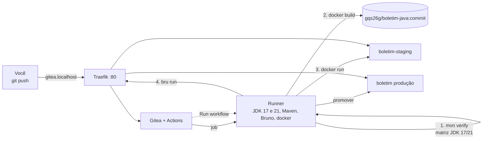

# Tutorial GQS26 (versão Java) — Gitea Actions: testes, mocks, integração, API e cobertura numa esteira própria

**Aula 26 — Garantia da Qualidade de Software** | Prof. Giovane Barcelos
**Duração estimada:** 2h
**Esta é a versão só Java.** Usa a mesma pasta `class26/lab-gitea/` do tutorial completo ([`GQS26-Tutorial-GiteaActions.md`](GQS26-Tutorial-GiteaActions.md), que também cobre Python), mas **remove o Python** com um script e segue apenas o Java (Spring Boot 3.5 + JUnit 5 + Mockito + JaCoCo + Bruno).
**Pré-requisitos:** Docker + Docker Compose v2 e Git. JDK 17+ e Maven são opcionais (rodar os testes antes do push).
**Arquivos:** pasta `class26/lab-gitea/` de <https://github.com/giovanebarcelos/gqs-sandbox>.

---

## O que você vai construir

| URL | O que é | Quem cria |
|---|---|---|
| `http://gitea.localhost` | **Gitea** — Git + **Gitea Actions** | `docker compose` |
| `http://boletim-staging.localhost` | Boletim API Java em **staging** | o pipeline, a cada push |
| `http://boletim.localhost` | Boletim API Java em **produção** | a promoção manual |
| `http://cobertura.localhost` | relatório de **cobertura** JaCoCo dos testes da sua máquina | `--profile cobertura` |
| `http://traefik.localhost` | painel do **Traefik** | `docker compose` |

As aplicações **não estão** no compose: quem publica a API — e decide se pode — é o pipeline.

### Pirâmide de testes do pipeline (Java)

| Camada | O que prova | Arquivo | Quantos |
|---|---|---|---|
| Unitário | a regra de negócio isolada | `CalculadoraBoletimTest` (JUnit 5, parametrizado) | 14 |
| Mock | a conversa controller ↔ calculadora, com a calculadora trocada por dublê | `BoletimControllerMockTest` (Mockito `@MockitoBean`) | 5 |
| Camada HTTP | rotas e JSON sem subir servidor | `BoletimControllerTest` (`@WebMvcTest`) | 6 |
| Integração | a aplicação **inteira** por HTTP real, sem mocks | `BoletimIntegracaoIT` (`@SpringBootTest`, Failsafe) | 5 |
| API | o sistema **publicado** em staging | `bruno/Boletim-API` (Bruno) | 8 |
| Cobertura | quanto do código os testes executaram | JaCoCo, gate de **80%** de linhas | — |



---

## Etapa 0 — Preparar a máquina (uma vez)

Instale **Git** e **Docker** (Compose v2). Linux: `curl -fsSL https://get.docker.com | sudo sh && sudo usermod -aG docker $USER` (reentre na sessão). Windows: `winget install Git.Git Docker.DockerDesktop` e use o **Git Bash**. macOS: `brew install --cask docker && brew install git`. Opcionais: JDK 17+ e Maven.

```bash
git --version && docker compose version && docker run --rm hello-world
git config --global user.name  "Seu Nome"
git config --global user.email "seu.email@exemplo.com"
git clone https://github.com/giovanebarcelos/gqs-sandbox.git
cd gqs-sandbox/class26/lab-gitea
```

---

## Etapa 1 — Subir a infraestrutura (15 min)

```bash
cp .env.example .env
openssl rand -hex 20                 # cole a saída em RUNNER_TOKEN no .env
docker compose up -d --build         # 1ª vez: alguns minutos (monta a imagem do runner)
docker compose ps                    # gitea (healthy), runner, traefik
docker logs gqs26g_runner | tail -3  # "Runner registered successfully."

docker exec -u git gqs26g_gitea gitea admin user create --admin \
  --username aluno --email aluno@gqs.local \
  --password 'Troque-esta-senha!' --must-change-password=false
```

Abra `http://gitea.localhost`, entre com `aluno` e confira em *Site Administration → Actions → Runners* o `gqs26g-runner` **Idle** com o rótulo `gqs-runner`.

> **Porta 80 ocupada** (outro lab)? Descomente `HTTP_PORT=8886` no `.env` e acrescente `:8886` em todas as URLs. **`*.localhost` não abre?** Use Chrome/Edge/Firefox.

---

## Etapa 2 — Conhecer o projeto e o pipeline (20 min)

### 2.1 As regras

`POST /api/boletim` com `{"aluno":"Ana","notas":[7,9,8],"frequencia":90}`:

| Regra | Descrição |
|---|---|
| **R1** | média aritmética com 1 casa decimal (arredonda para cima no 5) |
| **R2** | frequência **abaixo de 75%** → `REPROVADO_POR_FALTA`; senão média ≥ 7,0 `APROVADO`, ≥ 4,0 `EXAME`, abaixo `REPROVADO` |
| **R3** | 1 a 4 notas de 0 a 10; frequência de 0 a 100; fora disso **HTTP 400** |

Rotas: `GET /api/health`, `POST /api/boletim`, `GET /api/admin/estatisticas` (exige `X-Admin-Token`, vindo de um **secret** — Etapa 6).

### 2.2 O mock em uma olhada

```java
@MockitoBean
private CalculadoraBoletim calculadora;                       // dublê no lugar do real

when(calculadora.calcular("Ana", List.of(7.0, 9.0), 90.0))    // STUB
        .thenReturn(new Boletim("Ana", new BigDecimal("1.0"), Situacao.REPROVADO, 9.0, 7.0, "resposta do mock"));
verify(calculadora).calcular("Ana", List.of(7.0, 9.0), 90.0); // VERIFY
```

Esse teste passa **mesmo com a regra errada** — de propósito: ele só verifica a *conversa* entre camadas. Quem verifica a regra é o unitário. Já o `BoletimIntegracaoIT` não tem mock: sobe a aplicação numa porta aleatória e fala HTTP de verdade; o sufixo **`IT`** faz o *maven-failsafe-plugin* rodá-lo **depois** dos unitários (que rodam no *surefire*).

### 2.3 O pipeline (`.gitea/workflows/ci-java.yml`)

| Job | O que faz | Se falhar... |
|---|---|---|
| **1. Testes (JDK 17 / 21)** | `mvn -B verify` em **matriz**: unitários + mocks → integração → JaCoCo → gate de 80% | nada é empacotado |
| **2. Imagem Docker** | `docker build -t gqs26g/boletim-java:<commit> java` | nada é publicado |
| **3. Deploy em staging** | `scripts/deploy.sh java staging <commit>` | staging fica como estava |
| **4. Testes de API** | `bru run --env Staging`; passou → imagem `<commit>-homologada` | não pode ir a produção |

`needs:` encadeia os jobs; `matrix` + `fail-fast: false` roda uma vez por JDK (o runner tem os dois; `JAVA_HOME` escolhe); `paths:` só dispara o pipeline quando muda `java/**`, `bruno/**`, `scripts/**`; `if: github.event_name != 'pull_request'` impede PR de publicar.

`promover-producao.yml` usa `workflow_dispatch`: só roda quando alguém clica em **Run workflow** e informa a versão, e só aceita versões com a imagem `-homologada` (CD *Delivery*).

**Gitea × GitHub:** `upload-artifact` precisa ser **`@v3`** (a v4+ não funciona no Gitea); não há `$GITHUB_STEP_SUMMARY` (números vão para o log); não há *Environments* com aprovação (a trava é o `workflow_dispatch`); o JDK já vem na imagem do runner (sem `setup-java`).

---

## Etapa 3 — Primeiro push: o pipeline barra os defeitos (20 min)

### 3.1 Criar o repositório (só Java)

```bash
cp -r boletim ~/boletim && cd ~/boletim
bash scripts/somente-java.sh         # remove python/, ci-python.yml e opções de Python
git init -b main && git add . && git commit -m "Boletim API: versao inicial"
git remote add origin http://gitea.localhost/aluno/boletim.git
git push -u origin main              # usuário aluno e a senha da Etapa 1
```

O Gitea cria o repositório no primeiro push. **Os comandos seguintes rodam em `~/boletim`.**

### 3.2 O pipeline falha — por dois motivos diferentes

Em `http://gitea.localhost/aluno/boletim/actions`, o **CI Java** fica vermelho:

| Job | Resultado |
|---|---|
| 1. Testes (JDK 17) | ❌ erro de **compilação** |
| 1. Testes (JDK 21) | ❌ **2 testes** falham |
| 2, 3, 4 | ⊘ pulados |

JDK 17:

```text
[ERROR] ... maven-compiler-plugin:3.14.0:compile ... Fatal error compiling: error: release version 21 not supported
```

JDK 21:

```text
[ERROR] Tests run: 14, Failures: 2 ... CalculadoraBoletimTest
[ERROR]   situacaoPelaMediaEFrequencia:45 expected: <APROVADO> but was: <REPROVADO_POR_FALTA>
[ERROR]   situacaoPelaMediaEFrequencia:45 expected: <EXAME> but was: <REPROVADO_POR_FALTA>
```

Repare: os 5 testes **com mock** e os 6 de **camada HTTP** passaram. O defeito está na regra e só o unitário parametrizado da **borda (75%)** o vê. Em **Artifacts** estão os relatórios (o upload tem `if: always()`).

```bash
curl -s http://boletim-staging.localhost/api/health   # 404: nenhum ambiente foi criado
docker images 'gqs26g/*'                              # vazio: nenhuma imagem
```

É o **fail fast**: o defeito parou antes de existir qualquer artefato.

---

## Etapa 4 — Corrigir o defeito 1; a matriz mostra o defeito 2 (10 min)

A regra diz "**abaixo de** 75%" reprova; o código usa `<=`. Em `java/src/main/java/br/edu/gqs/boletim/CalculadoraBoletim.java`:

```diff
-        if (frequencia <= FREQUENCIA_MINIMA) {
+        if (frequencia < FREQUENCIA_MINIMA) {
```

```bash
git commit -am "Corrige limite de frequencia: 75% aprova" && git push
```

**JDK 21 ✅** (25 unitários + 5 de integração, cobertura 100%) e **JDK 17 ❌** continua vermelho; os jobs 2–4 seguem pulados, porque o `needs` exige **toda** a matriz verde. Se o pipeline testasse só o JDK 21 estaria verde — e a produção, que roda **Java 17**, nem compilaria. A matriz pegou o que nenhum teste unitário pegaria.

---

## Etapa 5 — Corrigir o defeito 2: Java 17 (10 min)

O `pom.xml` exige Java 21 e o código usa `List.getFirst()/getLast()` (só existem desde o 21). Ajuste o código à produção:

`java/pom.xml`:

```diff
-        <java.version>21</java.version>
+        <java.version>17</java.version>
```

`CalculadoraBoletim.java`:

```diff
-        double menor = ordenadas.getFirst();
-        double maior = ordenadas.getLast();
+        double menor = ordenadas.get(0);
+        double maior = ordenadas.get(ordenadas.size() - 1);
```

```bash
git commit -am "Compatibiliza com Java 17 (a producao roda 17)" && git push
```

Agora os **5 jobs** ficam ✅. No job 4:

```text
   ✓ BOL01 ... ✓ BOL05 - 75% de frequencia (o minimo) nao reprova por falta ... ✓ BOL08
│ Requests      │ 8 (8 Passed) │
```

```bash
docker images 'gqs26g/*' --format '{{.Repository}}:{{.Tag}}'
# gqs26g/boletim-java:eee02b2-homologada   <- a "etiqueta" que libera a promoção
# gqs26g/boletim-java:eee02b2
curl -s http://boletim-staging.localhost/api/health
```

(Seus hashes serão outros.) Abra `http://traefik.localhost`: a rota de staging foi criada **pelo pipeline**, por *labels* do container.

### 5.1 Relatório de cobertura

Pelo Gitea: **Artifacts → `relatorios-java-21`** → `site/jacoco/index.html`. Ou na sua máquina:

```bash
cd ~/boletim/java && mvn -q verify                  # gera target/site/jacoco/
cd ~/gqs-sandbox/class26/lab-gitea
echo "BOLETIM_DIR=$HOME/boletim" >> .env
docker compose --profile cobertura up -d            # abra http://cobertura.localhost
```

Linhas **verdes** foram executadas pelos testes; **vermelhas**, não. Cobertura mede o que foi *executado*, não se está *certo* — a Etapa 3 mostrou defeitos convivendo com 100%.

---

## Etapa 6 — Secret e variável (10 min)

O `/api/admin/estatisticas` só responde a quem enviar `X-Admin-Token` igual ao `TOKEN_ADMIN`. Esse valor **nunca** vai para o repositório. No Gitea: repositório → **Settings → Actions**:

1. **Secrets → Add Secret**: `TOKEN_ADMIN` = `segredo-do-gitea-123` (invente o seu).
2. **Variables → Add Variable**: `INSTITUICAO` = `Faculdade GQS`.

Republique sem mexer no código: **Actions → CI Java → Run workflow**.

```bash
curl -s http://boletim-staging.localhost/api/health
# {"status":"ok","versao":"eee02b2","instituicao":"Faculdade GQS"}
curl -s -o /dev/null -w '%{http_code}\n' http://boletim-staging.localhost/api/admin/estatisticas   # 401
curl -s -H 'X-Admin-Token: segredo-do-gitea-123' http://boletim-staging.localhost/api/admin/estatisticas
# {"boletinsCalculados":5,"versao":"eee02b2"}
```

O valor do secret aparece como `***` nos logs. (O Gitea não tem *Environments*: o mesmo secret vale para staging e produção.)

---

## Etapa 7 — Promover para produção e rollback (10 min)

**Versão não homologada é recusada.** Pegue o hash do 1º commit (`git log --oneline --reverse | head -1`) e rode **Actions → Promover para producao → Run workflow** com ele:

```text
A versao a1b2c3d (java) NAO foi homologada em staging - promocao recusada.
```

**Versão homologada passa.** Repita com `git rev-parse --short=7 HEAD`:

```bash
curl -s http://boletim.localhost/api/health
# {"status":"ok","versao":"eee02b2","instituicao":"Faculdade GQS"}
```

A mesma imagem testada em staging foi promovida: **construída uma vez, promovida, nunca reconstruída**. **Rollback** = rodar o mesmo workflow com uma versão homologada anterior (~3 s, sem rebuild).

> Teste de segurança: informe `abc; rm -rf /` como versão. O workflow recusa (*"Versao invalida"*): o valor entra por variável de ambiente e é validado por regex, nunca colado com `${{ }}` no script.

---

## Etapa 8 — O gate de cobertura em ação (10 min)

`exercicios/Historico.java` tem ~20 linhas de lógica que nenhum teste executa.

```bash
cp ~/gqs-sandbox/class26/lab-gitea/exercicios/Historico.java ~/boletim/java/src/main/java/br/edu/gqs/boletim/
cd ~/boletim && git add . && git commit -m "Adiciona historico (sem testes)" && git push
```

```text
[INFO] Tests run: 25, Failures: 0 ...      [INFO] Tests run: 5, Failures: 0 ...
[WARNING] Rule violated for bundle boletim-api: lines covered ratio is 0.74, but expected minimum is 0.80
[INFO] BUILD FAILURE
```

Nenhum teste quebrou — **a esteira recusou código não testado**. Escreva um teste para `Historico` ou desfaça: `git revert HEAD --no-edit && git push`.

---

## Etapa 9 — Pull request: validar sem publicar (10 min)

```bash
git checkout -b feature/mensagem-clara
# altere uma mensagem de erro em CalculadoraBoletim.java
git commit -am "Mensagem mais clara" && git push -u origin feature/mensagem-clara
```

Abra o link que o `git push` imprime e crie o PR para `main`. O **CI Java** roda pelo evento `pull_request`: o job 1 (testes) executa, os jobs 2–4 ficam **⊘ pulados** — o PR é validado e nada é publicado. Para **impedir o merge** com pipeline vermelho: *Settings → Branches → Add branch protection* na `main`, com *Enable Status Check* nos jobs `Testes (JDK 17)` e `Testes (JDK 21)`.

---

## Etapa 10 — Encerrar

```bash
cd ~/gqs-sandbox/class26/lab-gitea
./scripts/limpar-ambientes.sh        # staging/produção e imagens gqs26g/*
docker compose --profile cobertura down
docker compose down -v               # -v apaga também o Gitea e o cache do runner
```

---

## Armadilhas

| Sintoma | Causa e solução |
|---|---|
| Job fica **Waiting** | runner offline ou rótulo diferente de `gqs-runner`: `docker logs gqs26g_runner` |
| `GHESNotSupportedError` no upload | use `actions/upload-artifact@v3` no Gitea |
| `Failed to fetch actions/checkout` | o Gitea baixa as actions de `github.com`: o runner precisa de internet |
| Pipeline não dispara | filtro `paths:` não casou; use **Run workflow** |
| `docker: Cannot connect to the Docker daemon` no job | não remova o volume `docker.sock` do runner |
| Dois labs ao mesmo tempo | todos usam a porta 80: `docker compose down` num deles ou mude `HTTP_PORT` |
| `docker.sock` no runner | equivale a dar root da máquina ao runner: aceitável em laboratório, não em produção |

## Perguntas para o relatório

1. Por que o teste **com mock** passa com a regra de frequência errada? Que defeito ele detecta?
2. Qual defeito só a **matriz** pegou e por que nenhum unitário o acusaria?
3. Diferença entre o teste de **integração** (`IT`) e o de **API** (Bruno): o que o Bruno vê e o `IT` não?
4. Cobertura de 100% com defeitos presentes: o que isso diz sobre cobertura como única métrica?
5. Por que a promoção **recusa** a versão sem `-homologada` em vez de avisar?
6. Três diferenças práticas entre este pipeline e o equivalente no GitHub Actions.

## O que entregar

Capturas: (1) aba Actions verde com a matriz JDK 17/21; (2) relatório JaCoCo; (3) `curl` em `boletim.localhost/api/health`; (4) a execução que falhou pelo gate de cobertura; (5) respostas às perguntas.
