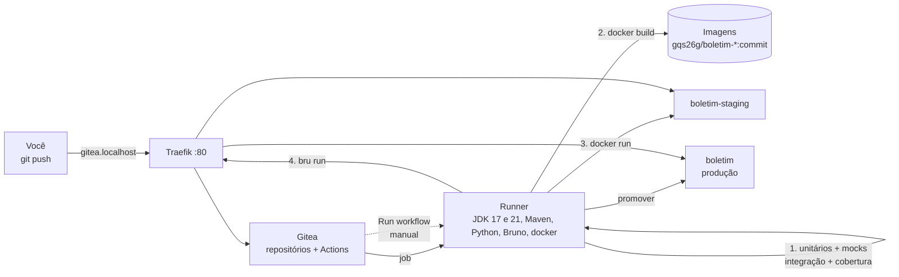

# Tutorial GQS26 — Gitea Actions na prática: testes, mocks, integração, API e cobertura numa esteira própria

**Aula 26 — Garantia da Qualidade de Software** | Prof. Giovane Barcelos
**Duração estimada:** 2h30
**Pré-requisitos:** Docker + Docker Compose e Git. JDK 17+, Maven, Python e Node são **opcionais** — o pipeline roda tudo dentro do runner; eles só servem para rodar os testes na sua máquina antes do `push`. A **Etapa 0** mostra como instalar.
**Arquivos do laboratório:** pasta `class26/lab-gitea/` do repositório <https://github.com/giovanebarcelos/gqs-sandbox> (Etapa 0.4).
**Tutorial irmão:** [`../lab-github/GQS26-Tutorial-GitHubActions.md`](../lab-github/GQS26-Tutorial-GitHubActions.md) — a mesma aplicação e os mesmos testes no GitHub Actions. Faça um, depois o outro, e compare.

---

## O que você vai construir

Uma esteira de CI/CD completa rodando na sua máquina — servidor Git, executor de pipelines, ambientes de staging e produção — acessada por nomes amigáveis no navegador:

| URL | O que é | Quem cria |
|---|---|---|
| `http://gitea.localhost` | **Gitea** — servidor Git com **Gitea Actions** (pipelines em YAML, sintaxe do GitHub Actions) | `docker compose` |
| `http://boletim-staging.localhost` | Boletim API **Java** em **staging** (homologação) | o pipeline, a cada push |
| `http://boletim.localhost` | Boletim API **Java** em **produção** | a promoção manual |
| `http://boletim-python-staging.localhost` | Boletim API **Python** em staging | o pipeline |
| `http://boletim-python.localhost` | Boletim API **Python** em produção | a promoção manual |
| `http://cobertura.localhost` | Relatórios de **cobertura** (JaCoCo e coverage.py) dos testes que você rodar na sua máquina | `docker compose --profile cobertura` |
| `http://traefik.localhost` | Painel do **Traefik**, o proxy reverso | `docker compose` |

Repare na terceira coluna: **as aplicações não estão no `docker-compose.yml`**. O compose sobe só a infraestrutura de CI/CD. Quem publica a API — e decide se ela pode ser publicada — é o pipeline.

A aplicação é a **Boletim API** (média, situação e frequência de um aluno), em duas implementações idênticas — mesmas rotas, mesmas regras e **os mesmos defeitos plantados**:

| | Java (principal) | Python (secundária) |
|---|---|---|
| Aplicação | Spring Boot 3.5 (`java/`) | Flask 3 (`python/`) |
| Pipeline | `.gitea/workflows/ci-java.yml` | `.gitea/workflows/ci-python.yml` |
| Promoção para produção | `.gitea/workflows/promover-producao.yml` (escolhe a linguagem) | idem |

### A pirâmide de testes que o pipeline executa

| Camada | O que prova | Java | Python | Quantos |
|---|---|---|---|---|
| **Teste unitário** | a regra de negócio isolada | JUnit 5 — `CalculadoraBoletimTest` | pytest — `test_calculadora.py` | Java 14 · Python 15 |
| **Teste com mock** | a conversa entre camadas, com a vizinha trocada por um dublê | Mockito — `BoletimControllerMockTest` (`@MockitoBean`) | `unittest.mock` — `test_app_mock.py` | Java 5 · Python 5 |
| **Teste de camada HTTP** | rotas e JSON, sem subir o servidor | `@WebMvcTest` + MockMvc — `BoletimControllerTest` | cliente de teste do Flask — `test_app.py` | Java 6 · Python 6 |
| **Teste de integração** | a aplicação **inteira**, por HTTP de verdade, sem mocks | `@SpringBootTest` — `BoletimIntegracaoIT` (Failsafe) | servidor Werkzeug real — `tests/integracao/` | Java 5 · Python 5 |
| **Teste de API** | o sistema **publicado** em staging | Bruno — `bruno/Boletim-API` | Bruno (mesma coleção) | 8 |
| **Cobertura** | quanto do código os testes executaram | JaCoCo — gate de **80%** de linhas | coverage.py — gate de **80%** | — |



Ao longo do tutorial você vai:

1. subir um Gitea com runner próprio e enviar o projeto com `git push`;
2. ver o pipeline **parar** em cada versão de Java e em Python, por motivos diferentes;
3. corrigir o defeito 1 e ver **uma versão do JDK passar e a outra continuar quebrada** — o valor da matriz;
4. corrigir o defeito 2, ver tudo verde e a versão chegar a **staging**, onde o **Bruno** testa a API publicada;
5. configurar **secret** e **variável** e ver o ambiente mudar sem tocar no código;
6. **promover para produção** com um clique (CD *Delivery*) e ver a trava recusar uma versão não homologada;
7. provocar a queda da **cobertura** abaixo de 80% e ver o gate reprovar;
8. abrir um **pull request** e ver o pipeline validar sem publicar nada.

### Estrutura da pasta

```
class26/lab-gitea/
├── GQS26-Tutorial-GiteaActions.md     ← este tutorial
├── docker-compose.yml                 ← Traefik + Gitea + runner (+ cobertura) — a infraestrutura
├── .env.example                       ← token do runner e porta (copie para .env)
├── runner/                            ← imagem do runner: act_runner + JDK 17 e 21, Maven,
│   ├── Dockerfile                        Python, Node, Bruno CLI e cliente Docker
│   └── entrypoint.sh
├── cobertura/                         ← nginx que serve os relatórios de cobertura
├── exercicios/                        ← arquivos da Etapa 8 (gate de cobertura)
├── scripts/limpar-ambientes.sh        ← remove staging/produção e as imagens geradas
└── boletim/                           ← vira o repositório aluno/boletim
    ├── .gitea/workflows/
    │   ├── ci-java.yml                ← testes (matriz 17/21) → imagem → staging → testes de API
    │   ├── ci-python.yml              ← testes → imagem → staging → testes de API
    │   └── promover-producao.yml      ← produção, disparado à mão
    ├── java/                          ← pom.xml (JaCoCo, Failsafe) · Dockerfile · src/main · src/test
    ├── python/                        ← boletim/ · tests/ · tests/integracao/ · pytest.ini · Dockerfile
    ├── bruno/Boletim-API/             ← 8 testes de API e os ambientes Staging, Producao, ...
    └── scripts/deploy.sh              ← publica uma versão num ambiente
```

### Números de referência

Medidos ao executar este tutorial do início ao fim (Gitea 28.2, act_runner 0.6.1, Traefik 3.6, Bruno CLI 4.3):

| Momento | Java | Python |
|---|---|---|
| 1º push (defeitos 1 e 2) | **JDK 17:** erro de compilação `release version 21 not supported` · **JDK 21:** 25 testes, **2 falhas** · jobs 2–4 **pulados** | 26 testes unitários, **2 falhas** · jobs 2–4 pulados |
| 2º push (defeito 1 corrigido) | **JDK 21 ✅** · **JDK 17 ❌** (compilação) · jobs 2–4 pulados | **4 jobs verdes** · imagem marcada como `homologada` |
| 3º push (defeito 2 corrigido) | **5 jobs verdes** · Bruno **8 de 8** · `homologada` | — |
| Cobertura de linhas (unitários + integração) | **100%** (56 de 56) — gate em 80% | **98%** — gate em 80% |

> A primeira execução do job "2. Imagem Docker" demora mais (1 a 2 min): o Docker baixa as imagens `maven` e `eclipse-temurin`. Nas seguintes, o cache resolve.

---

# ETAPA 0 — Preparar a máquina (15 a 30 min, só uma vez)

### 0.1 O que instalar

| Ferramenta | Versão mínima | Para quê | Obrigatório? |
|---|---|---|---|
| Git | qualquer recente | clonar o repositório e fazer `push` para o Gitea | **sim** |
| Docker + Docker Compose v2 | Compose 2.20+ | subir Traefik, Gitea e o runner; o runner usa o Docker para publicar a API | **sim** |
| JDK 17+ e Maven 3.9+ | — | rodar `mvn verify` **antes** do push | opcional |
| Python 3.10+ | — | rodar o `pytest` antes do push | opcional |
| Node.js 18+ e Bruno CLI | — | rodar os testes de API na sua máquina | opcional |

O pipeline **não usa** nada disso da sua máquina: o runner tem a própria cópia de JDK 17, JDK 21, Maven, Python e Bruno (veja `runner/Dockerfile`). É a primeira lição de CI: **o build não depende da máquina de ninguém**.

**Linux (Ubuntu/Debian/Fedora):**

```bash
curl -fsSL https://get.docker.com | sudo sh
sudo systemctl enable --now docker
sudo usermod -aG docker $USER        # saia e entre de novo na sessão depois disto
sudo apt install -y git              # Fedora: sudo dnf install -y git
# opcionais: sudo apt install -y openjdk-21-jdk maven python3 python3-venv nodejs npm
```

**Windows 10/11** (PowerShell; o Docker Desktop precisa do WSL 2 — `wsl --install` como administrador, depois reinicie):

```powershell
winget install -e --id Git.Git
winget install -e --id Docker.DockerDesktop
# opcionais: EclipseAdoptium.Temurin.21.JDK, Python.Python.3.12, OpenJS.NodeJS.LTS
```

Abra o Docker Desktop e espere *Engine running*.

> **Linux × Windows 11:** daqui em diante, cada bloco de comandos aparece em duas versões — **Linux/macOS (bash)** e **Windows 11 (PowerShell)** — ou num bloco único, quando os comandos são idênticos nos dois. No Windows, abra o **Terminal → PowerShell** (não precisa ser administrador). Quem preferir o **Git Bash** pode usar os comandos do Linux.

**macOS** (com [Homebrew](https://brew.sh)):

```bash
brew install --cask docker           # abra o Docker Desktop uma vez
brew install git                     # opcionais: openjdk@21 maven python@3.12 node
```

### 0.2 Conferir

**Linux, macOS e Windows 11** (mesmos comandos):

```bash
git --version
docker --version
docker compose version               # precisa ser v2.x
docker run --rm hello-world
```

### 0.3 Identidade do Git

O Gitea mostra o autor de cada commit; configure uma vez (**Linux, macOS e Windows 11**, mesmos comandos):

```bash
git config --global user.name  "Seu Nome"
git config --global user.email "seu.email@exemplo.com"
```

### 0.4 Baixar o repositório

O tutorial supõe o clone na sua pasta pessoal (`~/gqs-sandbox`; no Windows, `$HOME\gqs-sandbox`).

**Linux/macOS (bash):**

```bash
cd ~
git clone https://github.com/giovanebarcelos/gqs-sandbox.git
cd gqs-sandbox/class26/lab-gitea
```

**Windows 11 (PowerShell):**

```powershell
cd $HOME
git clone https://github.com/giovanebarcelos/gqs-sandbox.git
cd gqs-sandbox\class26\lab-gitea
```

Já tem o repositório? `cd gqs-sandbox` e `git pull`.

**As Etapas 1 e 2 são executadas dentro de `gqs-sandbox/class26/lab-gitea`.** A partir da Etapa 3 você trabalha numa **cópia** do projeto, fora do `gqs-sandbox` (a Etapa 3.1 explica por quê).

---

## Etapa 1 — Subir a infraestrutura de CI/CD (15 min)

### 1.1 Preparar o `.env`

**Linux/macOS (bash):**

```bash
cp .env.example .env
openssl rand -hex 20                 # gera 40 caracteres hexadecimais
```

**Windows 11 (PowerShell):**

```powershell
Copy-Item .env.example .env
$b = New-Object byte[] 20; [Security.Cryptography.RandomNumberGenerator]::Create().GetBytes($b); -join ($b | ForEach-Object { $_.ToString('x2') })   # 40 caracteres hexadecimais
notepad .env
```

Abra o `.env` e cole o valor gerado em `RUNNER_TOKEN`. É o segredo que o **runner** usa para se registrar no Gitea: o Gitea lê o mesmo valor ao subir, e o runner se apresenta com ele.

> Qualquer sequência de 40 caracteres `0-9a-f` serve. **O `.env` não vai para o Git** — já está no `.gitignore`. Token em arquivo versionado é o anti-padrão da Aula 25.

### 1.2 Verificar a porta 80

O Traefik usa a porta 80 da sua máquina. Se ela estiver ocupada (outro servidor web, o lab da Aula 25, o lab GitHub desta aula ou o das Aulas 23B/24 ainda rodando), descomente `HTTP_PORT=8886` no `.env` e **acrescente `:8886` em todas as URLs** deste tutorial (`http://gitea.localhost:8886`, ...).

**Linux/macOS (bash):**

```bash
# algo já escuta na 80?
sudo lsof -i :80 || echo "porta 80 livre"
```

**Windows 11 (PowerShell):**

```powershell
# algo já escuta na 80? (mostra o processo dono da porta)
$c = Get-NetTCPConnection -LocalPort 80 -State Listen -ErrorAction SilentlyContinue
if ($c) { $c | ForEach-Object { Get-Process -Id $_.OwningProcess } } else { "porta 80 livre" }
```

### 1.3 Subir

**Linux, macOS e Windows 11** (mesmo comando):

```bash
docker compose up -d --build
```

A primeira vez demora alguns minutos: o Docker monta a imagem do runner (`runner/Dockerfile`), que instala os dois JDKs, Maven, Python, Node, o Bruno CLI e o cliente Docker sobre o `act_runner` oficial.

**Linux/macOS (bash):**

```bash
docker compose ps
# gqs26g_gitea     ... Up (healthy)
# gqs26g_runner    ... Up
# gqs26g_traefik   ... Up

docker logs gqs26g_runner | tail -3
# level=info msg="Runner registered successfully."
# ... runner: gqs26g-runner, with version: v0.6.1, with labels: [gqs-runner], declare successfully
```

**Windows 11 (PowerShell):**

```powershell
docker compose ps
docker logs --tail 3 gqs26g_runner
```

### 1.4 Criar o seu usuário

A tela de instalação do Gitea foi pulada (`INSTALL_LOCK`) e o cadastro público está desligado. Crie o administrador pela linha de comando — **troque a senha**:

**Linux/macOS (bash)** — a `\` continua o comando na linha seguinte:

```bash
docker exec -u git gqs26g_gitea gitea admin user create --admin \
  --username aluno --email aluno@gqs.local \
  --password 'Troque-esta-senha!' --must-change-password=false
# New user 'aluno' has been successfully created!
```

**Windows 11 (PowerShell)** — no PowerShell, quem continua a linha é a crase `` ` ``:

```powershell
docker exec -u git gqs26g_gitea gitea admin user create --admin `
  --username aluno --email aluno@gqs.local `
  --password 'Troque-esta-senha!' --must-change-password=false
```

> Pode usar outro nome de usuário: troque `aluno` também nas URLs dos `git remote` das próximas etapas.

### 1.5 Conferir no navegador

1. Abra `http://gitea.localhost` e entre com `aluno` e a senha.
2. Avatar (canto superior direito) → **Site Administration** → **Actions** → **Runners**: o `gqs26g-runner` aparece com o rótulo `gqs-runner` e o estado **Idle** (ocioso, esperando trabalho).
3. Abra `http://traefik.localhost`: em *HTTP Routers*, aparecem as rotas do Gitea e do painel. As das APIs ainda não existem — o pipeline ainda não publicou nada.

| Problema | Solução |
|---|---|
| `gitea.localhost` não abre | use Chrome, Edge ou Firefox (resolvem `*.localhost` sozinhos); em outros, acrescente `127.0.0.1 gitea.localhost boletim.localhost boletim-staging.localhost boletim-python.localhost boletim-python-staging.localhost cobertura.localhost` ao arquivo `hosts` |
| Runner não aparece / `Waiting to retry` no log | `RUNNER_TOKEN` vazio ou diferente; corrija o `.env` e rode `docker compose up -d --force-recreate` |
| Página do Traefik com *404* | a porta não é a 80: use a `HTTP_PORT` do `.env` na URL |

---

## Etapa 2 — Conhecer a aplicação, os testes e o pipeline (20 min)

### 2.1 Regras de negócio (o "requisito")

`POST /api/boletim` recebe `{"aluno": "Ana", "notas": [7, 9, 8], "frequencia": 90}` e devolve média, situação, maior e menor nota:

| Regra | Descrição |
|---|---|
| **R1** | média = média aritmética das notas, com **1 casa decimal** (arredonda para cima no 5) |
| **R2** | frequência **abaixo de 75%** → `REPROVADO_POR_FALTA` (vale sobre a média). Com frequência ≥ 75%: média ≥ 7,0 → `APROVADO`; média ≥ 4,0 → `EXAME`; abaixo → `REPROVADO` |
| **R3** | de 1 a 4 notas, cada uma de 0 a 10; frequência de 0 a 100. Fora disso, **HTTP 400** com a mensagem do erro |

Endpoints: `GET /api/health` (com a **versão publicada** e a instituição), `POST /api/boletim` e `GET /api/admin/estatisticas` (exige o cabeçalho `X-Admin-Token`, que vem de um **secret** — Etapa 6).

### 2.2 Os testes, camada por camada

Antes de olhar o pipeline, abra os testes. O mesmo comportamento é verificado de quatro ângulos:

**Unitário** — `java/src/test/java/.../CalculadoraBoletimTest.java`. Uma regra, sem Spring, sem HTTP. Repare no teste parametrizado `situacaoPelaMediaEFrequencia`: cada linha do `@CsvSource` é um caso de borda das regras R1/R2.

**Mock** — `BoletimControllerMockTest.java` (Java) e `tests/test_app_mock.py` (Python). Aqui a **calculadora é substituída por um dublê**:

```java
@MockitoBean
private CalculadoraBoletim calculadora;                       // dublê injetado no lugar do real

when(calculadora.calcular("Ana", List.of(7.0, 9.0), 90.0))    // STUB: "quando te chamarem assim, responda isto"
        .thenReturn(new Boletim("Ana", new BigDecimal("1.0"), Situacao.REPROVADO, 9.0, 7.0, "resposta do mock"));
...
verify(calculadora).calcular("Ana", List.of(7.0, 9.0), 90.0); // VERIFY: o controller chamou, com estes argumentos
```

Esse teste passa **mesmo que a regra de negócio esteja errada** — e é de propósito: ele só verifica se o controller entrega os dados certos e traduz o erro em HTTP 400. Quem verifica a regra é o teste unitário. Em Python o equivalente é `patch("boletim.app.calcular_boletim", return_value=...)` e `mock.assert_called_once_with(...)`.

**Integração** — `BoletimIntegracaoIT.java` e `tests/integracao/test_integracao.py`. **Nenhum mock**: a aplicação inteira sobe numa porta aleatória e o teste conversa por HTTP real. Dois detalhes importantes:

- No Java, o sufixo **`IT`** faz o *maven-failsafe-plugin* rodar a classe na fase `integration-test`, **depois** dos unitários (que rodam no *surefire*). No Python, o marcador `@pytest.mark.integracao` separa os dois grupos (`-m "not integracao"` × `-m integracao`).
- O teste `estatisticasContamSoOsBoletinsCalculadosComSucesso` verifica **estado compartilhado entre requisições** — algo que nenhum teste unitário enxerga.

**API (Bruno)** — `bruno/Boletim-API/*.bru`. Roda **depois do deploy**, contra `http://boletim-staging.localhost`: prova o sistema montado, dentro do container, atrás do Traefik.

### 2.3 O pipeline, job por job

Abra `boletim/.gitea/workflows/ci-java.yml`:

| Job | O que faz | Se falhar... |
|---|---|---|
| **1. Testes (JDK 17 / JDK 21)** | `mvn -B verify` **duas vezes**, uma por versão do JDK (matriz): compila, roda unitários + mocks (surefire), integração (failsafe), gera o relatório JaCoCo e **reprova abaixo de 80%** de linhas | nada é empacotado |
| **2. Imagem Docker** | `docker build -t gqs26g/boletim-java:<commit> java` — só em `push` | nada é publicado |
| **3. Deploy em staging** | `scripts/deploy.sh java staging <commit>` → `http://boletim-staging.localhost` | staging continua com a versão anterior |
| **4. Testes de API em staging** | `bru run --env Staging`; se passar, marca a imagem como `<commit>-homologada` | a versão **não pode ir para produção** |

O `ci-python.yml` é igual, com uma diferença no job 1: três passos separados — **unitários + mocks** (`-m "not integracao"`), **integração** (`-m integracao --cov-append`) e **relatório + gate** (`coverage report --fail-under=80`).

Detalhes do YAML que valem ouro:

- **`strategy.matrix`** (`java: ["17", "21"]`) cria **um job por versão**. O runner tem os dois JDKs; o passo escolhe um com `JAVA_HOME: /usr/lib/jvm/java-${{ matrix.java }}-openjdk`. **`fail-fast: false`** deixa a outra versão terminar quando uma falha — você vê os dois resultados.
- **`needs:`** encadeia os jobs. Sem ele, os quatro rodariam em paralelo — e o deploy aconteceria mesmo com teste vermelho.
- **`paths:`** faz o pipeline Java só rodar quando muda `java/**`, `bruno/**`, `scripts/**` ou o próprio YAML. Mudou só o Python? O Java nem dispara.
- **`if: github.event_name != 'pull_request'`** nos jobs 2–4: num *pull request* o pipeline só **valida**; publicar é coisa do `main` (Etapa 9).
- **`runs-on: gqs-runner`** escolhe o runner pelo rótulo. O `docker-compose.yml` registra o runner com `gqs-runner:host`: o job roda **dentro do container do runner**, que já tem as ferramentas.
- **`secrets.TOKEN_ADMIN` / `vars.INSTITUICAO`** no job 3 entram só em `env:` — nunca em `echo`.

E o `promover-producao.yml` tem gatilho **`workflow_dispatch`**: só roda quando alguém clica em **Run workflow**, escolhe a linguagem e informa a versão. É o **CD *Delivery***: o artefato está pronto, mas a decisão de publicar é humana. Antes de publicar, ele confere se existe a imagem `<versao>-homologada`: **só vai para produção o que passou em staging**.

### 2.4 Gitea Actions × GitHub Actions

A sintaxe é a mesma e as actions vêm do próprio GitHub (`actions/checkout@v7`) — mas a compatibilidade não é total. Estas são as diferenças que você vai encontrar neste lab:

| Assunto | GitHub Actions | Gitea Actions (este lab) |
|---|---|---|
| Pasta dos workflows | `.github/workflows/` | `.gitea/workflows/` (também lê `.github/workflows/`) |
| Runner | `ubuntu-latest` hospedado pelo GitHub | **seu** runner (`gqs-runner`), no modo `host` |
| Versões de JDK/Python | `actions/setup-java`, `actions/setup-python` | ferramentas **já instaladas** na imagem do runner (os dois JDKs; um Python) |
| `upload-artifact` | `@v7` | **`@v3`** — a v4+ usa uma API de artefatos que só existe no GitHub.com (erro `GHESNotSupportedError`) |
| Resumo na página da execução | `$GITHUB_STEP_SUMMARY` | não existe — os números vão para o **log** |
| Aprovação manual do deploy | *Environments* com *required reviewers* | não há; a trava é o `workflow_dispatch` + a checagem `-homologada` |
| Workflow reutilizável / composite action | `workflow_call`, `./.github/actions/...` | evitados neste lab — o YAML do Bruno é repetido nos dois pipelines |
| Registro de imagens | GHCR (GitHub Packages) | imagens locais `gqs26g/*` no Docker da máquina |
| Secrets e variáveis | *Settings → Secrets and variables → Actions* | *Settings → Actions → Secrets / Variables* |
| Custo | minutos hospedados (grátis em repositório público) | zero — mas **a infraestrutura é sua** |

---

## Etapa 3 — Primeiro push: o pipeline barra os defeitos (20 min)

### 3.1 Criar o seu repositório

O projeto `boletim` vira um repositório **próprio**, separado do `gqs-sandbox`. Copie a pasta para fora do clone — um repositório Git dentro de outro confunde os dois:

**Linux/macOS (bash):**

```bash
cp -r boletim ~/boletim
cd ~/boletim
git init -b main
git add .
git commit -m "Boletim API: versao inicial"
git remote add origin http://gitea.localhost/aluno/boletim.git
git push -u origin main
```

**Windows 11 (PowerShell):**

```powershell
Copy-Item -Recurse -Force boletim $HOME\boletim
cd $HOME\boletim
git init -b main
git add .
git commit -m "Boletim API: versao inicial"
git remote add origin http://gitea.localhost/aluno/boletim.git
git push -u origin main
```

O Git pede usuário e senha (no Windows, numa janela do *Git Credential Manager*): `aluno` e a senha da Etapa 1.4. O repositório **não precisava existir**: o Gitea está configurado para criá-lo no primeiro push (`ENABLE_PUSH_CREATE_USER`).

> **De agora em diante, os comandos rodam em `~/boletim`** (no Windows, `$HOME\boletim`), a menos que digam o contrário.

### 3.2 Acompanhar a execução

No Gitea, abra `aluno/boletim` → aba **Actions**. Aparecem **duas** execuções — *CI Java* e *CI Python* — e, em cerca de um minuto, as duas ficam **vermelhas**. O runner executa um job por vez (capacidade 1), então as execuções esperam a fila.

**CI Java** — a matriz gera dois jobs, e **cada um falha por um motivo diferente**:

| Job | Resultado |
|---|---|
| 1. Testes (JDK 17) | ❌ erro de **compilação** |
| 1. Testes (JDK 21) | ❌ **2 testes** falham |
| 2. Imagem Docker · 3. Deploy · 4. Testes de API | ⊘ pulados |

Clique em **1. Testes (JDK 17)** e abra o passo **mvn verify**:

```text
openjdk version "17.0.21.0.3" 2026-10-24
[ERROR] Failed to execute goal org.apache.maven.plugins:maven-compiler-plugin:3.14.0:compile (default-compile) on project boletim-api: Fatal error compiling: error: release version 21 not supported
```

Agora **1. Testes (JDK 21)** — o código compila, mas as regras estão erradas:

```text
[ERROR] Tests run: 14, Failures: 2, Errors: 0, Skipped: 0 <<< FAILURE! -- in br.edu.gqs.boletim.CalculadoraBoletimTest
[ERROR]   CalculadoraBoletimTest.situacaoPelaMediaEFrequencia:45 expected: <APROVADO> but was: <REPROVADO_POR_FALTA>
[ERROR]   CalculadoraBoletimTest.situacaoPelaMediaEFrequencia:45 expected: <EXAME> but was: <REPROVADO_POR_FALTA>
```

Repare: os testes **com mock** (`BoletimControllerMockTest`) e de **camada HTTP** passaram. O defeito está na regra, e só o teste unitário parametrizado da borda (75%) o enxerga.

**CI Python** — o job 1 falha no passo *Testes unitários e com mock*; os passos de integração e cobertura nem rodam:

```text
FAILED tests/test_calculadora.py::test_situacao_pela_media_e_frequencia[10-75-APROVADO]
FAILED tests/test_calculadora.py::test_situacao_pela_media_e_frequencia[5.0-75-EXAME]
2 failed, 24 passed, 5 deselected
```

O `5 deselected` são os 5 testes de integração, deixados de fora por `-m "not integracao"`.

Na página da execução, em **Artifacts**, baixe `relatorios-java-21`: tem os relatórios do Surefire e do Failsafe. O passo de upload tem `if: always()` — os relatórios são guardados **justamente** quando o build falha, que é quando mais se precisa deles.

### 3.3 O que **não** aconteceu

**Linux/macOS (bash):**

```bash
curl -s http://boletim-staging.localhost/api/health
# 404 page not found        <- nenhum ambiente foi criado
docker images 'gqs26g/*'
# (vazio)                   <- nenhuma imagem foi gerada
```

**Windows 11 (PowerShell)** — use sempre `curl.exe` (no PowerShell, `curl` sozinho pode ser apelido de `Invoke-WebRequest`):

```powershell
curl.exe -s http://boletim-staging.localhost/api/health
docker images 'gqs26g/*'
```

Isso é o **fail fast**: o defeito foi detectado em segundos, isolado ao commit que o causou, **antes** de existir qualquer artefato.

---

## Etapa 4 — Corrigir o defeito 1; a matriz mostra o defeito 2 (15 min)

### 4.1 A correção

A regra R2 diz "frequência **abaixo de** 75% reprova": exatamente 75% **não** reprova. O código usa `<=`.

`java/src/main/java/br/edu/gqs/boletim/CalculadoraBoletim.java`:

```diff
-        if (frequencia <= FREQUENCIA_MINIMA) {
+        if (frequencia < FREQUENCIA_MINIMA) {
```

`python/boletim/calculadora.py`:

```diff
-    if frequencia <= FREQUENCIA_MINIMA:
+    if frequencia < FREQUENCIA_MINIMA:
```

**Linux, macOS e Windows 11** (mesmos comandos):

```bash
git commit -am "Corrige limite de frequencia: 75% aprova"
git push
```

### 4.2 O pipeline avança — e a matriz mostra o resto

**CI Python:** os 4 jobs ficam ✅. Staging está no ar, o Bruno passa e a imagem é marcada como `homologada`.

**CI Java:**

| Job | Resultado |
|---|---|
| 1. Testes (JDK 21) | ✅ — 25 testes unitários + 5 de integração, cobertura 100% |
| 1. Testes (JDK 17) | ❌ **continua vermelho** — o erro de compilação não era o mesmo problema |
| 2. Imagem · 3. Deploy · 4. Testes de API | ⊘ pulados (`needs` exige que **todos** os jobs da matriz passem) |

Este é o ponto da aula: se o pipeline testasse **só o JDK 21**, estaria verde — e a produção, que roda **Java 17**, nem compilaria. A matriz acusou um defeito que nenhum teste unitário pegaria.

Confira o Python publicado em staging:

**Linux/macOS (bash):**

```bash
git rev-parse --short=7 HEAD                               # a versão = 7 primeiros caracteres do commit
curl -s http://boletim-python-staging.localhost/api/health
# {"status":"ok","versao":"ea9bd8e","instituicao":"ambiente staging"}
```

**Windows 11 (PowerShell):**

```powershell
git rev-parse --short=7 HEAD
curl.exe -s http://boletim-python-staging.localhost/api/health
```

Abra também `http://traefik.localhost`: em *HTTP Routers* apareceu `gqs26g-boletim-python-staging@docker`. **Foi o pipeline que criou essa rota**, por meio das *labels* do container (veja `scripts/deploy.sh`).

---

## Etapa 5 — Corrigir o defeito 2: Java 17 (10 min)

### 5.1 A correção

O `pom.xml` exige Java 21 (`<java.version>21</java.version>`) e o código usa `List.getFirst()` / `getLast()`, métodos que só existem desde o Java 21. Como a produção roda 17, o código é que se ajusta:

`java/pom.xml`:

```diff
-        <java.version>21</java.version>
+        <java.version>17</java.version>
```

`java/src/main/java/br/edu/gqs/boletim/CalculadoraBoletim.java`:

```diff
-        double menor = ordenadas.getFirst();
-        double maior = ordenadas.getLast();
+        double menor = ordenadas.get(0);
+        double maior = ordenadas.get(ordenadas.size() - 1);
```

**Linux, macOS e Windows 11** (mesmos comandos):

```bash
git commit -am "Compatibiliza com Java 17 (a producao roda 17)"
git push
```

### 5.2 Tudo verde

Desta vez a execução do **CI Java** tem os dois jobs da matriz ✅ e os jobs 2–4 rodam. No log do job **4. Testes de API em staging**:

```text
   ✓ BOL01 - Health responde 200 com status ok
   ✓ BOL02 - Media 8,0 e 90% de frequencia: APROVADO, maior 9 e menor 7
   ✓ BOL03 - Media 5,5: EXAME
   ✓ BOL04 - Media 2,5: REPROVADO
   ✓ BOL05 - 75% de frequencia (o minimo) nao reprova por falta
   ✓ BOL06 - 74% de frequencia: REPROVADO_POR_FALTA, mesmo com media 9,5
   ✓ BOL07 - Nota 11 responde 400
   ✓ BOL08 - Estatisticas sem X-Admin-Token responde 401
│ Requests      │ 8 (8 Passed) │
```

O **CI Python não rodou** neste push: o commit só tocou `java/` e o filtro `paths:` do `ci-python.yml` não casou — a Etapa 2.3 explica.

**Linux, macOS e Windows 11** (mesmo comando):

```bash
docker images 'gqs26g/*' --format '{{.Repository}}:{{.Tag}}'
# gqs26g/boletim-java:eee02b2-homologada     <- a "etiqueta" que libera a promoção
# gqs26g/boletim-java:eee02b2
# gqs26g/boletim-python:ea9bd8e-homologada   <- o Python foi homologado no push da Etapa 4
# gqs26g/boletim-python:ea9bd8e
```

(Os hashes do seu repositório serão diferentes.)

### 5.3 Os relatórios de cobertura

**Pelo Gitea:** na página da execução do CI Java, em **Artifacts**, baixe `relatorios-java-21`, extraia e abra `site/jacoco/index.html`. No CI Python, `relatorios-python` traz `relatorio-cobertura/index.html`.

**Na sua máquina** (se instalou JDK/Maven/Python), gere e sirva os relatórios:

**Linux/macOS (bash):**

```bash
cd ~/boletim/java   && mvn -q verify          # relatório em target/site/jacoco/
cd ~/boletim/python && python3 -m venv .venv && .venv/bin/pip install -q -r requirements-dev.txt
.venv/bin/pytest -q -m "not integracao" --cov
.venv/bin/pytest -q -m integracao --cov --cov-append
.venv/bin/coverage html -d relatorio-cobertura

cd ~/gqs-sandbox/class26/lab-gitea            # a pasta do docker-compose.yml
echo "BOLETIM_DIR=$HOME/boletim" >> .env
docker compose --profile cobertura up -d
```

**Windows 11 (PowerShell)** — no Windows o Python se chama `python` (ou `py`) e o venv fica em `.venv\Scripts`. O `.env` é gravado em UTF-8 e com `/` no caminho (o `>>` do PowerShell 5 gravaria em UTF-16, que o Compose não lê):

```powershell
cd $HOME\boletim\java; mvn -q verify          # relatório em target\site\jacoco\
cd $HOME\boletim\python; python -m venv .venv; .venv\Scripts\pip install -q -r requirements-dev.txt
.venv\Scripts\pytest -q -m "not integracao" --cov
.venv\Scripts\pytest -q -m integracao --cov --cov-append
.venv\Scripts\coverage html -d relatorio-cobertura

cd $HOME\gqs-sandbox\class26\lab-gitea        # a pasta do docker-compose.yml
[IO.File]::AppendAllText("$PWD\.env", "`nBOLETIM_DIR=$($HOME -replace '\\','/')/boletim`n")
docker compose --profile cobertura up -d
```

Abra `http://cobertura.localhost`. Em cada relatório, as linhas **verdes** foram executadas pelos testes; as **vermelhas**, não. Cobertura mede o que os testes **executaram**, não se estão **certos** — por isso o gate de 80% convive com os testes de borda da Etapa 3.

---

## Etapa 6 — Secret e variável: configuração fora do código (10 min)

O endpoint `/api/admin/estatisticas` só responde a quem enviar o cabeçalho `X-Admin-Token` igual ao `TOKEN_ADMIN` do ambiente. Esse valor **nunca** pode estar no repositório. A `INSTITUICAO`, que aparece no `/api/health`, não é sigilosa — vira uma **variável**.

### 6.1 Cadastrar no Gitea

No repositório `aluno/boletim`: **Settings** → **Actions**:

1. **Secrets** → **Add Secret** → nome `TOKEN_ADMIN`, valor `segredo-do-gitea-123` (invente o seu).
2. **Variables** → **Add Variable** → nome `INSTITUICAO`, valor `Faculdade GQS`.

> Prefere a linha de comando? A API do Gitea faz o mesmo:
> ```bash
> curl -u 'aluno:Troque-esta-senha!' -X PUT -H 'Content-Type: application/json' \
>      -d '{"data":"segredo-do-gitea-123"}' \
>      http://gitea.localhost/api/v1/repos/aluno/boletim/actions/secrets/TOKEN_ADMIN
> curl -u 'aluno:Troque-esta-senha!' -X POST -H 'Content-Type: application/json' \
>      -d '{"value":"Faculdade GQS"}' \
>      http://gitea.localhost/api/v1/repos/aluno/boletim/actions/variables/INSTITUICAO
> ```
>
> No **Windows 11 (PowerShell)**, o JSON vai pela entrada padrão (`--data-binary '@-'`), o que evita o problema das aspas duplas em argumentos de programas externos:
> ```powershell
> '{"data":"segredo-do-gitea-123"}' | curl.exe -u 'aluno:Troque-esta-senha!' -X PUT `
>      -H 'Content-Type: application/json' --data-binary '@-' `
>      http://gitea.localhost/api/v1/repos/aluno/boletim/actions/secrets/TOKEN_ADMIN
> '{"value":"Faculdade GQS"}' | curl.exe -u 'aluno:Troque-esta-senha!' -X POST `
>      -H 'Content-Type: application/json' --data-binary '@-' `
>      http://gitea.localhost/api/v1/repos/aluno/boletim/actions/variables/INSTITUICAO
> ```

Depois de salvo, o Gitea **nunca mais mostra** o valor do secret — só permite trocá-lo.

### 6.2 Reimplantar sem mexer no código

Staging foi publicado antes do cadastro. Para republicar a mesma versão: **Actions** → **CI Java** (na lista da esquerda) → **Run workflow** → **Run workflow**. Repita para o **CI Python**. (O `workflow_dispatch` dos dois YAMLs existe para isso.)

**Linux/macOS (bash):**

```bash
curl -s http://boletim-staging.localhost/api/health
# {"status":"ok","versao":"eee02b2","instituicao":"Faculdade GQS"}      <- a variável chegou

curl -s -o /dev/null -w '%{http_code}\n' http://boletim-staging.localhost/api/admin/estatisticas
# 401                                                                   <- sem token, recusado
curl -s -H 'X-Admin-Token: segredo-do-gitea-123' http://boletim-staging.localhost/api/admin/estatisticas
# {"boletinsCalculados":5,"versao":"eee02b2"}                           <- com token, aceito
```

**Windows 11 (PowerShell)** — `NUL` faz o papel do `/dev/null`:

```powershell
curl.exe -s http://boletim-staging.localhost/api/health
curl.exe -s -o NUL -w '%{http_code}\n' http://boletim-staging.localhost/api/admin/estatisticas
curl.exe -s -H 'X-Admin-Token: segredo-do-gitea-123' http://boletim-staging.localhost/api/admin/estatisticas
```

Procure `segredo-do-gitea-123` nos logs do job **3. Deploy em staging**: não aparece. O Gitea mascara o valor (`***`), e o `deploy.sh` repassa o secret ao container com `-e TOKEN_ADMIN` — sem o valor na linha de comando.

> **Boa prática:** secret e variável têm escopo de repositório (ou organização). O Gitea não tem *Environments*: o mesmo `TOKEN_ADMIN` vale para staging **e** produção. No GitHub (tutorial irmão) cada ambiente tem o seu.

---

## Etapa 7 — Promover para produção (10 min)

### 7.1 Tentar promover uma versão não homologada

Pegue o hash do **primeiro** commit (o do 1º push, que nunca passou):

**Linux/macOS (bash):**

```bash
git log --oneline --reverse | head -1
# a1b2c3d Boletim API: versao inicial
```

**Windows 11 (PowerShell):**

```powershell
git log --oneline --reverse | Select-Object -First 1
```

1. Aba **Actions** → **Promover para producao** na lista da esquerda → **Run workflow**.
2. *Aplicação*: `java`. *Versão homologada*: o hash acima → **Run workflow**.

```text
A versao a1b2c3d (java) NAO foi homologada em staging - promocao recusada.
❌ Failure - Main Conferir se a versao passou em staging
```

`http://boletim.localhost` continua sem responder: **produção nunca recebeu uma versão reprovada**. A trava não depende de alguém lembrar de olhar o pipeline — está no próprio workflow.

> **Teste de segurança:** rode a promoção digitando `abc; rm -rf /` como versão. O workflow recusa com *"Versao invalida"*. O valor do formulário entra por **variável de ambiente** e é validado com uma expressão regular, nunca colado direto no script com `${{ }}` — essa é a defesa contra injeção de comandos em workflows.

### 7.2 Promover a versão homologada

Repita com a versão do último commit (`git rev-parse --short=7 HEAD`) e `java`. O job termina em poucos segundos:

**Linux/macOS (bash):**

```bash
curl -s http://boletim.localhost/api/health
# {"status":"ok","versao":"eee02b2","instituicao":"Faculdade GQS"}
```

**Windows 11 (PowerShell):**

```powershell
curl.exe -s http://boletim.localhost/api/health
```

Agora a **Boletim em produção** responde em `http://boletim.localhost`, com a mesma imagem que passou nos testes de staging — **o artefato é construído uma vez e promovido**, nunca reconstruído. Faça o mesmo com `python` e a versão do último commit para ter `http://boletim-python.localhost` — ela foi homologada pelo *Run workflow* do CI Python na Etapa 6.2 (o push da Etapa 5 não disparou o CI Python). Pulou a 6.2? Use a versão da Etapa 4.

### 7.3 Rollback

Para voltar a uma versão anterior, rode **o mesmo workflow** informando uma versão homologada antiga (as imagens `-homologada` ficam no Docker). Leva ~3 segundos — não há rebuild.

---

## Etapa 8 — O gate de cobertura em ação (10 min)

Os testes passam, mas e se alguém adicionar código **sem testes**? Simule: o arquivo `exercicios/historico.py` (e `Historico.java`) tem ~20 linhas de lógica que nenhum teste executa.

**Linux/macOS (bash):**

```bash
cp ~/gqs-sandbox/class26/lab-gitea/exercicios/historico.py   ~/boletim/python/boletim/
cp ~/gqs-sandbox/class26/lab-gitea/exercicios/Historico.java ~/boletim/java/src/main/java/br/edu/gqs/boletim/
cd ~/boletim
git add . && git commit -m "Adiciona historico do aluno (sem testes)" && git push
```

**Windows 11 (PowerShell):**

```powershell
Copy-Item $HOME\gqs-sandbox\class26\lab-gitea\exercicios\historico.py   $HOME\boletim\python\boletim\
Copy-Item $HOME\gqs-sandbox\class26\lab-gitea\exercicios\Historico.java $HOME\boletim\java\src\main\java\br\edu\gqs\boletim\
cd $HOME\boletim
git add .; git commit -m "Adiciona historico do aluno (sem testes)"; git push
```

Os dois pipelines **falham** — com todos os testes verdes:

```text
# Java (passo mvn verify, JDK 21 e 17)
[INFO] Tests run: 25, Failures: 0, Errors: 0, Skipped: 0
[INFO] Tests run: 5, Failures: 0, Errors: 0, Skipped: 0
[WARNING] Rule violated for bundle boletim-api: lines covered ratio is 0.74, but expected minimum is 0.80
[INFO] BUILD FAILURE

# Python (passo "Relatorio de cobertura e gate de 80%")
boletim/historico.py        21     21     0%
TOTAL                       82     22    73%
Coverage failure: total of 73 is less than fail-under=80
```

Nenhum teste quebrou — **a esteira recusou código não testado**. Para liberar, escreva testes para `Historico`/`historico_do_aluno` (um unitário já resolve) ou apague os arquivos:

**Linux/macOS (bash):**

```bash
git revert HEAD --no-edit && git push
```

**Windows 11 (PowerShell):**

```powershell
git revert HEAD --no-edit; git push
```

---

## Etapa 9 — Pull request: validar sem publicar (10 min)

**Linux, macOS e Windows 11** (mesmos comandos):

```bash
git checkout -b feature/mensagem-clara
# edite uma mensagem de erro em python/boletim/calculadora.py (ex.: "Informe de 1 a 4 notas")
git commit -am "Mensagem mais clara"
git push -u origin feature/mensagem-clara
```

No Gitea, abra o link que o `git push` imprime (*Create a new pull request*) e crie o PR para `main`. Na aba **Actions** aparece uma execução do **CI Python** disparada pelo evento `pull_request`:

| Job | Resultado |
|---|---|
| 1. Testes | ✅ roda (unitários, mocks, integração, cobertura) |
| 2. Imagem · 3. Deploy · 4. Testes de API | ⊘ **pulados** (`if: github.event_name != 'pull_request'`) |

O PR é **validado**, mas nada é publicado: staging e produção continuam como estavam. Só o merge no `main` dispara a esteira completa.

> Para **impedir o merge** com pipeline vermelho: no repositório, **Settings → Branches → Add branch protection** na `main`, ative *Enable Status Check* e marque os jobs `CI Python / 1. Testes ...` e `CI Java / 1. Testes (JDK 17)`/`(JDK 21)`.

---

## Etapa 10 — Encerrar o ambiente

**Linux/macOS (bash):**

```bash
cd ~/gqs-sandbox/class26/lab-gitea
./scripts/limpar-ambientes.sh        # containers de staging/produção e imagens gqs26g/*
docker compose --profile cobertura down
docker compose down -v               # -v apaga também o Gitea e o cache do runner
```

**Windows 11 (PowerShell)** — o script `.sh` roda no bash que vem com o Git for Windows:

```powershell
cd $HOME\gqs-sandbox\class26\lab-gitea
& "$env:ProgramFiles\Git\bin\bash.exe" scripts/limpar-ambientes.sh   # containers de staging/produção e imagens gqs26g/*
docker compose --profile cobertura down
docker compose down -v               # -v apaga também o Gitea e o cache do runner
```

`docker compose down` (sem `-v`) preserva repositórios, usuário e histórico do Gitea para a próxima aula.

---

## Armadilhas conhecidas

| Sintoma | Causa e solução |
|---|---|
| Aba **Actions** não existe no repositório | Actions desligado: **Settings → Advanced → Actions** (ou crie o repositório pelo `push`, como na Etapa 3) |
| Job fica **Waiting** para sempre | o runner está offline ou o rótulo do `runs-on` não bate com `gqs-runner`: veja `docker logs gqs26g_runner` e a página *Site Administration → Actions → Runners* |
| `GHESNotSupportedError` no upload de artefato | `actions/upload-artifact@v4` ou superior: no Gitea use **`@v3`** |
| `Failed to fetch actions/checkout` | o Gitea baixa as actions de `github.com`: precisa de internet no container do runner |
| Pipeline **não dispara** num commit | o filtro `paths:` não casou — o commit não tocou `java/**`, `python/**`, `bruno/**` ou `scripts/**`. Use **Run workflow** |
| `bru` falha com `ECONNREFUSED` em `*.localhost` | o `docker-compose.yml` precisa listar o host em `extra_hosts` do runner (veja o `runner/entrypoint.sh`) |
| `docker: Cannot connect to the Docker daemon` no job | o `docker.sock` não está montado no runner — não remova o volume do `docker-compose.yml` |
| Dois labs ao mesmo tempo | todos usam a porta 80: pare um (`docker compose down`) ou troque `HTTP_PORT` no `.env` |
| Segurança do `docker.sock` | quem controla o runner controla o Docker da máquina (equivale a ser root). Aceitável num laboratório; em produção use runner dedicado e isolado |
| Windows: runner reiniciando com `exec ... entrypoint.sh: no such file or directory` ou `$'\r': command not found` | os `.sh` foram baixados com fim de linha CRLF: `git pull` no `gqs-sandbox` (o `.gitattributes` força LF) e `docker compose up -d --build` |
| Windows: `curl` responde com um objeto do PowerShell ou erro de parâmetro | use `curl.exe` (no PowerShell 5, `curl` é apelido de `Invoke-WebRequest`) |
| Windows: `&&` dá erro *"não é um separador de instrução válido"* | o PowerShell 5 não aceita `&&`: use os blocos **Windows 11 (PowerShell)**, que separam com `;` |
| Windows: `bash.exe` não encontrado | o Git for Windows foi instalado em outra pasta: rode o script pelo **Git Bash** (`bash scripts/...`) |
| Windows: `.env` ignorado ou com caracteres estranhos | o arquivo foi salvo em UTF-16: salve-o como UTF-8 no Bloco de Notas (*Salvar como → Codificação*) |

---

## Perguntas para o relatório

1. Por que o teste **com mock** do controller passa mesmo com a regra de frequência errada? Que tipo de defeito ele detecta, então?
2. Qual defeito só a **matriz** do JDK pegou? Por que nenhum teste unitário o acusaria?
3. Qual a diferença entre o teste de **integração** (`BoletimIntegracaoIT`) e o teste de **API** (Bruno)? Cite uma coisa que o Bruno vê e o `IT` não.
4. A cobertura chegou a 100% e ainda assim havia defeitos (Etapa 3). O que isso diz sobre usar cobertura como única métrica?
5. Por que a promoção para produção **recusa** a versão sem `-homologada`, em vez de apenas avisar?
6. Cite três diferenças práticas entre este pipeline e o equivalente no GitHub Actions (tutorial irmão).

## O que entregar

1. Captura da aba **Actions** com os pipelines verdes (Java e Python) e a matriz JDK 17/21.
2. Captura do relatório de cobertura (`http://cobertura.localhost` ou o artefato baixado).
3. Captura do `curl` em `http://boletim.localhost/api/health` mostrando a versão promovida e a instituição.
4. Captura da execução que **falhou pelo gate de cobertura** (Etapa 8).
5. Respostas às seis perguntas acima.
