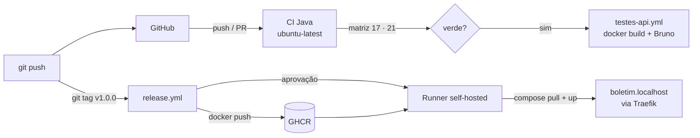

# Tutorial GQS26 (versão Java) — GitHub Actions: testes, mocks, integração, API e cobertura, do `git push` à produção

**Aula 26 — Garantia da Qualidade de Software** | Prof. Giovane Barcelos
**Duração estimada:** 2h30
**Esta é a versão só Java.** Usa a mesma pasta `class26/lab-github/` do tutorial completo ([`GQS26-Tutorial-GitHubActions.md`](GQS26-Tutorial-GitHubActions.md), que também cobre Python), mas **remove o Python** com um script e segue apenas o Java (Spring Boot 3.5 + JUnit 5 + Mockito + JaCoCo + Bruno).
**Pré-requisitos:** conta no **GitHub**, Git e Docker + Compose v2. JDK 17+ e Maven são opcionais.
**Arquivos:** pasta `class26/lab-github/` de <https://github.com/giovanebarcelos/gqs-sandbox>.

---

## O que você vai construir

| Onde | O que é | Quem cria |
|---|---|---|
| **github.com** → *Actions* | CI com testes em **matriz Java 17/21**, API testada com Bruno | `ci-java.yml`, `testes-api.yml` |
| **github.com** → *Packages* | imagem Docker `boletim-java` (GHCR) | `release.yml` |
| `http://boletim.localhost` | Boletim API Java em **produção** (sua máquina) | o job `deploy`, no runner self-hosted |
| `http://cobertura.localhost` | relatório JaCoCo dos testes da sua máquina | `--profile cobertura` |
| `http://traefik.localhost` | painel do **Traefik** | `docker compose` |

### Pirâmide de testes (Java)

| Camada | O que prova | Arquivo | Quantos |
|---|---|---|---|
| Unitário | a regra de negócio isolada | `CalculadoraBoletimTest` (JUnit 5, parametrizado) | 14 |
| Mock | a conversa controller ↔ calculadora, com a calculadora trocada por dublê | `BoletimControllerMockTest` (Mockito `@MockitoBean`) | 5 |
| Camada HTTP | rotas e JSON sem subir servidor | `BoletimControllerTest` (`@WebMvcTest`) | 6 |
| Integração | a aplicação **inteira** por HTTP real, sem mocks | `BoletimIntegracaoIT` (`@SpringBootTest`, Failsafe) | 5 |
| API | a imagem Docker rodando, como será publicada | `bruno/Boletim-API` (Bruno) | 8 |
| Cobertura | quanto do código os testes executaram | JaCoCo, gate de **80%** de linhas | — |

### Workflows

| Arquivo | O que faz |
|---|---|
| `ci-java.yml` | **matriz Java 17/21**: `mvn verify` (unitários + mocks → integração → JaCoCo → gate 80%), resumo de cobertura, artefatos; depois chama `testes-api.yml` |
| `testes-api.yml` | workflow **reutilizável**: `docker build` + API no runner + coleção Bruno |
| `.github/actions/bruno/` | **composite action**: instala o Bruno CLI e roda a coleção |
| `release.yml` | tag `v*` → imagem no **GHCR** → deploy no runner self-hosted, **após aprovação** do Environment `production` |
| `codeql.yml` · `dependabot.yml` | SAST e SCA |



---

## Etapa 0 — Preparar a máquina (uma vez)

Instale **Git** e **Docker** (Compose v2). Linux: `curl -fsSL https://get.docker.com | sudo sh && sudo usermod -aG docker $USER` (reentre na sessão). Windows 11: `winget install -e --id Git.Git` e `winget install -e --id Docker.DockerDesktop` (o Docker Desktop precisa do WSL 2: `wsl --install` como administrador e reinicie; abra o Docker Desktop e espere *Engine running*); `gh` opcional: `winget install -e --id GitHub.cli`. macOS: `brew install --cask docker && brew install git gh`. Opcionais: `gh` (GitHub CLI), JDK 17+, Maven.

> **Linux × Windows 11:** cada bloco de comandos aparece em duas versões — **Linux/macOS (bash)** e **Windows 11 (PowerShell)**. No Windows, abra o **Terminal → PowerShell** (não precisa ser administrador). Quem preferir o **Git Bash** pode usar os comandos do Linux.

**Linux/macOS (bash):**

```bash
git config --global user.name  "Seu Nome"
git config --global user.email "seu.email@exemplo.com"
gh auth login                        # opcional (GitHub.com > HTTPS > navegador)
cd ~
git clone https://github.com/giovanebarcelos/gqs-sandbox.git
cd gqs-sandbox/class26/lab-github
```

**Windows 11 (PowerShell):**

```powershell
git config --global user.name  "Seu Nome"
git config --global user.email "seu.email@exemplo.com"
gh auth login                        # opcional (GitHub.com > HTTPS > navegador)
cd $HOME
git clone https://github.com/giovanebarcelos/gqs-sandbox.git
cd gqs-sandbox\class26\lab-github
```

Sem `gh`, o `git push` pede usuário e um **Personal Access Token** (Settings → Developer settings → Tokens classic, escopos `repo` e `workflow`) no lugar da senha.

---

## Etapa 1 — Conhecer o projeto e os workflows (20 min)

### 1.1 As regras

`POST /api/boletim` com `{"aluno":"Ana","notas":[7,9,8],"frequencia":90}`:

| Regra | Descrição |
|---|---|
| **R1** | média aritmética com 1 casa decimal (arredonda para cima no 5) |
| **R2** | frequência **abaixo de 75%** → `REPROVADO_POR_FALTA`; senão média ≥ 7,0 `APROVADO`, ≥ 4,0 `EXAME`, abaixo `REPROVADO` |
| **R3** | 1 a 4 notas de 0 a 10; frequência de 0 a 100; fora disso **HTTP 400** |

Rotas: `GET /api/health`, `POST /api/boletim`, `GET /api/admin/estatisticas` (exige `X-Admin-Token`, vindo de um **secret** — Etapa 7).

### 1.2 O mock em uma olhada

```java
@MockitoBean
private CalculadoraBoletim calculadora;                       // dublê no lugar do real

when(calculadora.calcular("Ana", List.of(7.0, 9.0), 90.0))    // STUB
        .thenReturn(new Boletim("Ana", new BigDecimal("1.0"), Situacao.REPROVADO, 9.0, 7.0, "resposta do mock"));
verify(calculadora).calcular("Ana", List.of(7.0, 9.0), 90.0); // VERIFY
```

Esse teste passa **mesmo com a regra errada** — de propósito: ele só verifica a *conversa* entre camadas. O `BoletimIntegracaoIT`, ao contrário, não tem mock: sobe a aplicação numa porta aleatória e fala HTTP real; o sufixo **`IT`** faz o *maven-failsafe-plugin* rodá-lo **depois** dos unitários (que rodam no *surefire*).

### 1.3 O que olhar no `ci-java.yml`

- **`paths:`** — só dispara quando muda `java/**`, `bruno/**` ou os próprios YAMLs.
- **`permissions: contents: read`** — menor privilégio para o `GITHUB_TOKEN`.
- **`concurrency` + `cancel-in-progress`** — push novo cancela a execução antiga.
- **`strategy.matrix.java: ["17","21"]`** + **`fail-fast: false`** — um job por JDK, e a outra versão termina mesmo se uma falhar.
- **`actions/setup-java` com `cache: maven`** — instala o JDK da matriz e guarda `~/.m2`.
- **`mvn -B verify`** — compila → unitários e mocks (surefire) → integração (failsafe) → relatório JaCoCo → **gate de 80%**.
- **`$GITHUB_STEP_SUMMARY`** — o *Resumo da cobertura* aparece na página da execução.
- **`upload-artifact` com `if: always()`** — relatórios guardados mesmo com o build vermelho.
- **`testes-api: uses: ./.github/workflows/testes-api.yml`** — **workflow reutilizável**; `needs: testes` só libera se **toda** a matriz passar. A **composite action** `bruno/action.yml` reaproveita *steps* (Node, Bruno CLI, `bru run`); o reutilizável reaproveita *jobs*.

---

## Etapa 2 — Primeiro push: o pipeline barra os defeitos (20 min)

### 2.1 Criar o repositório (só Java)

**Linux/macOS (bash):**

```bash
cp -r . ~/gqs26-boletim-ci && cd ~/gqs26-boletim-ci   # estando em gqs-sandbox/class26/lab-github
bash somente-java.sh                  # remove python/, ci-python.yml e o Python do compose, release, CodeQL e Dependabot
git init -b main && git add . && git commit -m "Boletim API: versao inicial"
gh repo create gqs26-boletim-ci --public --source=. --remote=origin --push
```

**Windows 11 (PowerShell):**

```powershell
Copy-Item -Recurse -Force (Get-Location).Path $HOME\gqs26-boletim-ci; cd $HOME\gqs26-boletim-ci   # estando em gqs-sandbox\class26\lab-github
& "$env:ProgramFiles\Git\bin\bash.exe" somente-java.sh   # o script roda no bash do Git for Windows
git init -b main; git add .; git commit -m "Boletim API: versao inicial"
gh repo create gqs26-boletim-ci --public --source=. --remote=origin --push
```

Sem `gh`: no site, **New repository** → `gqs26-boletim-ci` → **Public** → sem README/.gitignore/licença; depois `git remote add origin https://github.com/SEU-USUARIO/gqs26-boletim-ci.git` e `git push -u origin main` (dois comandos, iguais nos dois sistemas). O repositório precisa ser **público** (Environments com revisores e CodeQL são gratuitos só assim). **Os comandos seguintes rodam em `~/gqs26-boletim-ci`** (no Windows, `$HOME\gqs26-boletim-ci`).

### 2.2 O pipeline falha — por dois motivos diferentes

Na aba **Actions**: *CI Java* e *CodeQL*. O CI Java fica vermelho:

| Job | Resultado |
|---|---|
| Testes (Java 17) | ❌ erro de **compilação** |
| Testes (Java 21) | ❌ **2 testes** falham |
| Testes de API | ⊘ pulado (`needs: testes`) |

Java 17:

```text
[ERROR] ... maven-compiler-plugin:3.14.0:compile ... Fatal error compiling: error: release version 21 not supported
```

Java 21:

```text
[ERROR] Tests run: 14, Failures: 2 ... CalculadoraBoletimTest
[ERROR]   situacaoPelaMediaEFrequencia:45 expected: <APROVADO> but was: <REPROVADO_POR_FALTA>
[ERROR]   situacaoPelaMediaEFrequencia:45 expected: <EXAME> but was: <REPROVADO_POR_FALTA>
```

Os testes **com mock** e de **camada HTTP** passaram: o defeito está na regra, e só o unitário da **borda (75%)** o vê. Em **Artifacts** estão os relatórios, guardados mesmo com o build vermelho. O **CodeQL** passa — análise de segurança não depende dos testes.

---

## Etapa 3 — Corrigir o defeito 1; a matriz mostra o defeito 2 (10 min)

Regra: "**abaixo de** 75%" reprova; o código usa `<=`. `java/src/main/java/br/edu/gqs/boletim/CalculadoraBoletim.java`:

```diff
-        if (frequencia <= FREQUENCIA_MINIMA) {
+        if (frequencia < FREQUENCIA_MINIMA) {
```

**Linux/macOS (bash):**

```bash
git commit -am "Corrige limite de frequencia: 75% aprova" && git push
```

**Windows 11 (PowerShell):**

```powershell
git commit -am "Corrige limite de frequencia: 75% aprova"; git push
```

**Java 21 ✅** (25 unitários + 5 de integração, cobertura 100%); **Java 17 ❌** continua vermelho; os testes de API seguem pulados. Se o pipeline testasse só a versão mais nova estaria verde — e a produção, que roda **Java 17**, nem compilaria.

---

## Etapa 4 — Corrigir o defeito 2 e ver tudo verde (20 min)

O `pom.xml` exige Java 21 e o código usa `List.getFirst()/getLast()` (só existem desde o 21). Ajuste o código à produção.

`java/pom.xml`:

```diff
-        <java.version>21</java.version>
+        <java.version>17</java.version>
```

`CalculadoraBoletim.java`:

```diff
-        double menor = ordenadas.getFirst();
-        double maior = ordenadas.getLast();
+        double menor = ordenadas.get(0);
+        double maior = ordenadas.get(ordenadas.size() - 1);
```

**Linux/macOS (bash):**

```bash
git commit -am "Compatibiliza com Java 17" && git push
```

**Windows 11 (PowerShell):**

```powershell
git commit -am "Compatibiliza com Java 17"; git push
```

Tudo ✅. Explore a página da execução:

1. **Resumo da cobertura** — no fim da página: *"Java 21: cobertura de linhas 100.0% (56 de 56)"* (e uma linha por JDK).
2. **Artifacts** — baixe `relatorios-java-21`, extraia e abra `site/jacoco/index.html`.
3. **Testes de API** — no job *Bruno contra a API (java)*, passo *Rodar a colecao Bruno*:

```text
   ✓ BOL01 ... ✓ BOL05 - 75% de frequencia (o minimo) nao reprova por falta ... ✓ BOL08
│ Requests      │ 8 (8 Passed) │
```

O job fez `docker build`, subiu o container **no runner** e rodou o Bruno contra `http://localhost:8080`; o JUnit XML fica no artefato `resultados-api-java`.

### 4.1 Cobertura na sua máquina (opcional)

**Linux/macOS (bash):**

```bash
cd java && mvn -q verify && cd ..
cp .env.example .env
docker compose --profile cobertura up -d traefik cobertura   # http://cobertura.localhost
```

**Windows 11 (PowerShell):**

```powershell
cd java; mvn -q verify; cd ..
Copy-Item .env.example .env
docker compose --profile cobertura up -d traefik cobertura   # http://cobertura.localhost
```

Linhas **verdes** foram executadas; **vermelhas**, não. Cobertura mede o que foi *executado*, não se está *certo* — a Etapa 2 mostrou defeitos convivendo com 100%. (Porta 80 ocupada? `HTTP_PORT=8883` no `.env` e `:8883` nas URLs.)

---

## Etapa 5 — O gate de cobertura em ação (10 min)

`exercicios/Historico.java` tem ~20 linhas de lógica que nenhum teste executa.

**Linux/macOS (bash):**

```bash
cp exercicios/Historico.java java/src/main/java/br/edu/gqs/boletim/
git add . && git commit -m "Adiciona historico (sem testes)" && git push
```

**Windows 11 (PowerShell):**

```powershell
Copy-Item exercicios\Historico.java java\src\main\java\br\edu\gqs\boletim\
git add .; git commit -m "Adiciona historico (sem testes)"; git push
```

```text
[INFO] Tests run: 25, Failures: 0 ...      [INFO] Tests run: 5, Failures: 0 ...
[WARNING] Rule violated for bundle boletim-api: lines covered ratio is 0.74, but expected minimum is 0.80
[INFO] BUILD FAILURE
```

Nenhum teste quebrou — **a esteira recusou código não testado**, e o job de API nem rodou. Escreva um teste para `Historico` ou desfaça: `git revert HEAD --no-edit && git push` (Windows/PowerShell: `git revert HEAD --no-edit; git push`).

---

## Etapa 6 — Pull request e branch protection (15 min)

**Settings → Rules → Rulesets → New ruleset → New branch ruleset**: nome `main protegida`, *Enforcement* **Active**, alvo **Include default branch**, marque **Require a pull request before merging** e **Require status checks to pass**, adicionando `Testes (Java 17)` e `Testes (Java 21)`. **Create.**

**Linux/macOS (bash):**

```bash
git checkout -b feature/mensagem-clara
# altere uma mensagem de erro em CalculadoraBoletim.java
git commit -am "Mensagem mais clara" && git push -u origin feature/mensagem-clara
gh pr create --fill
```

**Windows 11 (PowerShell):**

```powershell
git checkout -b feature/mensagem-clara
# altere uma mensagem de erro em CalculadoraBoletim.java
git commit -am "Mensagem mais clara"; git push -u origin feature/mensagem-clara
gh pr create --fill
```

O botão **Merge** fica **bloqueado** (*Required statuses must pass*) até os dois jobs ficarem verdes. Armadilha clássica: com `paths:` no workflow, um check obrigatório que não rodou fica *Expected — Waiting for status* e bloqueia o merge; num repositório real, remova o `paths:` do workflow exigido. Com os checks verdes, faça o merge.

---

## Etapa 7 — Environment, secret e variável (10 min)

`/api/admin/estatisticas` só responde a quem enviar `X-Admin-Token` igual ao `TOKEN_ADMIN`. **Settings → Environments → New environment → `production`**:

1. **Required reviewers**: adicione a si mesmo → *Save protection rules*. Todo job com `environment: production` fica **parado** até alguém aprovar (CD *Delivery*).
2. **Environment secrets** → `TOKEN_ADMIN` = `segredo-do-github-123` (invente o seu).
3. **Environment variables** → `INSTITUICAO` = `Faculdade GQS`.

No **Environment** (e não no repositório) só jobs que declaram `environment: production` enxergam os valores — um workflow de PR nunca terá acesso ao `TOKEN_ADMIN`. O GitHub nunca mais mostra o valor do secret e o mascara (`***`) nos logs.

---

## Etapa 8 — Runner self-hosted e deploy local (40 min)

O job `deploy` usa `runs-on: [self-hosted, gqs26]`: roda num **runner na sua máquina**, que enxerga o Docker local.

> ⚠️ Um runner self-hosted executa código de workflows na **sua** máquina. Em repositório público, deixe *Settings → Actions → General → Fork pull request workflows* em **Require approval for all outside collaborators** e **remova o runner ao terminar** (Etapa 10).

### 8.1 Traefik e API locais

**Linux/macOS (bash):**

```bash
cp .env.example .env                  # se ainda não fez
docker compose up -d --build
curl -s http://boletim.localhost/api/health
# {"status":"ok","versao":"local","instituicao":"ambiente local"}
```

**Windows 11 (PowerShell)** — use `curl.exe` (no PowerShell, `curl` sozinho pode ser apelido de `Invoke-WebRequest`):

```powershell
Copy-Item .env.example .env           # se ainda não fez
docker compose up -d --build
curl.exe -s http://boletim.localhost/api/health
```

`http://traefik.localhost` mostra a rota `boletim-java`, criada pelas *labels* do compose — sem arquivo de configuração do Traefik.

### 8.2 Registrar o runner

1. **Settings → Actions → Runners → New self-hosted runner** → Linux x64 (**também no Windows**: o runner roda num container Linux). Copie só o **token** (o valor depois de `--token`; vale 1 hora, uso único).
2. No `.env` (Linux: `nano .env`; Windows: `notepad .env`): `REPO_URL=https://github.com/SEU-USUARIO/gqs26-boletim-ci` e `RUNNER_TOKEN=<token>`.
3. Suba o runner.

**Linux/macOS (bash):**

```bash
docker compose --profile runner up -d --build
docker logs gqs26_runner | tail -3      # ... Listening for Jobs
```

**Windows 11 (PowerShell):**

```powershell
docker compose --profile runner up -d --build
docker logs --tail 3 gqs26_runner       # ... Listening for Jobs
```

Em *Runners* o `gqs26-runner` aparece **Idle** com o rótulo `gqs26`.

---

## Etapa 9 — Release: da tag à produção, com aprovação (20 min)

**Linux/macOS (bash):**

```bash
git checkout main && git pull
git tag v1.0.0 && git push origin v1.0.0     # ou: gh release create v1.0.0 --generate-notes
```

**Windows 11 (PowerShell):**

```powershell
git checkout main; git pull
git tag v1.0.0; git push origin v1.0.0       # ou: gh release create v1.0.0 --generate-notes
```

Na aba **Actions**, execução **Release**:

| Job | O que acontece |
|---|---|
| **Imagem java no GHCR** | `docker/build-push-action` publica `ghcr.io/SEU-USUARIO/boletim-java:v1.0.0` e `:latest` (só este job tem `packages: write`) |
| **Deploy em producao** | ⏸ *Review pending: production* |

Clique em **Review deployments → production → Approve and deploy**. O runner faz `docker login ghcr.io`, `docker compose pull` + `up -d --no-build --no-deps boletim-java` e o **smoke test**.

**Linux/macOS (bash):**

```bash
curl -s http://boletim.localhost/api/health
# {"status":"ok","versao":"v1.0.0","instituicao":"Faculdade GQS"}
curl -s -o /dev/null -w '%{http_code}\n' http://boletim.localhost/api/admin/estatisticas      # 401
curl -s -H 'X-Admin-Token: segredo-do-github-123' http://boletim.localhost/api/admin/estatisticas
# {"boletinsCalculados":0,"versao":"v1.0.0"}
```

**Windows 11 (PowerShell)** — `NUL` faz o papel do `/dev/null`:

```powershell
curl.exe -s http://boletim.localhost/api/health
curl.exe -s -o NUL -w '%{http_code}\n' http://boletim.localhost/api/admin/estatisticas      # 401
curl.exe -s -H 'X-Admin-Token: segredo-do-github-123' http://boletim.localhost/api/admin/estatisticas
```

O secret não aparece nos logs (`***`). Em **Packages** a imagem está publicada. Se o `pull` der `denied`: o pacote precisa estar ligado ao repositório pelo label `org.opencontainers.image.source` do `release.yml`.

**Segunda versão e rollback:** `git tag v1.0.1 && git push origin v1.0.1` (Windows/PowerShell: `git tag v1.0.1; git push origin v1.0.1`) e aprove de novo. Para voltar: **Actions → execução do Release `v1.0.0` → Re-run all jobs → aprove**. A aprovação vale nos dois sentidos.

---

## Etapa 10 — DevSecOps e encerramento

| Prática | Ferramenta | Onde ver |
|---|---|---|
| **SAST** | CodeQL (`codeql.yml`, Java) | *Security → Code scanning* |
| **SCA** | Dependabot (`dependabot.yml`: Maven, GitHub Actions, Docker) | *Pull requests* "Bump ..." e *Security → Dependabot* |
| **Secret scanning** | grátis em repositório público | *Security → Secret scanning* |

Os PRs do Dependabot disparam o **mesmo CI**, e a branch protection só deixa mesclar se estiver verde. (Em repositório **privado**, o CodeQL exige GitHub Advanced Security e o job falha com *"Code scanning is not enabled"* — é esperado.)

**Encerrar:**

**Linux/macOS (bash):**

```bash
cd ~/gqs26-boletim-ci
docker compose --profile runner --profile cobertura down
```

**Windows 11 (PowerShell):**

```powershell
cd $HOME\gqs26-boletim-ci
docker compose --profile runner --profile cobertura down
```

E **remova o runner** em *Settings → Actions → Runners → … → Remove runner*.

---

## Armadilhas

| Sintoma | Causa e solução |
|---|---|
| Workflow não aparece | precisa estar em `.github/workflows/` com `.yml`; confira a indentação |
| Pipeline não dispara | filtro `paths:` não casou; use **Run workflow** |
| Job `deploy` fica Queued | nenhum runner com o rótulo `gqs26` online: `docker logs gqs26_runner` |
| Token do runner expirou (`NotFound`) | vale 1 hora e é de uso único: gere outro e `docker compose --profile runner up -d --force-recreate` |
| `denied` ao baixar do GHCR | pacote sem vínculo com o repositório ou sem `packages: read` |
| Merge bloqueado em *Expected* | check obrigatório que o `paths:` impediu de rodar |
| Dois labs ao mesmo tempo | todos usam a porta 80: `docker compose down` num deles ou mude `HTTP_PORT` |
| `docker.sock` no runner | equivale a dar root da máquina ao runner: aceitável em laboratório, não em produção |
| Windows: runner reiniciando com `exec /entrypoint.sh: no such file or directory` ou `$'\r': command not found` | os `.sh` foram baixados com fim de linha CRLF: `git pull` no `gqs-sandbox` (o `.gitattributes` força LF), copie de novo e rode `docker compose --profile runner up -d --build` |
| Windows: `curl` responde com um objeto do PowerShell ou erro de parâmetro | use `curl.exe` (no PowerShell 5, `curl` é apelido de `Invoke-WebRequest`) |
| Windows: `bash.exe` não encontrado | o Git for Windows foi instalado em outra pasta: rode o script pelo **Git Bash** (`bash somente-java.sh`) |

## Perguntas para o relatório

1. Por que o teste **com mock** passa com a regra de frequência errada? Que defeito ele detecta?
2. Qual defeito só a **matriz** pegou e por que nenhum unitário o acusaria?
3. Diferença entre o teste de **integração** (`IT`) e o de **API** (Bruno)?
4. Cobertura de 100% com defeitos presentes: o que isso diz sobre cobertura como única métrica?
5. Diferença entre **workflow reutilizável** e **composite action**; quando usar cada um?
6. Por que o `TOKEN_ADMIN` fica no **Environment** e não nos secrets do repositório?
7. Três diferenças práticas entre este pipeline e o equivalente no Gitea Actions.

## O que entregar

Capturas: (1) aba Actions verde com a matriz Java 17/21 e o job de API; (2) resumo de cobertura e o relatório JaCoCo; (3) a execução que falhou pelo gate de cobertura; (4) o PR bloqueado pelos checks; (5) o *Review deployments* pendente e o `curl` em `boletim.localhost/api/health` com `v1.0.0`; (6) respostas às perguntas.
