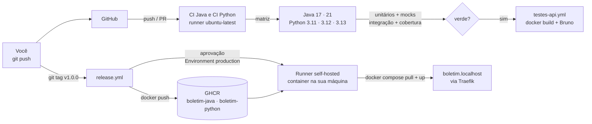

# Tutorial GQS26 — GitHub Actions na prática: testes, mocks, integração, API e cobertura, do `git push` à produção

**Aula 26 — Garantia da Qualidade de Software** | Prof. Giovane Barcelos
**Duração estimada:** 3h
**Pré-requisitos:** uma **conta no GitHub**, Git e Docker + Docker Compose. JDK 17+, Maven, Python e Node são **opcionais** — o GitHub roda tudo nos runners dele; eles só servem para rodar os testes na sua máquina antes do `push`. A **Etapa 0** mostra como instalar.
**Arquivos do laboratório:** pasta `class26/lab-github/` do repositório <https://github.com/giovanebarcelos/gqs-sandbox> (Etapa 0.4).
**Tutorial irmão:** [`../lab-gitea/GQS26-Tutorial-GiteaActions.md`](../lab-gitea/GQS26-Tutorial-GiteaActions.md) — a mesma aplicação e os mesmos testes no **Gitea Actions**, numa esteira 100% local. Faça um, depois o outro, e compare.

---

## O que você vai construir

Um repositório no GitHub com uma esteira de CI/CD completa e, na sua máquina, o "servidor de produção" que recebe o deploy, acessado por nomes amigáveis no navegador:

| Onde | O que é | Quem cria |
|---|---|---|
| **github.com** → aba *Actions* | os pipelines de **CI**: testes unitários, mocks, integração, API e cobertura em **matriz** de versões | os workflows `ci-java.yml` e `ci-python.yml` |
| **github.com** → *Packages* | as imagens Docker `boletim-java` e `boletim-python` (GHCR) | o workflow `release.yml` |
| `http://boletim.localhost` | Boletim API **Java** em **produção** (sua máquina) | o job `deploy` do release, no runner self-hosted |
| `http://boletim-python.localhost` | Boletim API **Python** em produção | idem |
| `http://cobertura.localhost` | Relatórios de **cobertura** (JaCoCo e coverage.py) dos testes que você rodar na sua máquina | `docker compose --profile cobertura` |
| `http://traefik.localhost` | Painel do **Traefik**, o proxy reverso | `docker compose` |

A aplicação é a **Boletim API** (média, situação e frequência de um aluno), em duas implementações idênticas — mesmas rotas, mesmas regras e **os mesmos defeitos plantados**:

| | Java (principal) | Python (secundária) |
|---|---|---|
| Aplicação | Spring Boot 3.5 (`java/`) | Flask 3 (`python/`) |
| CI | `.github/workflows/ci-java.yml` — matriz **Java 17 e 21** | `.github/workflows/ci-python.yml` — matriz **Python 3.11, 3.12 e 3.13** |

### A pirâmide de testes que o pipeline executa

| Camada | O que prova | Java | Python | Quantos |
|---|---|---|---|---|
| **Teste unitário** | a regra de negócio isolada | JUnit 5 — `CalculadoraBoletimTest` | pytest — `test_calculadora.py` | Java 14 · Python 15 |
| **Teste com mock** | a conversa entre camadas, com a vizinha trocada por um dublê | Mockito — `BoletimControllerMockTest` (`@MockitoBean`) | `unittest.mock` — `test_app_mock.py` | Java 5 · Python 5 |
| **Teste de camada HTTP** | rotas e JSON, sem subir o servidor | `@WebMvcTest` + MockMvc — `BoletimControllerTest` | cliente de teste do Flask — `test_app.py` | Java 6 · Python 6 |
| **Teste de integração** | a aplicação **inteira**, por HTTP de verdade, sem mocks | `@SpringBootTest` — `BoletimIntegracaoIT` (Failsafe) | servidor Werkzeug real — `tests/integracao/` | Java 5 · Python 5 |
| **Teste de API** | a aplicação **dentro do container**, como será publicada | Bruno — `bruno/Boletim-API` | Bruno (mesma coleção) | 8 |
| **Cobertura** | quanto do código os testes executaram | JaCoCo — gate de **80%** de linhas | coverage.py — gate de **80%** | — |

### Os workflows

| Arquivo | Gatilho | O que faz |
|---|---|---|
| `ci-java.yml` | `push`/`pull_request` em `java/**`, `bruno/**` | **matriz Java 17/21**: `mvn verify` (unitários + mocks → integração → JaCoCo → gate de 80%), resumo de cobertura na página da execução, artefatos; depois chama o `testes-api.yml` |
| `ci-python.yml` | `push`/`pull_request` em `python/**`, `bruno/**` | **matriz Python 3.11/3.12/3.13**: unitários + mocks → integração → relatório + gate de 80%; depois chama o `testes-api.yml` |
| `testes-api.yml` | `workflow_call` (**reutilizável**) | constrói a imagem Docker, sobe a API no runner e roda a coleção Bruno por uma *composite action* |
| `.github/actions/bruno/action.yml` | `uses: ./.github/actions/bruno` | **composite action**: instala o Bruno CLI e roda a coleção |
| `release.yml` | tag `v*` | publica as imagens no **GHCR** e faz o **deploy** no seu runner self-hosted, **depois da aprovação** do Environment `production` |
| `codeql.yml` | `push`, PR, semanal | **SAST**: análise estática de segurança (CodeQL) |
| `dependabot.yml` | semanal | **SCA**: PRs de atualização de dependências e actions |



Ao longo do tutorial você vai:

1. criar um repositório público e enviar o projeto com `git push`;
2. ver os pipelines **falharem** — cada versão da matriz por um motivo diferente;
3. corrigir o defeito 1 e ver **uma versão passar e a outra continuar quebrada** — o valor da matriz;
4. corrigir o defeito 2, ver tudo verde, a **cobertura** no resumo da execução e a **API testada com Bruno** pelo workflow reutilizável;
5. provocar a queda da **cobertura** abaixo de 80% e ver o gate reprovar;
6. proteger a `main` com **branch protection** e abrir um **pull request**;
7. configurar **Environment**, **secret** e **variável**, registrar um **runner self-hosted** e publicar a **v1.0.0** em `http://boletim.localhost` depois de uma **aprovação manual**;
8. ver o **CodeQL** e o **Dependabot** em ação (DevSecOps).

### Estrutura da pasta

```
class26/lab-github/                    ← vira o repositório SEU-USUARIO/gqs26-boletim-ci
├── GQS26-Tutorial-GitHubActions.md    ← este tutorial
├── .github/
│   ├── workflows/                     ← ci-java · ci-python · testes-api · release · codeql
│   ├── actions/bruno/action.yml       ← composite action
│   └── dependabot.yml
├── java/                              ← pom.xml (JaCoCo, Failsafe) · Dockerfile · src/main · src/test
├── python/                            ← boletim/ · tests/ · tests/integracao/ · pytest.ini · Dockerfile
├── bruno/Boletim-API/                 ← 8 testes de API e os ambientes Java, Python, Traefik, ...
├── docker-compose.yml                 ← Traefik + Boletim Java/Python (+ runner, + cobertura)
├── runner/                            ← imagem do runner self-hosted (actions-runner + docker compose)
├── cobertura/                         ← nginx que serve os relatórios de cobertura
├── exercicios/                        ← arquivos da Etapa 6 (gate de cobertura)
└── .env.example                       ← porta do Traefik e dados do runner (copie para .env)
```

---

# ETAPA 0 — Preparar a máquina (15 a 30 min, só uma vez)

### 0.1 O que instalar

| Ferramenta | Versão mínima | Para quê | Obrigatório? |
|---|---|---|---|
| Conta no **GitHub** | — | hospedar o repositório e rodar as Actions | **sim** |
| Git | qualquer recente | clonar o repositório e fazer `push` | **sim** |
| Docker + Docker Compose v2 | Compose 2.20+ | subir o Traefik, as APIs e o runner da Etapa 8 | **sim** (a partir da Etapa 8) |
| GitHub CLI (`gh`) | 2.x | criar repositório, PR e tag pela linha de comando | opcional (tudo também se faz no site) |
| JDK 17+ e Maven 3.9+ | — | rodar `mvn verify` **antes** do push | opcional |
| Python 3.10+ | — | rodar o `pytest` antes do push | opcional |
| Node.js 18+ e Bruno CLI | — | rodar os testes de API na sua máquina | opcional |

**Linux (Ubuntu/Debian/Fedora):**

```bash
curl -fsSL https://get.docker.com | sudo sh
sudo systemctl enable --now docker
sudo usermod -aG docker $USER        # saia e entre de novo na sessão depois disto
sudo apt install -y git              # Fedora: sudo dnf install -y git
# opcionais: sudo apt install -y gh openjdk-21-jdk maven python3 python3-venv nodejs npm
```

**Windows 10/11** (PowerShell; o Docker Desktop precisa do WSL 2 — `wsl --install` como administrador, depois reinicie):

```powershell
winget install -e --id Git.Git
winget install -e --id Docker.DockerDesktop
# opcionais: GitHub.cli, EclipseAdoptium.Temurin.21.JDK, Python.Python.3.12, OpenJS.NodeJS.LTS
```

Abra o Docker Desktop e espere *Engine running*.

> **Linux × Windows 11:** daqui em diante, cada bloco de comandos aparece em duas versões — **Linux/macOS (bash)** e **Windows 11 (PowerShell)** — ou num bloco único, quando os comandos são idênticos nos dois. No Windows, abra o **Terminal → PowerShell** (não precisa ser administrador). Quem preferir o **Git Bash** pode usar os comandos do Linux.

**macOS** (com [Homebrew](https://brew.sh)):

```bash
brew install --cask docker           # abra o Docker Desktop uma vez
brew install git gh                  # opcionais: openjdk@21 maven python@3.12 node
```

### 0.2 Conferir

**Linux, macOS e Windows 11** (mesmos comandos):

```bash
git --version
docker --version
docker compose version               # precisa ser v2.x
gh --version                         # opcional
```

### 0.3 Identidade do Git e login no GitHub

**Linux, macOS e Windows 11** (mesmos comandos):

```bash
git config --global user.name  "Seu Nome"
git config --global user.email "seu.email@exemplo.com"
gh auth login                        # opcional: escolha GitHub.com > HTTPS > login pelo navegador
```

Sem o `gh`, o `git push` pede usuário e um **Personal Access Token** (GitHub → Settings → Developer settings → Personal access tokens → *Tokens (classic)* com escopos `repo` e `workflow`) no lugar da senha.

### 0.4 Baixar o repositório do laboratório

**Linux/macOS (bash):**

```bash
cd ~
git clone https://github.com/giovanebarcelos/gqs-sandbox.git
cd gqs-sandbox/class26/lab-github
```

**Windows 11 (PowerShell):**

```powershell
cd $HOME
git clone https://github.com/giovanebarcelos/gqs-sandbox.git
cd gqs-sandbox\class26\lab-github
```

Já tem o repositório? `cd gqs-sandbox` e `git pull`.

---

## Etapa 1 — Conhecer a aplicação, os testes e os workflows (25 min)

### 1.1 Regras de negócio (o "requisito")

`POST /api/boletim` recebe `{"aluno": "Ana", "notas": [7, 9, 8], "frequencia": 90}` e devolve média, situação, maior e menor nota:

| Regra | Descrição |
|---|---|
| **R1** | média = média aritmética das notas, com **1 casa decimal** (arredonda para cima no 5) |
| **R2** | frequência **abaixo de 75%** → `REPROVADO_POR_FALTA` (vale sobre a média). Com frequência ≥ 75%: média ≥ 7,0 → `APROVADO`; média ≥ 4,0 → `EXAME`; abaixo → `REPROVADO` |
| **R3** | de 1 a 4 notas, cada uma de 0 a 10; frequência de 0 a 100. Fora disso, **HTTP 400** com a mensagem do erro |

Endpoints: `GET /api/health` (com a **versão publicada** e a instituição), `POST /api/boletim` e `GET /api/admin/estatisticas` (exige o cabeçalho `X-Admin-Token`, que vem de um **secret** — Etapa 8).

### 1.2 Os testes, camada por camada

Antes de olhar o pipeline, abra os testes. O mesmo comportamento é verificado de vários ângulos:

**Unitário** — `java/src/test/java/.../CalculadoraBoletimTest.java`. Uma regra, sem Spring, sem HTTP. Repare no teste parametrizado `situacaoPelaMediaEFrequencia`: cada linha do `@CsvSource` é um caso de borda das regras R1/R2.

**Mock** — `BoletimControllerMockTest.java` (Java) e `tests/test_app_mock.py` (Python). Aqui a **calculadora é substituída por um dublê**:

```java
@MockitoBean
private CalculadoraBoletim calculadora;                       // dublê injetado no lugar do real

when(calculadora.calcular("Ana", List.of(7.0, 9.0), 90.0))    // STUB: "quando te chamarem assim, responda isto"
        .thenReturn(new Boletim("Ana", new BigDecimal("1.0"), Situacao.REPROVADO, 9.0, 7.0, "resposta do mock"));
...
verify(calculadora).calcular("Ana", List.of(7.0, 9.0), 90.0); // VERIFY: o controller chamou, com estes argumentos
```

Esse teste passa **mesmo que a regra de negócio esteja errada** — e é de propósito: ele só verifica se o controller entrega os dados certos e traduz o erro em HTTP 400. Quem verifica a regra é o teste unitário. Em Python o equivalente é `patch("boletim.app.calcular_boletim", return_value=...)` e `mock.assert_called_once_with(...)`.

**Integração** — `BoletimIntegracaoIT.java` e `tests/integracao/test_integracao.py`. **Nenhum mock**: a aplicação inteira sobe numa porta aleatória e o teste conversa por HTTP real. Dois detalhes importantes:

- No Java, o sufixo **`IT`** faz o *maven-failsafe-plugin* rodar a classe na fase `integration-test`, **depois** dos unitários (que rodam no *surefire*). No Python, o marcador `@pytest.mark.integracao` separa os dois grupos (`-m "not integracao"` × `-m integracao`).
- O teste `estatisticasContamSoOsBoletinsCalculadosComSucesso` verifica **estado compartilhado entre requisições** — algo que nenhum teste unitário enxerga.

**API (Bruno)** — `bruno/Boletim-API/*.bru`. Cada arquivo é uma requisição HTTP com asserções (`expect(res.getStatus()).to.equal(200)`), versionável como texto. No pipeline roda contra a imagem Docker **construída a partir do código do commit**: prova o sistema montado, dentro do container, do jeito que será publicado.

### 1.3 Os workflows, linha a linha

Abra `.github/workflows/ci-java.yml` e procure estes pontos:

- **`on.push.paths` / `on.pull_request.paths`** — o pipeline Java só roda quando muda `java/**`, `bruno/**` ou os próprios YAMLs. Mudou só o Python? O Java nem dispara.
- **`permissions: contents: read`** — **menor privilégio**: o `GITHUB_TOKEN` só lê o repositório (Slide 16).
- **`concurrency` + `cancel-in-progress: true`** — um push novo na mesma branch cancela a execução antiga, que já não importa.
- **`timeout-minutes`** — nenhum job fica preso indefinidamente consumindo minutos.
- **`strategy.matrix.java: ["17", "21"]`** — cria **um job por versão**, em paralelo. **`fail-fast: false`** deixa a outra versão terminar quando uma falha — você vê os dois resultados.
- **`actions/setup-java` com `cache: maven`** — instala o JDK escolhido pela matriz e guarda `~/.m2` entre execuções.
- **`mvn -B verify`** — encadeia: compilar → unitários e mocks (*surefire*) → integração (*failsafe*) → relatório JaCoCo → **gate de 80%** de linhas.
- **`$GITHUB_STEP_SUMMARY`** — o passo *Resumo da cobertura* escreve uma linha em Markdown na página da execução.
- **`actions/upload-artifact` com `if: always()`** — os relatórios são guardados **mesmo quando o build falha**, que é quando mais se precisa deles.
- **`testes-api: uses: ./.github/workflows/testes-api.yml`** — chama o **workflow reutilizável** (Slide 10). O mesmo arquivo atende Java e Python; só mudam os `inputs` (`projeto`, `porta`, `ambiente-bruno`). `needs: testes` garante que ele só roda se **todos** os jobs da matriz passarem.

E o `.github/actions/bruno/action.yml` é uma **composite action**: reaproveita um conjunto de **steps** (instalar o Node, instalar o Bruno CLI, `bru run`). A diferença que o Slide 10 explica: o *workflow reutilizável* reaproveita **jobs** inteiros; a *composite action* reaproveita **steps** dentro de um job.

> **Ponto de atenção sobre as versões das actions:** os YAMLs usam versões fixas (`actions/checkout@v7`, `actions/setup-java@v6`, ...). Fixar a versão evita que uma atualização inesperada quebre o pipeline (Slide 16); o Dependabot, na Etapa 9, abre PRs para atualizá-las com segurança.

### 1.4 (Opcional) Rodar os testes na sua máquina

Boa prática — *nunca commitar código com testes quebrados*. Dentro de `gqs-sandbox/class26/lab-github`:

**Linux/macOS (bash):**

```bash
cd java && mvn -q verify && cd ..
# [ERROR] Tests run: 14, Failures: 2 ... situacaoPelaMediaEFrequencia: expected: <APROVADO> but was: <REPROVADO_POR_FALTA>

cd python && python3 -m venv .venv && .venv/bin/pip install -q -r requirements-dev.txt
.venv/bin/pytest -q -m "not integracao"
# 2 failed, 24 passed, 5 deselected
```

**Windows 11 (PowerShell)** — no Windows o Python se chama `python` (ou `py`) e o venv fica em `.venv\Scripts`:

```powershell
cd java; mvn -q verify; cd ..
cd python; python -m venv .venv; .venv\Scripts\pip install -q -r requirements-dev.txt
.venv\Scripts\pytest -q -m "not integracao"
cd ..
```

Falhou? Ótimo: é o defeito 1. Faça o push assim mesmo — a Etapa 2 mostra o pipeline fazendo o papel de quem esqueceu de rodar os testes. (`python/.venv` e `java/target` estão no `.gitignore`: não vão para o commit.)

---

## Etapa 2 — Primeiro push: os pipelines barram os defeitos (25 min)

### 2.1 Criar o seu repositório

O projeto vira um repositório **próprio**, separado do `gqs-sandbox`. Copie a pasta para fora do clone — um repositório Git dentro de outro confunde os dois:

**Linux/macOS (bash):**

```bash
cp -r . ~/gqs26-boletim-ci           # estando em gqs-sandbox/class26/lab-github
cd ~/gqs26-boletim-ci
git init -b main
git add .
git commit -m "Boletim API: versao inicial"
```

**Windows 11 (PowerShell):**

```powershell
Copy-Item -Recurse -Force (Get-Location).Path $HOME\gqs26-boletim-ci   # estando em gqs-sandbox\class26\lab-github
cd $HOME\gqs26-boletim-ci
git init -b main
git add .
git commit -m "Boletim API: versao inicial"
```

Crie o repositório **público** no GitHub (necessário para as *required reviewers* e o CodeQL gratuitos — Etapas 8 e 9) e envie. Com o `gh` (**Linux, macOS e Windows 11**, mesmo comando):

```bash
gh repo create gqs26-boletim-ci --public --source=. --remote=origin --push
```

Sem o `gh`: no site, **New repository** → nome `gqs26-boletim-ci` → **Public** → *não* marque README/.gitignore/licença → **Create repository**; depois (mesmos comandos nos dois sistemas):

```bash
git remote add origin https://github.com/SEU-USUARIO/gqs26-boletim-ci.git
git push -u origin main
```

> **De agora em diante, os comandos rodam em `~/gqs26-boletim-ci`** (no Windows, `$HOME\gqs26-boletim-ci`), a menos que digam o contrário.

### 2.2 Acompanhar a execução

No GitHub, abra a aba **Actions**. Aparecem as execuções **CI Java**, **CI Python** e **CodeQL**. Em cerca de dois minutos, as duas primeiras ficam **vermelhas** — e cada versão da matriz falha por um motivo diferente.

**CI Java**

| Job | Resultado |
|---|---|
| Testes (Java 17) | ❌ erro de **compilação** |
| Testes (Java 21) | ❌ **2 testes** falham |
| Testes de API / Bruno contra a API (java) | ⊘ pulado (`needs: testes`) |

Clique em **Testes (Java 17)** → passo **mvn verify**:

```text
[ERROR] Failed to execute goal org.apache.maven.plugins:maven-compiler-plugin:3.14.0:compile (default-compile) on project boletim-api: Fatal error compiling: error: release version 21 not supported
```

Agora **Testes (Java 21)** — compila, mas as regras estão erradas:

```text
[ERROR] Tests run: 14, Failures: 2, Errors: 0, Skipped: 0 <<< FAILURE! -- in br.edu.gqs.boletim.CalculadoraBoletimTest
[ERROR]   CalculadoraBoletimTest.situacaoPelaMediaEFrequencia:45 expected: <APROVADO> but was: <REPROVADO_POR_FALTA>
[ERROR]   CalculadoraBoletimTest.situacaoPelaMediaEFrequencia:45 expected: <EXAME> but was: <REPROVADO_POR_FALTA>
```

Repare: os testes **com mock** e de **camada HTTP** passaram. O defeito está na regra, e só o teste unitário parametrizado da borda (75%) o enxerga.

**CI Python**

| Job | Resultado |
|---|---|
| Testes (Python 3.11) | ❌ `SyntaxError` — o código nem importa |
| Testes (Python 3.12) | ❌ 2 testes falham |
| Testes (Python 3.13) | ❌ 2 testes falham |

No 3.11, o passo *Testes unitários e com mock*:

```text
E   SyntaxError: f-string: unmatched '['
ERROR tests/integracao/test_integracao.py
```

No 3.12/3.13:

```text
FAILED tests/test_calculadora.py::test_situacao_pela_media_e_frequencia[10-75-APROVADO]
FAILED tests/test_calculadora.py::test_situacao_pela_media_e_frequencia[5.0-75-EXAME]
2 failed, 24 passed, 5 deselected
```

O `5 deselected` são os 5 testes de integração, deixados de fora por `-m "not integracao"`. Os passos seguintes (integração, gate de cobertura) **nem rodam**: cada passo só executa se o anterior passou.

**CodeQL** roda em paralelo (Java e Python) e deve passar: a análise de segurança não depende dos testes.

Na página de cada execução, em **Artifacts**, estão os relatórios (`relatorios-java-21`, `relatorios-python-3.12`, ...), guardados mesmo com o build vermelho.

---

## Etapa 3 — Corrigir o defeito 1; a matriz mostra o resto (15 min)

### 3.1 A correção

A regra R2 diz "frequência **abaixo de** 75% reprova": exatamente 75% **não** reprova. Os dois códigos usam `<=`.

`java/src/main/java/br/edu/gqs/boletim/CalculadoraBoletim.java`:

```diff
-        if (frequencia <= FREQUENCIA_MINIMA) {
+        if (frequencia < FREQUENCIA_MINIMA) {
```

`python/boletim/calculadora.py`:

```diff
-    if frequencia <= FREQUENCIA_MINIMA:
+    if frequencia < FREQUENCIA_MINIMA:
```

**Linux, macOS e Windows 11** (mesmos comandos):

```bash
git commit -am "Corrige limite de frequencia: 75% aprova"
git push
```

### 3.2 O pipeline avança — e a matriz mostra o resto

| Pipeline | Resultado |
|---|---|
| CI Java — Java 21 | ✅ 25 testes unitários + 5 de integração, cobertura 100% |
| CI Java — Java 17 | ❌ **continua vermelho** (compilação) |
| CI Java — Testes de API | ⊘ pulado: `needs` exige que **todos** os jobs da matriz passem |
| CI Python — 3.12 e 3.13 | ✅ |
| CI Python — 3.11 | ❌ **continua vermelho** (`SyntaxError`) |

Este é o ponto da aula: se o pipeline testasse **só a versão mais nova**, estaria verde — e a produção, que roda **Java 17**, nem compilaria; qualquer usuário em **Python 3.11** não conseguiria nem importar o módulo. A matriz acusou dois defeitos que nenhum teste unitário pegaria, porque o problema é **a versão da linguagem**, não a lógica.

---

## Etapa 4 — Corrigir o defeito 2 e ver tudo verde (20 min)

### 4.1 As correções

**Java.** O `pom.xml` exige Java 21 e o código usa `List.getFirst()`/`getLast()`, métodos que só existem desde o Java 21. Como a produção roda 17, o código se ajusta:

`java/pom.xml`:

```diff
-        <java.version>21</java.version>
+        <java.version>17</java.version>
```

`java/src/main/java/br/edu/gqs/boletim/CalculadoraBoletim.java`:

```diff
-        double menor = ordenadas.getFirst();
-        double maior = ordenadas.getLast();
+        double menor = ordenadas.get(0);
+        double maior = ordenadas.get(ordenadas.size() - 1);
```

**Python.** Aspas duplas **dentro** de uma f-string com aspas duplas só são aceitas a partir do Python 3.12. `python/boletim/calculadora.py`, última linha de `calcular_boletim`:

```diff
-    boletim["resumo"] = f"{boletim["aluno"]}: {boletim["situacao"]} com media {boletim["media"]}"
+    boletim["resumo"] = f"{boletim['aluno']}: {boletim['situacao']} com media {boletim['media']}"
```

**Linux, macOS e Windows 11** (mesmos comandos):

```bash
git commit -am "Compatibiliza com Java 17 e Python 3.11"
git push
```

### 4.2 Tudo verde

Os dois pipelines terminam ✅: **5 jobs de teste** (Java 17, 21; Python 3.11, 3.12, 3.13) e **2 jobs de API**. Explore a página de cada execução:

1. **Resumo da cobertura** — role até o fim da página da execução do CI Java: o passo `$GITHUB_STEP_SUMMARY` publicou *"Java 21: cobertura de linhas 100.0% (56 de 56)"* (e uma linha por versão). No CI Python: *"Python 3.12: cobertura de linhas 98%"*.
2. **Artifacts** — baixe `relatorios-java-21`, extraia e abra `site/jacoco/index.html`: a cobertura por pacote, classe e linha. Em `relatorios-python-3.12`, `relatorio-cobertura/index.html`.
3. **Testes de API** — no job *Testes de API / Bruno contra a API (java)*, abra o passo *Rodar a colecao Bruno*:

```text
   ✓ BOL01 - Health responde 200 com status ok
   ✓ BOL02 - Media 8,0 e 90% de frequencia: APROVADO, maior 9 e menor 7
   ✓ BOL03 - Media 5,5: EXAME
   ✓ BOL04 - Media 2,5: REPROVADO
   ✓ BOL05 - 75% de frequencia (o minimo) nao reprova por falta
   ✓ BOL06 - 74% de frequencia: REPROVADO_POR_FALTA, mesmo com media 9,5
   ✓ BOL07 - Nota 11 responde 400
   ✓ BOL08 - Estatisticas sem X-Admin-Token responde 401
│ Requests      │ 8 (8 Passed) │
```

Este job fez `docker build` da imagem, subiu o container **no runner** e disparou o Bruno contra `http://localhost:8080`. O artefato `resultados-api-java` guarda o JUnit XML.

4. Volte à página principal da aba **Actions**: o ícone ✅ também aparece ao lado do commit na lista de commits — o status do pipeline sem abrir a aba.

### 4.3 Os relatórios de cobertura, na sua máquina (opcional)

Se instalou JDK/Maven/Python, gere os relatórios e sirva-os com o Traefik:

**Linux/macOS (bash):**

```bash
cd java   && mvn -q verify && cd ..                   # relatório em java/target/site/jacoco/
cd python && python3 -m venv .venv && .venv/bin/pip install -q -r requirements-dev.txt
.venv/bin/pytest -q -m "not integracao" --cov
.venv/bin/pytest -q -m integracao --cov --cov-append
.venv/bin/coverage html -d relatorio-cobertura && cd ..

cp .env.example .env
docker compose --profile cobertura up -d traefik cobertura
```

**Windows 11 (PowerShell):**

```powershell
cd java; mvn -q verify; cd ..                         # relatório em java\target\site\jacoco\
cd python; python -m venv .venv; .venv\Scripts\pip install -q -r requirements-dev.txt
.venv\Scripts\pytest -q -m "not integracao" --cov
.venv\Scripts\pytest -q -m integracao --cov --cov-append
.venv\Scripts\coverage html -d relatorio-cobertura; cd ..

Copy-Item .env.example .env
docker compose --profile cobertura up -d traefik cobertura
```

Abra `http://cobertura.localhost`. Em cada relatório, as linhas **verdes** foram executadas pelos testes; as **vermelhas**, não. Cobertura mede o que os testes **executaram**, não se estão **certos** — a Etapa 2 mostrou os dois defeitos convivendo com 100% de cobertura.

> Porta 80 ocupada? Descomente `HTTP_PORT=8883` no `.env` e acrescente `:8883` nas URLs.

---

## Etapa 5 — O gate de cobertura em ação (10 min)

Os testes passam, mas e se alguém adicionar código **sem testes**? Simule: `exercicios/historico.py` (e `Historico.java`) têm ~20 linhas de lógica que nenhum teste executa.

**Linux/macOS (bash):**

```bash
cp exercicios/historico.py   python/boletim/
cp exercicios/Historico.java java/src/main/java/br/edu/gqs/boletim/
git add . && git commit -m "Adiciona historico do aluno (sem testes)" && git push
```

**Windows 11 (PowerShell):**

```powershell
Copy-Item exercicios\historico.py   python\boletim\
Copy-Item exercicios\Historico.java java\src\main\java\br\edu\gqs\boletim\
git add .; git commit -m "Adiciona historico do aluno (sem testes)"; git push
```

Os dois pipelines **falham** — com todos os testes verdes:

```text
# Java (passo mvn verify)
[INFO] Tests run: 25, Failures: 0, Errors: 0, Skipped: 0
[INFO] Tests run: 5, Failures: 0, Errors: 0, Skipped: 0
[WARNING] Rule violated for bundle boletim-api: lines covered ratio is 0.74, but expected minimum is 0.80
[INFO] BUILD FAILURE

# Python (passo "Relatorio de cobertura e gate de 80%")
boletim/historico.py        21     21     0%
TOTAL                       82     22    73%
Coverage failure: total of 73 is less than fail-under=80
```

Nenhum teste quebrou — **a esteira recusou código não testado**. E os jobs de API **nem rodaram** (`needs`). Para liberar, escreva testes para `Historico`/`historico_do_aluno` ou desfaça:

**Linux/macOS (bash):**

```bash
git revert HEAD --no-edit && git push
```

**Windows 11 (PowerShell):**

```powershell
git revert HEAD --no-edit; git push
```

---

## Etapa 6 — Pull request e branch protection (15 min)

Até aqui você empurrou direto na `main`. Em equipe, a `main` é protegida e tudo entra por **pull request**, depois que o CI passa.

### 6.1 Proteger a `main`

No repositório: **Settings** → **Rules** → **Rulesets** → **New ruleset** → **New branch ruleset**:

1. *Ruleset name*: `main protegida`. *Enforcement status*: **Active**.
2. *Target branches* → **Add target** → **Include default branch**.
3. Marque **Require a pull request before merging**.
4. Marque **Require status checks to pass** → **Add checks** e escolha: `Testes (Java 17)`, `Testes (Java 21)`, `Testes (Python 3.11)`, `Testes (Python 3.12)`, `Testes (Python 3.13)`. (Os nomes só aparecem na busca depois que rodaram ao menos uma vez — rodaram.)
5. **Create**.

> Em conta gratuita, regras valem para repositório público. O administrador pode ter *bypass*; desative-o para ver a trava de verdade.

### 6.2 Abrir um PR

**Linux, macOS e Windows 11** (mesmos comandos):

```bash
git checkout -b feature/mensagem-clara
# edite uma mensagem de erro em python/boletim/calculadora.py (ex.: "Informe de 1 a 4 notas")
git commit -am "Mensagem mais clara"
git push -u origin feature/mensagem-clara
gh pr create --fill                  # ou clique em "Compare & pull request" no site
```

Na página do PR, a seção **Checks** lista os jobs rodando. O botão **Merge pull request** fica **bloqueado** (*"Required statuses must pass before merging"*) até os cinco jobs de teste ficarem verdes. Dos dois CIs, só o Python roda (mais o CodeQL): o commit só tocou `python/` e o filtro `paths:` do Java não casou.

> Os checks **obrigatórios** que não rodam por causa do `paths:` ficam como *Expected — Waiting for status to be reported* e bloqueiam o merge. É a armadilha clássica de combinar `paths:` com branch protection: para um repositório de verdade, remova o `paths:` dos workflows exigidos ou use um job "guarda-chuva" que sempre roda.

Quando estiverem verdes, faça o merge. Agora sim os pipelines rodam no `main`.

---

## Etapa 7 — Segredos, variáveis e Environment (10 min)

O endpoint `/api/admin/estatisticas` só responde a quem enviar o cabeçalho `X-Admin-Token` igual ao `TOKEN_ADMIN` do ambiente. Esse valor **nunca** pode estar no repositório. A `INSTITUICAO`, que aparece no `/api/health`, não é sigilosa — vira uma **variável**.

No repositório: **Settings** → **Environments** → **New environment** → nome **`production`** → **Configure environment**:

1. **Required reviewers**: marque, digite o seu usuário e **Save protection rules**. Agora **qualquer job** com `environment: production` fica **parado** até alguém aprovar (CD *Delivery*).
2. **Environment secrets** → **Add environment secret** → `TOKEN_ADMIN` = `segredo-do-github-123` (invente o seu).
3. **Environment variables** → **Add environment variable** → `INSTITUICAO` = `Faculdade GQS`.

Por que no **Environment** e não no repositório? Porque só jobs que declaram `environment: production` enxergam esses valores — um workflow de PR, por exemplo, nunca terá acesso ao `TOKEN_ADMIN`. O `staging` poderia ter outro `TOKEN_ADMIN`, sem conflito.

Depois de salvo, o GitHub **nunca mais mostra** o valor do secret — só permite trocá-lo, e o mascara (`***`) nos logs.

---

## Etapa 8 — Runner self-hosted e deploy local em produção (40 min)

O job `deploy` do `release.yml` roda com `runs-on: [self-hosted, gqs26]`: num **runner na sua máquina**, que enxerga o Docker local e consegue atualizar `http://boletim.localhost`. É o cenário real de um servidor próprio que o GitHub não alcança.

> ⚠️ **Segurança:** um runner self-hosted executa código de workflows na **sua** máquina. Com ele registrado num repositório **público**, um *fork* malicioso poderia tentar rodar código nele via pull request. Em **Settings → Actions → General → Fork pull request workflows** deixe **Require approval for all outside collaborators**, e **desligue o runner ao fim da aula** (Etapa 11). O `release.yml` só dispara com tag — que só quem tem permissão de escrita cria.

### 8.1 Subir o Traefik e as APIs locais

Em `~/gqs26-boletim-ci` (no Windows, `$HOME\gqs26-boletim-ci`):

**Linux/macOS (bash):**

```bash
cp .env.example .env                 # se ainda não fez na Etapa 4.3
docker compose up -d --build
```

**Windows 11 (PowerShell):**

```powershell
Copy-Item .env.example .env          # se ainda não fez na Etapa 4.3
docker compose up -d --build
```

O Docker constrói as imagens **a partir do seu código** (as duas funcionam agora que você corrigiu os defeitos — com o defeito 2 o build do Java falharia: o `Dockerfile` usa Java 17).

**Linux/macOS (bash):**

```bash
curl -s http://boletim.localhost/api/health
# {"status":"ok","versao":"local","instituicao":"ambiente local"}
curl -s http://boletim-python.localhost/api/health
# {"status":"ok","versao":"local","instituicao":"ambiente local"}
```

**Windows 11 (PowerShell)** — use sempre `curl.exe` (no PowerShell, `curl` sozinho pode ser apelido de `Invoke-WebRequest`):

```powershell
curl.exe -s http://boletim.localhost/api/health
curl.exe -s http://boletim-python.localhost/api/health
```

Abra `http://traefik.localhost`: em *HTTP Routers* estão `boletim-java` e `boletim-python`, criadas pelas *labels* do `docker-compose.yml` — nenhum arquivo de configuração do Traefik foi escrito.

### 8.2 Registrar o runner

1. No GitHub: **Settings** → **Actions** → **Runners** → **New self-hosted runner** → *Linux* → *x64* (escolha *Linux* **também no Windows**: o runner roda num container Linux do Docker).
2. Não instale nada ali. Copie só o **token** (o valor depois de `--token` no comando `./config.sh`) — vale 1 hora e só é usado no primeiro start.
3. No `.env` (Linux: `nano .env`; Windows: `notepad .env`), preencha:

```ini
REPO_URL=https://github.com/SEU-USUARIO/gqs26-boletim-ci
RUNNER_TOKEN=cole-o-token-aqui
```

4. Suba o runner (um container, definido no `docker-compose.yml` com `profiles: ["runner"]`):

**Linux/macOS (bash):**

```bash
docker compose --profile runner up -d --build
docker logs gqs26_runner | tail -3
# √ Connected to GitHub
# Current runner version: ...
# Listening for Jobs
```

**Windows 11 (PowerShell):**

```powershell
docker compose --profile runner up -d --build
docker logs --tail 3 gqs26_runner
```

Em **Settings → Actions → Runners** o `gqs26-runner` aparece **Idle**, com o rótulo `gqs26`. É esse rótulo que o `runs-on: [self-hosted, gqs26]` procura.

---

## Etapa 9 — Release: da tag à produção, com aprovação (20 min)

### 9.1 Criar a tag

**Linux/macOS (bash):**

```bash
git checkout main && git pull
git tag v1.0.0
git push origin v1.0.0
```

**Windows 11 (PowerShell):**

```powershell
git checkout main; git pull
git tag v1.0.0
git push origin v1.0.0
```

(Com `gh`: `gh release create v1.0.0 --generate-notes` cria a tag **e** a release.)

### 9.2 O pipeline de release

Aba **Actions** → execução **Release**:

| Job | O que acontece |
|---|---|
| **Imagem java no GHCR** e **Imagem python no GHCR** (matriz) | `docker/build-push-action` constrói e publica `ghcr.io/SEU-USUARIO/boletim-java:v1.0.0` e `:latest`. Só estes jobs têm `packages: write` |
| **Deploy em producao** | ⏸ **Waiting** — *"Review pending: production"* |

O job de deploy está parado pelo Environment. Clique em **Review deployments**, marque `production`, escreva um comentário e **Approve and deploy**. O runner assume e:

1. faz `docker login ghcr.io` com o `GITHUB_TOKEN` (permissão `packages: read`, só nesse job);
2. troca as imagens: `docker compose pull` + `docker compose up -d --no-build --no-deps boletim-java boletim-python`, com `IMAGEM_JAVA=ghcr.io/.../boletim-java:v1.0.0`;
3. roda o **smoke test**: espera `/api/health` responder a versão `v1.0.0` e chama `/api/admin/estatisticas` com o secret.

**Linux/macOS (bash):**

```bash
curl -s http://boletim.localhost/api/health
# {"status":"ok","versao":"v1.0.0","instituicao":"Faculdade GQS"}      <- versão da tag, variável do Environment

curl -s -o /dev/null -w '%{http_code}\n' http://boletim.localhost/api/admin/estatisticas
# 401                                                                   <- sem token
curl -s -H 'X-Admin-Token: segredo-do-github-123' http://boletim.localhost/api/admin/estatisticas
# {"boletinsCalculados":0,"versao":"v1.0.0"}                            <- com o secret do Environment
```

**Windows 11 (PowerShell)** — `NUL` faz o papel do `/dev/null`:

```powershell
curl.exe -s http://boletim.localhost/api/health
curl.exe -s -o NUL -w '%{http_code}\n' http://boletim.localhost/api/admin/estatisticas
curl.exe -s -H 'X-Admin-Token: segredo-do-github-123' http://boletim.localhost/api/admin/estatisticas
```

Procure `segredo-do-github-123` nos logs do job: não aparece (`***`). Em **Packages** (na página do repositório), as duas imagens estão publicadas.

> **Se a imagem não puder ser baixada** (`denied` ao `pull`): o pacote foi criado privado e sem vínculo com o repositório. Confirme que o `build-push-action` do `release.yml` tem o `label org.opencontainers.image.source` — é ele que liga o pacote ao repositório e dá ao `GITHUB_TOKEN` o direito de leitura.

### 9.3 Segunda versão e rollback

**Linux/macOS (bash):**

```bash
# qualquer mudança em java/ ou python/ via PR, depois:
git tag v1.0.1 && git push origin v1.0.1
```

**Windows 11 (PowerShell):**

```powershell
# qualquer mudança em java/ ou python/ via PR, depois:
git tag v1.0.1; git push origin v1.0.1
```

Aprove de novo; `versao` passa a `v1.0.1`. Para **voltar** à v1.0.0: **Actions** → a execução do **Release** de `v1.0.0` → **Re-run all jobs** → aprove. O pipeline reenvia a imagem *daquela* tag e o deploy troca de volta. A aprovação manual vale para os dois sentidos.

---

## Etapa 10 — DevSecOps: CodeQL e Dependabot (10 min)

O Slide 17 diz que DevSecOps "espalha checagens de segurança em etapas já existentes". Este repositório já tem duas, sem você ter feito nada:

| Prática | Ferramenta | Onde ver |
|---|---|---|
| **SAST** — análise estática do código-fonte | **CodeQL** (`codeql.yml`: Java e Python, em todo push/PR e toda segunda) | **Security** → **Code scanning**. Alertas aparecem na linha do PR |
| **SCA** — dependências com vulnerabilidades conhecidas | **Dependabot** (`dependabot.yml`: Maven, pip, GitHub Actions, Docker, semanal) | **Pull requests** (PRs com título *"Bump ..."*) e **Security → Dependabot** |
| **Secrets scanning** — segredo commitado por engano | **Secret scanning** (grátis em repositório público) | **Security → Secret scanning** |

Experimente: no Dependabot, abra um PR *"Bump actions/..."*. Ele dispara o **mesmo CI** — e a branch protection da Etapa 6 só deixa mesclar se estiver verde. É o ciclo completo de manutenção automática.

> **Repositório privado?** CodeQL e *secret scanning* exigem GitHub Advanced Security. Sem ele, o job `CodeQL` falha com *"Code scanning is not enabled"* — é esperado, não é erro do lab.

---

## Etapa 11 — Encerrar o ambiente

**Linux/macOS (bash):**

```bash
cd ~/gqs26-boletim-ci
docker compose --profile runner --profile cobertura down       # derruba tudo, inclusive o runner
```

**Windows 11 (PowerShell):**

```powershell
cd $HOME\gqs26-boletim-ci
docker compose --profile runner --profile cobertura down       # derruba tudo, inclusive o runner
```

E, **no GitHub**, remova o runner que ficou registrado: **Settings → Actions → Runners → … → Remove runner**. Um runner "offline" esquecido num repositório público é um convite a problemas. Se quiser apagar as imagens publicadas: **Packages** → pacote → **Package settings → Delete this package**.

---

## Armadilhas conhecidas

| Sintoma | Causa e solução |
|---|---|
| Workflow **não aparece** na aba Actions | o arquivo precisa estar em `.github/workflows/` e ter a extensão `.yml`/`.yaml`; confira a indentação (YAML) |
| Pipeline **não dispara** num commit | o filtro `paths:` não casou. Use **Run workflow** (`workflow_dispatch`) |
| `Invalid workflow file` | recuo errado (matriz mal indentada). O editor do site mostra a linha do erro |
| Job `deploy` fica **Queued** para sempre | nenhum runner com o rótulo `gqs26` está online: veja `docker logs gqs26_runner` e **Settings → Actions → Runners** |
| `Waiting for a runner to pick up this job` e o runner está Idle | o `runs-on` do YAML não bate com os rótulos do runner (`self-hosted` **e** `gqs26`) |
| Token do runner **expirou** (`Http response code: NotFound`) | vale 1 hora e é de uso único: gere outro, atualize o `.env` e rode `docker compose --profile runner up -d --force-recreate` |
| `denied` ao baixar a imagem do GHCR | pacote sem vínculo com o repositório ou `packages: read` ausente no job; veja a nota da Etapa 9.2 |
| Merge bloqueado com *Expected — Waiting for status* | check obrigatório que o `paths:` impediu de rodar (Etapa 6.2) |
| Dois labs ao mesmo tempo | todos usam a porta 80: pare um (`docker compose down`) ou troque `HTTP_PORT` no `.env` |
| `*.localhost` não abre | use Chrome, Edge ou Firefox; em outros, acrescente `127.0.0.1 boletim.localhost boletim-python.localhost traefik.localhost cobertura.localhost` ao `hosts` |
| Segurança do `docker.sock` no runner | quem controla o runner controla o Docker da máquina (equivale a ser root). Aceitável num laboratório; em produção use runner dedicado e isolado |
| Windows: runner reiniciando com `exec /entrypoint.sh: no such file or directory` ou `$'\r': command not found` | os `.sh` foram baixados com fim de linha CRLF: `git pull` no `gqs-sandbox` (o `.gitattributes` força LF), copie de novo e rode `docker compose --profile runner up -d --build` |
| Windows: `curl` responde com um objeto do PowerShell ou erro de parâmetro | use `curl.exe` (no PowerShell 5, `curl` é apelido de `Invoke-WebRequest`) |
| Windows: `&&` dá erro *"não é um separador de instrução válido"* | o PowerShell 5 não aceita `&&`: use os blocos **Windows 11 (PowerShell)**, que separam com `;` |
| Windows: `.env` ignorado ou com caracteres estranhos | o arquivo foi salvo em UTF-16: salve-o como UTF-8 no Bloco de Notas (*Salvar como → Codificação*) |

---

## Perguntas para o relatório

1. Por que o teste **com mock** do controller passa mesmo com a regra de frequência errada? Que tipo de defeito ele detecta, então?
2. Quais defeitos só a **matriz** pegou? Por que nenhum teste unitário os acusaria?
3. Qual a diferença entre o teste de **integração** (`BoletimIntegracaoIT`) e o teste de **API** (Bruno)? Cite uma coisa que o Bruno vê e o `IT` não.
4. A cobertura chegou a 100% e ainda assim havia defeitos (Etapa 2). O que isso diz sobre usar cobertura como única métrica?
5. Qual a diferença entre o **workflow reutilizável** (`testes-api.yml`) e a **composite action** (`bruno/action.yml`)? Quando usar cada um?
6. Por que o `TOKEN_ADMIN` fica no **Environment** `production` e não nos secrets do repositório? O que muda para um workflow disparado por um *pull request*?
7. Cite três diferenças práticas entre este pipeline e o equivalente no Gitea Actions (tutorial irmão).

## O que entregar

1. Captura da aba **Actions** com a matriz toda verde (Java 17/21 e Python 3.11/3.12/3.13) e os jobs de API.
2. Captura do **resumo de cobertura** (`$GITHUB_STEP_SUMMARY`) e do relatório HTML baixado dos artefatos.
3. Captura da execução que **falhou pelo gate de cobertura** (Etapa 5).
4. Captura do PR com o merge **bloqueado** pelos checks obrigatórios (Etapa 6).
5. Captura do **Review deployments** pendente e do `curl` em `http://boletim.localhost/api/health` mostrando `v1.0.0` e a instituição.
6. Respostas às sete perguntas acima.
